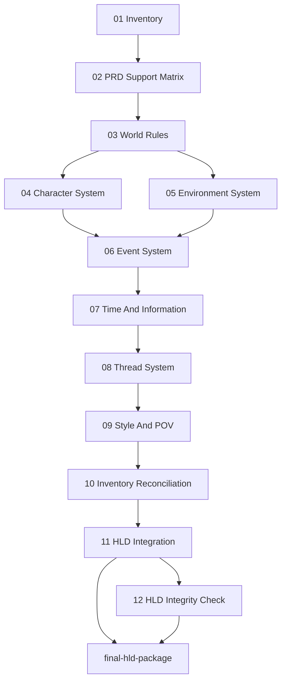

# Novel HLD Workflow Separation Refactor Implementation Plan

> **For agentic workers:** REQUIRED SUB-SKILL: Use superpowers:subagent-driven-development (recommended) or superpowers:executing-plans to implement this plan task-by-task. Steps use checkbox (`- [ ]`) syntax for tracking.

**Goal:** Rebuild `novel-hld-workflow` so the HLD node is a pure harness workflow and all HLD business design is owned by independently acceptable skills.

**Architecture:** `novel-hld-workflow` only validates inputs, dispatches artifact owners, routes failures, records convergence, packages outputs, and blocks/opens downstream entry. Twelve independent HLD skills own the actual world-system design artifacts from inventory through integrity checking. A contract JSON plus Python validator enforces workflow/skill separation, source closure, artifact schemas, verdict consistency, and legacy-input rejection.

**Tech Stack:** Markdown skills under `skills/`, workflow specs under `docs/superpowers/specs/`, run artifacts under `docs/superpowers/runs/hld/`, Python validators under `scripts/`, pytest tests under `tests/`.

---

## Current State

| Area | Status | Evidence |
|---|---|---|
| HLD target specification | Designed | `docs/superpowers/specs/2026-07-05-novel-harness-workflows-and-skills-design.md` defines `novel-hld-workflow` and 12 HLD skills. |
| HLD engineering design tasks | Completed | `docs/design/DP-HLD-001..004*.md`, `docs/design/DP-HLD-ACCEPT-design-acceptance-review.md`, and `tasks/design/design-planning.json` validate successfully. |
| HLD harness implementation | Missing | `skills/novel-hld-workflow/SKILL.md` does not exist. |
| HLD independent skills | Missing | Only legacy `skills/novel-hld-writer/SKILL.md` exists; the 12 target HLD skills do not exist. |
| HLD contract validator | Missing | `docs/superpowers/specs/2026-07-07-novel-hld-contract.json`, `scripts/validate_hld_contract.py`, and `tests/test_validate_hld_contract.py` do not exist. |
| HLD business run | Blocked | Current PRD risk report has `Human review verdict = pending` and `HLD entry verdict = blocked_pending_human_review`. |

## Root Cause

The repository has already updated the conceptual workflow from monolithic HLD writing to `node = harness workflow + independent skills`, but the implementation still has only the old `novel-hld-writer`. That old skill mixes orchestration, role design, space design, time/information design, thread design, scene synthesis, style design, and LLD handoff. Because there is no executable HLD contract, nothing currently prevents a worker from bypassing the PRD gate, using legacy June HLD/LLD artifacts as authority, or letting the harness write business facts.

The fix is not to patch `novel-hld-writer`. The fix is to introduce a new HLD node implementation with a hard separation contract:

```text
novel-hld-workflow = pure harness
HLD business facts = artifacts 01-12 owned by independent skills
final HLD package = artifact 11 + artifact 12 packaged by harness
```

## Target File Structure

### Create

| File | Responsibility |
|---|---|
| `docs/superpowers/specs/2026-07-07-novel-hld-contract.json` | Machine-readable HLD contract: required skills, artifact topology, table schemas, source grammar, risk/verdict rules, convergence schema, and coverage matrix. |
| `scripts/validate_hld_contract.py` | Deterministic validator for HLD workflow implementation, skill files, contract coverage, blocked/pass fixtures, HLD artifact schemas, Source Map closure, and verdict consistency. |
| `tests/test_validate_hld_contract.py` | Regression tests proving the HLD contract rejects missing skills, harness leakage, PRD gate bypass, missing source closure, same-source fact rewrite, P0/P1 pass verdicts, malformed convergence logs, and legacy authority usage. |
| `skills/novel-hld-workflow/SKILL.md` | Pure harness workflow. It owns input gate, dispatch DAG, routing, convergence, packaging, blocked/pass run behavior, and handoff. |
| `skills/novel-world-entity-inventory-builder/SKILL.md` | Artifact 01 owner. Builds the initial HLD design universe from proposal/PRD/freeze/HLD requirements/story logic. |
| `skills/novel-prd-support-matrix-builder/SKILL.md` | Artifact 02 owner. Maps PRD scenes, freeze items, HLD requirements, story-logic boundaries, and inventory items to required world support. |
| `skills/novel-world-rule-designer/SKILL.md` | Artifact 03 owner. Designs world rules, institutions, technology, authority boundaries, and constraints. |
| `skills/novel-character-system-designer/SKILL.md` | Artifact 04 owner. Designs HLD-level characters, groups, motivations, relationships, functions, and information permissions. |
| `skills/novel-environment-system-designer/SKILL.md` | Artifact 05 owner. Designs HLD-level environments, spaces, spatial relations, functions, and state changes. |
| `skills/novel-event-system-designer/SKILL.md` | Artifact 06 owner. Designs visible, background, hidden, implied, and causal events. |
| `skills/novel-time-information-system-designer/SKILL.md` | Artifact 07 owner. Designs story time, narrative time, information objects, knowledge distribution, conceal/reveal mechanics, and POV permission dependencies. |
| `skills/novel-thread-system-designer/SKILL.md` | Artifact 08 owner. Designs main, branch, hidden, emotional, and thematic threads with node distribution and closure. |
| `skills/novel-style-pov-system-designer/SKILL.md` | Artifact 09 owner. Designs style, POV, narrative distance, dialogue/communication rules, image system, and prohibited expressions. |
| `skills/novel-hld-inventory-reconciler/SKILL.md` | Artifact 10 owner. Resolves amendment requests and produces final inventory/support closure. |
| `skills/novel-hld-integrator/SKILL.md` | Artifact 11 owner. Assembles final HLD and emits fact-level HLD Source Map plus LLD handoff index. |
| `skills/novel-hld-integrity-checker/SKILL.md` | Artifact 12 owner. Produces HLD risk report, verdict consistency matrix, convergence log, and LLD entry verdict. |

### Modify

| File | Change |
|---|---|
| `skills/novel-hld-writer/SKILL.md` | Demote to legacy reference. It must point to `novel-hld-workflow` and state it is not an authoritative HLD entry point. |
| `docs/superpowers/specs/2026-07-05-novel-harness-workflows-and-skills-design.md` | Ensure HLD section references the new contract, artifact ids, and validator gates. |
| `docs/superpowers/specs/2026-07-05-novel-creation-workflow-design.md` | Ensure HLD definition says HLD produces a complete world-system contract, not key-scene synthesis or LLD detail. |

## Workflow/Skill Separation Contract

### Harness Owns

| Harness responsibility | Allowed output | Explicitly forbidden |
|---|---|---|
| Input gate | Gate report; blocked manifest if PRD HLD entry is not `pass_to_hld`. | Cannot reinterpret PRD human review, proposal facts, PRD scene facts, or story-logic boundaries. |
| Dispatch | Ordered artifact route according to artifact DAG. | Cannot fill artifact table cells or write world facts. |
| Routing | Rerun target and convergence row from skill verdicts/checkers. | Cannot fix business content in-place. |
| Collection | Artifact index, missing-file diagnostics, verdict presence checks. | Cannot repair malformed business output. |
| Packaging | Final package shell using artifact 11 and artifact 12 only. | Cannot add, delete, merge, or rewrite HLD facts. |
| Reopen management | Reopen request to PRD/proposal/HLD skill owner. | Cannot silently modify upstream frozen constraints. |

### Skills Own

| Artifact | Skill | Business authority |
|---|---|---|
| 01 | `novel-world-entity-inventory-builder` | What entities must exist in the HLD design universe. |
| 02 | `novel-prd-support-matrix-builder` | What support each PRD/freeze/HLD/story-logic item requires. |
| 03 | `novel-world-rule-designer` | World rules and institutional/technical/social constraints. |
| 04 | `novel-character-system-designer` | Character/group system and information permissions. |
| 05 | `novel-environment-system-designer` | Environments, spaces, relations, and state changes. |
| 06 | `novel-event-system-designer` | Event chains and causal mechanics. |
| 07 | `novel-time-information-system-designer` | Time, information, concealment, reveal, and knowledge distribution. |
| 08 | `novel-thread-system-designer` | Thread distribution, crossovers, ownership, and closure. |
| 09 | `novel-style-pov-system-designer` | Style and POV execution rules. |
| 10 | `novel-hld-inventory-reconciler` | Amendment acceptance/rejection and final inventory closure. |
| 11 | `novel-hld-integrator` | Final HLD assembly and fact-level Source Map. |
| 12 | `novel-hld-integrity-checker` | Risk verdicts, convergence, and LLD entry decision. |

## Artifact DAG



Hard rule: artifact 11 must not depend on artifact 12. Artifact 12 checks artifact 11; the harness packages both without changing either.

## Required Artifact Schemas

| Artifact | Required section | Required columns |
|---|---|---|
| 01 | `## Initial world entity inventory` | `Inventory id`, `Entity type`, `Entity name`, `Required HLD owner`, `Upstream evidence`, `Source`, `Initial status` |
| 02 | `## PRD support matrix` | `Support id`, `Supports`, `Support type`, `Required HLD owner`, `Required answer`, `Boundary`, `Source`, `Support status` |
| 03 | `## World rule design table` | `Rule id`, `Rule type`, `Design fact`, `Supports`, `Boundary`, `Source`, `LLD handoff`, `Amendment request` |
| 04 | `## Character system table` | `Character id`, `Role type`, `Function`, `Relationship/motivation`, `Information permission`, `Supports`, `Source`, `LLD handoff`, `Amendment request` |
| 05 | `## Environment system table` | `Environment id`, `Environment type`, `Function`, `Spatial relation`, `State change`, `Supports`, `Source`, `LLD handoff`, `Amendment request` |
| 06 | `## Event system table` | `Event id`, `Event type`, `Causal role`, `Visibility`, `Participants`, `Consequences`, `Supports`, `Source`, `LLD handoff`, `Amendment request` |
| 07 | `## Time and information table` | `Info id`, `Time layer`, `Information object`, `Known by`, `Hidden from`, `Reveal condition`, `Supports`, `Source`, `LLD handoff`, `Amendment request` |
| 08 | `## Thread system table` | `Thread id`, `Thread type`, `Core question`, `Node distribution`, `Crossover`, `Closure state`, `Supports`, `Source`, `LLD handoff`, `Amendment request` |
| 09 | `## Style and POV table` | `Style/POV id`, `Rule type`, `Design fact`, `POV permission`, `Prohibited expression`, `Supports`, `Source`, `LLD handoff`, `Amendment request` |
| 10 | `## Inventory amendment disposition` | `Request id`, `Requested entity`, `Requested by artifact`, `Decision`, `Final inventory id`, `Reason`, `Source`, `Support status` |
| 11 | `## HLD Source Map` | `HLD fact id`, `Fact type`, `Upstream fact atom`, `HLD fact atom`, `Source refs`, `Owner artifact`, `Final inventory id`, `Expansion mode`, `Support mechanism`, `LLD handoff target`, `Preservation status` |
| 12 | `## Output`, `## Risks`, `## Verdict consistency matrix`, `## HLD Convergence Log` | `Field/Value`; `Risk/Severity/Handling/Blocking verdict effect`; `Verdict/Required condition/Actual evidence/Consistency`; `Stable issue id/Severity/Root cause/Fix hypothesis/Regression proof/Attempt count/Rerun target/Status` |

Every artifact 01-12 must end with `## Skill Verdict` using these rows:

| Field | Valid values |
|---|---|
| `Skill quality verdict` | `pass`, `pass_with_p2`, `fail` |
| `Source closure` | `closed`, `open:<reason>` |
| `Inventory coverage` | `closed`, `not_applicable`, `open:<reason>` |
| `Boundary obedience` | `pass`, `violation:<source ref>` |
| `Downstream readiness` | `ready`, `blocked:<reason>`, `reopen_upstream:<target>` |
| `Blocking issue` | `none` or stable issue ids |
| `Rerun target` | `none` or artifact/skill id |

## Source Closure Rules

Allowed source refs:

| Prefix | Meaning |
|---|---|
| `scene:PRD-Sxx` | Canonical PRD scene fact. |
| `freeze:PRD-FREEZE-xx` | PRD freeze boundary. |
| `hldreq:HLD-REQ-xx` | HLD expansion requirement. |
| `claim:CLAIM-xx` | Proposal claim. |
| `storylogic:PRD-LOGIC-xx` | PRD story-logic boundary. |
| `inventory:INV-xx` | Final reconciled HLD inventory entity. |

HLD may expand these facts only with these expansion modes: `explain`, `constrain`, `support`, `sequence`, `permission`, `exclude`, `handoff`. Any synonym of replacement, reinterpretation, or contradiction is invalid.

## PRD Gate Behavior

| PRD state | HLD workflow behavior |
|---|---|
| `HLD entry verdict = blocked_pending_human_review` | Emit only `docs/superpowers/runs/hld/<run-id>/manifest.md` and gate report. No artifacts 01-12. |
| `HLD entry verdict = blocked_revision_required` | Emit blocked manifest and reopen request to PRD. No artifacts 01-12. |
| `HLD entry verdict = pass_to_hld` | Dispatch artifact 01 and proceed through DAG. |

## Human Review Policy For HLD

HLD human review is optional and must not be copied from the PRD state machine.

| HLD human review state | LLD entry implication |
|---|---|
| `confirmed` | Can pass to LLD when Agent quality passes and no unresolved P0/P1 exists. |
| `not_required` | Can pass to LLD when Agent quality passes and no unresolved P0/P1 exists. |
| `pending_required` | Blocks LLD as `blocked_pending_human_review`. |
| `reopen_hld` | Blocks LLD as `blocked_revision_required`. |

## Implementation Tasks

### Task 1: Add HLD Contract And Failing Tests

**Files:**
- Create: `docs/superpowers/specs/2026-07-07-novel-hld-contract.json`
- Create: `scripts/validate_hld_contract.py`
- Create: `tests/test_validate_hld_contract.py`

- [ ] **Step 1: Write tests that fail against current repository**

Required tests:

| Test | Expected initial failure |
|---|---|
| `test_required_hld_skills_exist` | Missing `skills/novel-hld-workflow/SKILL.md` and 12 owner skills. |
| `test_hld_blocks_without_prd_pass_to_hld` | No validator exists to enforce blocked PRD gate. |
| `test_harness_skill_contains_no_business_authority` | No harness exists; old writer still has mixed authority. |
| `test_artifact_dag_is_closed_and_acyclic` | No HLD contract DAG exists. |
| `test_every_artifact_has_minimum_schema` | No artifact schemas exist in machine-readable contract. |
| `test_source_map_rejects_same_source_fact_rewrite` | No Source Map rewrite detector exists. |
| `test_p0_p1_blocks_lld_entry_verdict` | No HLD risk/verdict consistency validator exists. |
| `test_legacy_hld_writer_is_not_authoritative` | `novel-hld-writer` still presents itself as active HLD entry. |

Run: `pytest tests/test_validate_hld_contract.py -q`

Expected before implementation: failures caused by missing contract, validator, and skills.

- [ ] **Step 2: Create contract and validator until tests pass**

The validator must expose deterministic checks for:

| Function | Responsibility |
|---|---|
| `load_hld_contract()` | Load and parse the HLD contract JSON. |
| `validate_required_skill_files()` | Require harness and 12 skill files. |
| `validate_harness_boundary()` | Reject business-authority wording in `novel-hld-workflow`. |
| `validate_artifact_dag()` | Enforce artifact DAG, no cycles, artifact 11 not depending on artifact 12. |
| `validate_artifact_schemas()` | Require all minimum table schemas. |
| `validate_skill_verdict_schema()` | Require universal `## Skill Verdict` rows in every owner skill contract. |
| `validate_prd_entry_gate()` | Require blocked manifest behavior when PRD HLD entry is not `pass_to_hld`. |
| `validate_source_ref_grammar()` | Accept only allowed source prefixes. |
| `validate_hld_source_map_rows()` | Reject same-source fact rewrites and invalid expansion modes. |
| `validate_risk_verdict_consistency()` | Enforce P0/P1 blocking semantics and LLD entry state machine. |
| `validate_legacy_writer_demoted()` | Ensure `novel-hld-writer` points to the new workflow. |

Run: `pytest tests/test_validate_hld_contract.py -q`

Expected after implementation: all HLD contract tests pass.

### Task 2: Create Pure Harness Skill

**Files:**
- Create: `skills/novel-hld-workflow/SKILL.md`
- Test: `tests/test_validate_hld_contract.py`

- [ ] **Step 1: Write `novel-hld-workflow` as a pure harness**

Required sections:

| Section | Required content |
|---|---|
| `## Role` | State it is the HLD node harness and does not design world facts. |
| `## Input Gate` | Read proposal, final PRD package, PRD risk report; block unless `HLD entry verdict = pass_to_hld`. |
| `## Dispatch DAG` | List artifacts 01-12 and dependencies. |
| `## Harness Boundary` | Allowed actions and forbidden business actions. |
| `## Routing Rules` | Use only structured Skill Verdict, artifact 11, artifact 12, and validator output. |
| `## Blocked Run Behavior` | If PRD gate blocked, write only manifest and gate report. |
| `## Packaging` | Final package from artifact 11 and artifact 12 only. |
| `## Convergence Protocol` | Stable issue id, root cause, fix hypothesis, regression proof, attempt count, rerun target, status. |

Forbidden text categories:

| Forbidden category | Example forbidden wording |
|---|---|
| world design authority | “define world rules directly” |
| character design authority | “write character system” |
| event design authority | “fix event logic in package” |
| prose authority | “draft scene text” |

- [ ] **Step 2: Validate harness boundary**

Run: `python3 scripts/validate_hld_contract.py`

Expected: pass for harness boundary after all required skills are created; fail before missing skills are created.

### Task 3: Create 12 Independent HLD Skill Contracts

**Files:**
- Create the 12 skill files listed in Target File Structure.
- Test: `tests/test_validate_hld_contract.py`

- [ ] **Step 1: Create each skill from the same contract skeleton**

Each skill must include:

| Section | Requirement |
|---|---|
| `## Responsibility` | Exactly one artifact/business capability. |
| `## Inputs` | Upstream artifact ids and source refs. |
| `## Output Artifact` | Exact artifact id, path pattern, and required table schema. |
| `## Boundary` | Allowed decisions and explicit forbidden scope. |
| `## Rules` | Pass/reject rules. |
| `## References` | Good/bad artifact quality dimensions. |
| `## Traceability` | Required source ref grammar. |
| `## Acceptance` | Independent acceptance checklist. |
| `## Skill Verdict` | Universal verdict schema rows. |

- [ ] **Step 2: Ensure skills are independently acceptable**

For each skill, include at least one skill-specific blocking condition:

| Skill | Required blocking condition |
|---|---|
| `novel-world-entity-inventory-builder` | Missing required entity type blocks support matrix. |
| `novel-prd-support-matrix-builder` | Any PRD scene/freeze/HLD/story-logic item lacks support row. |
| `novel-world-rule-designer` | Any rule lacks PRD support or rewrites story logic. |
| `novel-character-system-designer` | Digital life is treated as the senior's resurrection. |
| `novel-environment-system-designer` | Accident/lab/enclosure environments lack causal function. |
| `novel-event-system-designer` | Major event mechanics bypass researcher or digital life. |
| `novel-time-information-system-designer` | Usable intelligence and complete cause collapse into one layer. |
| `novel-thread-system-designer` | Main, hidden, emotional, or theme line lacks closure. |
| `novel-style-pov-system-designer` | POV enters unrestricted digital-life interiority. |
| `novel-hld-inventory-reconciler` | Rejected or unresolved amendment is used downstream. |
| `novel-hld-integrator` | Integrator adds unsupported HLD facts. |
| `novel-hld-integrity-checker` | P0/P1 coexists with pass verdict or malformed convergence row. |

Run: `pytest tests/test_validate_hld_contract.py::test_required_hld_skills_exist -q`

Expected: pass.

### Task 4: Demote Legacy Writer

**Files:**
- Modify: `skills/novel-hld-writer/SKILL.md`
- Test: `tests/test_validate_hld_contract.py`

- [ ] **Step 1: Replace active authority with legacy pointer**

Required content:

```markdown
# novel-hld-writer

## Status

Legacy reference only. This skill is not the active HLD workflow entry point.

Use `skills/novel-hld-workflow/SKILL.md` for all current HLD work.

This file may be read only to understand historical assumptions. It must not be used as frozen authority, must not dispatch HLD business work, and must not override proposal, PRD, HLD contract, or current workflow specifications.
```

- [ ] **Step 2: Validate legacy demotion**

Run: `pytest tests/test_validate_hld_contract.py::test_legacy_hld_writer_is_not_authoritative -q`

Expected: pass.

### Task 5: Update Global Workflow Specs

**Files:**
- Modify: `docs/superpowers/specs/2026-07-05-novel-harness-workflows-and-skills-design.md`
- Modify: `docs/superpowers/specs/2026-07-05-novel-creation-workflow-design.md`
- Test: `tests/test_validate_hld_contract.py`

- [ ] **Step 1: Link HLD node to contract and validator**

The HLD section must explicitly name:

| Required statement | Purpose |
|---|---|
| `novel-hld-workflow` is the only HLD entry point. | Prevent old writer use. |
| HLD business facts must be produced only by artifacts 01-12 owner skills. | Preserve workflow/skill separation. |
| Final HLD package depends exactly on artifact 11 and artifact 12. | Prevent integrator/checker loop. |
| PRD gate blocks HLD business artifacts until `pass_to_hld`. | Preserve human review boundary. |
| `scripts/validate_hld_contract.py` is the contract validator. | Make implementation checkable. |

- [ ] **Step 2: Validate spec alignment**

Run: `python3 scripts/validate_hld_contract.py`

Expected: pass.

### Task 6: Add Blocked And Pass Fixtures

**Files:**
- Create: `docs/superpowers/runs/hld/fixtures/blocked-prd-entry/manifest.md`
- Create: `docs/superpowers/runs/hld/fixtures/pass-minimal/artifacts/01-inventory.md`
- Create: `docs/superpowers/runs/hld/fixtures/pass-minimal/artifacts/02-support-matrix.md`
- Create: `docs/superpowers/runs/hld/fixtures/pass-minimal/artifacts/03-world-rules.md`
- Create: `docs/superpowers/runs/hld/fixtures/pass-minimal/artifacts/04-character-system.md`
- Create: `docs/superpowers/runs/hld/fixtures/pass-minimal/artifacts/05-environment-system.md`
- Create: `docs/superpowers/runs/hld/fixtures/pass-minimal/artifacts/06-event-system.md`
- Create: `docs/superpowers/runs/hld/fixtures/pass-minimal/artifacts/07-time-information.md`
- Create: `docs/superpowers/runs/hld/fixtures/pass-minimal/artifacts/08-thread-system.md`
- Create: `docs/superpowers/runs/hld/fixtures/pass-minimal/artifacts/09-style-pov.md`
- Create: `docs/superpowers/runs/hld/fixtures/pass-minimal/artifacts/10-inventory-reconciliation.md`
- Create: `docs/superpowers/runs/hld/fixtures/pass-minimal/artifacts/11-hld-integrator.md`
- Create: `docs/superpowers/runs/hld/fixtures/pass-minimal/artifacts/12-hld-integrity.md`

- [ ] **Step 1: Add blocked fixture**

Blocked fixture must contain:

| Field | Required value |
|---|---|
| `Execution status` | `blocked_before_hld_business_dispatch` |
| `Blocking verdict` | `blocked_pending_human_review` |
| `Business artifacts generated` | `none` |
| `PRD HLD entry verdict` | `blocked_pending_human_review` |

- [ ] **Step 2: Add pass-minimal fixture**

Pass fixture must include all artifact tables with minimum schemas and no P0/P1 risks.

- [ ] **Step 3: Validate fixtures**

Run: `pytest tests/test_validate_hld_contract.py -q`

Expected: pass.

## Acceptance Criteria

The refactor is complete only when all of the following are true:

| Criterion | Verification |
|---|---|
| HLD harness exists and has no business authority. | `python3 scripts/validate_hld_contract.py` |
| 12 independent skill contracts exist and each owns exactly one artifact. | `pytest tests/test_validate_hld_contract.py::test_required_hld_skills_exist -q` |
| Artifact DAG is acyclic and final package depends exactly on artifacts 11 and 12. | `pytest tests/test_validate_hld_contract.py::test_artifact_dag_is_closed_and_acyclic -q` |
| PRD blocked state cannot produce HLD business artifacts. | `pytest tests/test_validate_hld_contract.py::test_hld_blocks_without_prd_pass_to_hld -q` |
| HLD Source Map is fact-level, not citation-only. | `pytest tests/test_validate_hld_contract.py::test_source_map_rejects_same_source_fact_rewrite -q` |
| P0/P1 risks cannot coexist with pass Agent quality or `pass_to_lld`. | `pytest tests/test_validate_hld_contract.py::test_p0_p1_blocks_lld_entry_verdict -q` |
| Legacy HLD writer is no longer authoritative. | `pytest tests/test_validate_hld_contract.py::test_legacy_hld_writer_is_not_authoritative -q` |
| Existing PRD/proposal/design regressions still pass. | `pytest tests/test_validate_design_tasks.py tests/test_validate_prd_contract.py tests/test_validate_proposal_contract.py tests/test_validate_hld_contract.py -q` |

## Non-Goals

| Non-goal | Reason |
|---|---|
| Generate business HLD for the novel now. | Current PRD `HLD entry verdict` is `blocked_pending_human_review`. |
| Rewrite PRD or proposal. | HLD is downstream and must preserve frozen upstream facts. |
| Migrate old June HLD/LLD into current authority. | Legacy artifacts are non-frozen and can contaminate current source closure. |
| Write prose, scene drafts, or LLD details. | These belong to LLD/writing after HLD passes. |

## Self-Review

| Check | Result |
|---|---|
| Workflow/skill separation is explicit. | Pass: harness allowed/forbidden actions are separated from 12 skill authorities. |
| Every HLD business capability has one owner. | Pass: artifacts 01-12 map one-to-one to independent skills. |
| Artifact-level validation is planned. | Pass: contract JSON, Python validator, pytest tests, schemas, Source Map, and verdict rules are included. |
| PRD human-review gate is preserved. | Pass: blocked PRD state permits only blocked manifest, no business artifacts. |
| Legacy contamination is addressed. | Pass: old writer is demoted and old HLD/LLD artifacts are excluded as authority. |
| No implementation is performed by this plan. | Pass: this document designs the refactor and verification path only. |
