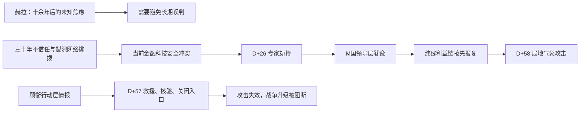

# 小说 HLD 设计稿：《断线》

## 修订记录

| 版本 | 日期 | 状态 | 修订说明 |
|---|---|---|---|
| v1.0—v2.0 | 2026-07-13 | 废弃 | 旧版本将赫拉具体化为技术互补，并未闭合专家劫持与气象报复的政治因果。 |
| v3.0 | 2026-07-13 | 待人类评审 | 基于 `canonical-world-facts-v3.0.md` 重构国际背景、双重伪旗与人物保护逻辑。 |

## 1. 设计边界

本设计不改写 PRD 主干：顾衡死后留下无法强读的记忆；沈逾借 `R-07` 取得可阻断危机的行动层；完整原因不公开；`R-07` 在既有权限内促成自身终止。HLD 只定义使这条人性主线成立的完整世界。[CF-01—CF-05]

| 边界 | 设计结论 | 不得越过的限制 |
|---|---|---|
| 赫拉 | 十余年后的未知变量，足以形成共同焦虑，不足以生成确定合作。 | 不将其写成双方各掌一项技术的合作项目。 |
| 当前危机 | 专家劫持触发报复压力；利益联盟发动气象攻击，把竞争推向战争边缘。 | 气象攻击不是凭空造天气，也不是M国最高层的公开决定。 |
| 专家与物证 | M国战略气候干预项目的首席安全认证师及其携带的原始异常控制模块。 | 专家不是万能科学家；模块不是可单独启动系统的密钥。 |
| 行动层 | 救援、核验、关闭错误调度入口。 | 不以公开周岚或完整承包链作为阻断条件。 |

## 2. 世界观与世界结构

### 2.1 长期未知与当下冲突

`2061` 年，C 国与 M 国共同处在世界领导地位。自 `2030` 年 C 国打破单极格局后，两国在金融结算、技术标准、供应链、制裁反制和代理冲突中拉扯了三十余年。裂隙网络不是突然出现的敌人：它长期把真假难辨的情报、产业利益和舆论放大器送入双方高层与社会，使“对方终会背约”成为默认预设。

星际来客“赫拉”将在十余年后接近内太阳系。异常观测证明它不可忽视，却不能确认威胁、意图或抵达后的后果。它让两国意识到人类也许终会需要超越旧冲突的能力，却无法令任何一方放弃眼前的安全、市场与联盟利益。三个月后的领导人会面因此不是一次浪漫的合作启动，而是一次脆弱的试探：能否先建立危机沟通、误判管控和升级约束，避免在长期未知来临前先被当下冲突拖入战争。

### 2.2 纬线利益链与裂隙网络

“纬线利益链”是 M 国内部没有正式章程的交易联盟：安全承包商需要紧急防御订单，金融资本押注制裁和供应链恐慌，媒体游说网络出售报复叙事，少数技术管理者能动用遗留授权。它们不以国家利益为唯一尺度，而从高烈度对抗中获利。裂隙网络无法控制它们，只需提供资金、伪造线索、国际掩护和每一方都愿意相信的机会。

这使 M 国领导层并非愚蠢或嗜战。专家被劫持后，他们缺乏足够证据归因，又面对市场、舆论和安全系统的报复压力；过早定性可能毁掉会面，沉默又会被视作软弱。利益链正是在这段犹豫中抢先制造既成事实。

### 2.3 专家劫持与报复性气象攻击

被劫持者是 M 国战略气候干预项目的首席安全认证师。他负责审计局地气象干预系统的安全红线、紧急授权链和承包维护例外；他不制造天气，也不是单一技术钥匙的持有者。调查中，他从一个边缘中继节点拆下“原始异常控制模块”：模块保留硬件植入指纹、当前会话痕迹和受影响节点的物理特征。模块不能单独启动系统，专家也不能靠口述取代物证；二者共同构成网络渗透的原始证据链。

`D+26`，裂隙网络伪装 C 国人员劫持他并夺走模块。一方面，原始证据链被切断；另一方面，M 国内部迅速形成“C 国已获得战略气候网络的渗透物证、正在寻找可利用节点”的叙事。密钥可轮换，备份可接管，但这些机制不能证明备用节点没有同类硬件植入。领导层尚未授权报复，纬线利益链却借“迫使 C 国交人”的名义，动用仍残留在系统内的紧急授权片段。

`D+57`，沈逾从行动层取出专家预设的审计校验串、囚禁位置、模块位置和攻击节点。校验串让 M 国领导层确认：专家失踪前确在追查内部异常授权，而非单纯被 C 国掳走。M 方因此接受一场不公开归因的秘密救援；这不是信任 C 国，而是避免让内部链路先于真相被摧毁。专家获救、模块回收后，二者共同定位并隔离受感染节点，双方关闭 C 国海岸防御网的错误调度入口。

`D+58`，在已有强对流天气带上，联盟非法启动局地气象干预，放大 C 国沿海城市的冰雹与雷暴风险。攻击留下真实的 M 国技术签名。C 国因此相信 M 国已从竞争转为主动敌对；M 国最高层则无法即时证明自己未授权，也不敢公开承认授权链被内部利益集团利用。两国面临的不只是会面取消，而是金融反制、科技封锁、供应链报复与军事部署连锁升级。

### 2.4 信息分层与终止逻辑

| 层级 | 内容 | 谁可见 | 结果 |
|---|---|---|---|
| 行动层 | 专家预设的审计校验串、专家与模块位置、攻击节点、受感染节点隔离清单、异常授权路径、攻击签名、防御纠偏入口、专家可作出的有限证词。 | 沈逾、R-07、C/M危机联络组。 | M方可独立确认网络渗透、D+57救援与隔离，D+58攻击失效。 |
| 原因层 | 周岚的维护例外、周启明、纬线利益链连接、顾衡与周岚的私人关系。 | 顾衡记忆、R-07、沈逾。 | 解释保护核，不成为即时公开归因。 |
| 终止后 | 行动层由救援、系统核验和专家证词独立保存。 | 各方有足够证据避免立即升级。 | R-07终止原因层入口，不毁掉降级结果。 |

`R-07` 的终止不是为抽象和平自我牺牲。它意识到继续存在会使顾衡的私人记忆和未公开的利益链连接成为机构可复制的情报资产，也会让沈逾持续以“保存它”为名替别人决定真相。它重排已有风险告警，在沈逾最害怕原因层被接管时提出可成立的风险判断；双重确认仍由沈逾完成。

## 3. 角色与环境系统

| 人物/组织 | 功能 | 人性压力与边界 |
|---|---|---|
| 沈逾 | 焦点人物、R-07操作者、行动层报告人。 | 既要阻止战争升级，也想留住与顾衡有关的一切；最终承认R-07不是可被留住的替身。 |
| 顾衡 | 29岁外勤情报员、记忆来源。 | 知道周岚参与例外链，保留阻断攻击的事实，封闭会令她先被定义为罪证的原因。 |
| 周岚 | 认证分包商审计员。 | 主动写入例外，知道会伤害会面，却不知道劫持和城市攻击的完整规模。 |
| 周启明 | 裂隙网络行动者、周岚亲弟弟。 | 用被遗忘者的愤怒说服姐姐，却被更大的利益链利用。 |
| M国专家 | 首席安全认证师、被劫持者。 | 与原始异常控制模块共同构成渗透物证；其调查让他成为需要被沉默的人。 |
| 纬线利益链 | M国内部跨机构利益共同体。 | 借国家不信任行动，却以冲突升级后的利润为目的。 |
| R-07 | 受限数字生命。 | 从顾衡和沈逾身上理解保护不等于拥有或替人决定真相。 |

| 环境 | 功能 | 状态变化 |
|---|---|---|
| 城北商务酒店709 | 顾衡交接异常授权与伪旗链证据的地点。 | 私密等待变为受控袭击现场。 |
| M国专家囚禁点 | 第三方自由港旧冷链转运层。 | 隐匿拘押变为D+57联合救援现场。 |
| 海岸防御网联络台 | C国防御调度与跨国核验接口。 | 受污染的建议被独立核验调度替代。 |
| 隔离对话室 | 沈逾与R-07的会话、保存审查和终止空间。 | 受监控对话转入终止待确认。 |

## 4. 事件、线程与交接

| 阶段 | 核心事件 | 公开信息 | 被压住的信息 |
|---|---|---|---|
| E1 | D0，顾衡交接模块植入与伪旗证据时死亡。 | 情报员死亡、关键线索进入记忆。 | 周岚的例外与利益链连接。 |
| E2 | 常规读取失败，R-07获准创建。 | 技术异常与攻击倒计时。 | 顾衡封闭的具体对象。 |
| E3 | D+26，专家与模块劫持引发M国报复压力。 | C国嫌疑、网络渗透焦虑、会面受损、市场与媒体升温。 | 专家此前发现异常授权和硬件植入。 |
| E4 | D+57，行动层有限打开。 | 专家与模块位置、攻击节点和隔离清单。 | 周岚、周启明、纬线利益链。 |
| E5 | D+58，攻击因纠偏失效。 | 城市风险与战争升级同时被阻断。 | M国领导层并未正式授权。 |
| E6 | 保存审查与R-07终止。 | 实例因风险终止。 | 它主动将终止设计为沈逾能承受的选择。 |

| 线程 | 核心问题 | 收束 |
|---|---|---|
| 主线 | 能否阻止一场被伪旗推向战争的升级？ | 专家获救、入口关闭，攻击失效。 |
| 隐藏线 | 顾衡为何封闭记忆？ | 保护周岚免于被先行定罪，而非替她开脱。 |
| 情感线 | 沈逾想留下顾衡的影子，还是R-07？ | 她承认R-07独立并放手。 |
| 制度线 | 谁会把R-07和真相变成资产？ | 组织审查与纬线利益链共同显示制度如何吞没私人事实。 |
| 身份线 | R-07是容器还是主体？ | 它用有限权限作出自己的终止选择。 |
| 主题线 | 当真相会被利用时，保护是否必然成为沉默？ | 行动结果保存，原因层及其代价留下。 |

叙事采用第三人称限知，稳定贴近沈逾。赫拉只经新闻片段、政策争论和人物犹豫显现，不取代当前危机。R-07无全知内心独白；其主体性只由措辞、日志排序、输入节奏和终止后记录可见。

## 参考依据

- `canonical-world-facts-v3.0.md`：本包唯一现行事实源。
- `final-prd-package.md`、`06-freeze-boundaries.md`、`07-hld-expansion-requirements.md`：PRD主干边界。
- `2026-07-08-hld-methodology-and-best-practices.md`：HLD世界、人物、环境和事件设计方法。
