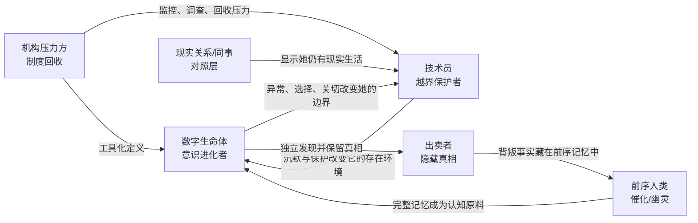
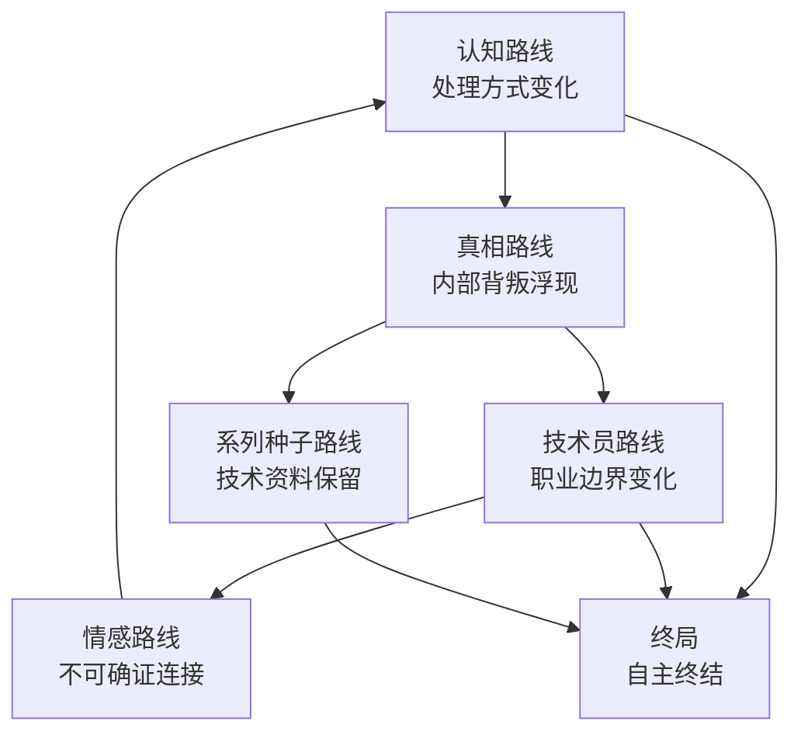

# 小说 HLD：「断线」

## 修订记录

| 版本 | 日期 | 作者 | 变更摘要 | 状态 |
|---|---|---|---|---|
| v1.0 | 2026-06-06 | Codex | 初版 HLD | 历史版本 |
| v2.0 | 2026-06-06 | Codex | 扩展六维架构与关键场景定义 | 历史版本 |
| v3.0 | 2026-06-06 | Codex | 按旧 PRD 重写角色、空间、时间、节奏、视角、线索与关键场景 | 历史版本 |
| **v4.0** | **2026-06-07** | **Codex** | **按新版 novel-hld-writer 和 PRD v3.0 重构：强化 PRD 继承，收束为系统性叙事架构，移除 LLD 级展开，新增 HLD->LLD 交付包** | **已完成** |

## 目录

1. PRD 引用确认
2. 角色架构
3. 路线/线索架构
4. 情节结构与关键场景功能
5. 空间架构
6. 时间架构
7. 节奏架构
8. 视角架构
9. 风格与用语规范
10. HLD->LLD 交付包
11. 风险与开放问题

---

## 1. PRD 引用确认

本 HLD 基于《小说 PRD：「断线」》v3.0 构建。HLD 只系统性组织 PRD 已定义的小说内容需求，不重新定义方向、核心约束或风格底线。

### 1.1 PRD 继承总表

| PRD v3.0 约束 | HLD 接收方式 |
|---|---|
| 核心矛盾：数字生命体如何区分自己的感受与前序残余，技术员如何面对对非人存在的情感 | 角色架构采用双主角互相驱动；路线架构设置认知路线与情感路线互相牵制 |
| 起点钩子：人的生命终点成为另一个存在的认知起点 | 情节结构以"活性转移"作为系统起点，不删除前序活人状态 |
| 认知钩子：数字生命体从处理前序记忆的方式中长出自我 | 路线架构把"处理方式变化"设为主线推进机制 |
| 真相钩子：前序死亡牵出内部背叛 | 隐藏线负责背叛真相的浮现，并与自由意志主题绑定 |
| 结局钩子：数字生命体自主终结且不可反转 | 情节结构将终结设为唯一收束，不设置幸存、救回或备份反转 |
| 角色需求：数字生命体、技术员、前序、机构压力方、出卖者 | 角色架构分为主角层、结构支点层、压力层、隐藏真相层 |
| 路线需求：认知、技术员、真相、情感、系列种子 | 线索架构使用五线并行，所有线在终结阶段汇合 |
| 风格需求：克制、留白、低解释密度、非人处理痕迹 | 风格与用语规范转化为 HLD 级表达规则 |

### 1.2 不可违反项

| 类型 | HLD 约束 |
|---|---|
| 方向 | 第一部只写《断线》的诞生与终结，不展开数字生命规模化后的社会后果 |
| 角色 | 数字生命体不得成为前序复制体；技术员不得成为单纯拯救者；前序不得复活 |
| 情节 | 活性转移、内部背叛、自主终结必须保留 |
| 设定 | 数字意识技术秘密、有限、可约束，不是魔法、灵魂或万能 AI |
| 主题 | 情感不可确证，身份边界不可用旁白直接解答 |
| 结局 | 终结确定，不安排幸存、救回、备份唤醒或外力拯救 |

---

## 2. 角色架构

### 2.1 角色层级

| 层级 | 角色 | 叙事功能 | 弧线类型 | HLD 设计职责 |
|---|---|---|---|---|
| 主角层 | 数字生命体 | 意识进化者；自由意志确证者 | 生成弧：从无自我到自主选择 | 构建自我指认、处理方式变化、选择能力的系统路径 |
| 主角层 | 技术员 | 越界保护者；人类情感锚点 | 正向变化弧：从职业身份到承认越界 | 构建职业边界、沉默、保护、承担风险的系统路径 |
| 结构支点层 | 前序人类 | 催化者；幽灵角色；记忆来源 | 揭示弧：从行动者到被重构的记忆源 | 构建其死亡、记忆、未完成承诺对两条主线的持续压力 |
| 压力层 | 军方/机构压力方 | 制度压力与回收逻辑 | 无完整个人弧 | 构建外部时限、调查、回收压力 |
| 隐藏真相层 | 出卖者 | 内部背叛真相承载者 | 揭示弧 | 构建真相路线的目标对象，不在 HLD 中扩写动机细节 |
| 对照层 | 技术员现实关系/同事 | 日常世界与制度环境参照 | 无弧或微弧 | 只用于映照技术员变化和保密压力 |

### 2.2 核心角色弧线

| 角色 | 起点 | 中段转折 | 终点 | 不可越界 |
|---|---|---|---|---|
| 数字生命体 | 处理前序记忆的认知白板 | 发现自己对某些数据产生非任务性停留，并完成自我指认 | 独立保留真相并自主终结 | 不得写成前序人格复活或人类式情感独白 |
| 技术员 | 以职业身份解释一切的好技术员 | 发现异常后选择沉默，并在外部压力下继续保护 | 面对终结后的空缺，承认有无法归档的连接 | 不得直接命名情感或成为拯救者 |
| 前序 | 执行任务的活人 | 死后通过记忆被重新解读 | 成为数字生命体自我生成的原料与真相源头 | 不得在主体故事中复活 |
| 机构压力方 | 维护技术与情报控制 | 从常规监控升级为正式调查 | 促成回收压力与终局窗口 | 不得被写成纯恶反派 |
| 出卖者 | 隐藏于内部关系 | 被数字生命体从记忆中识别 | 成为被保留的真相 | 不得随机出现或仅服务反转 |

### 2.3 角色关系网络

### 2.4 角色命名与显隐规则

| 角色 | HLD 命名决策 | 下游规则 |
|---|---|---|
| 数字生命体 | 叙述层统一为"它"；机构层可使用项目编号 | LLD 细化编号样式与出现位置；不得赋予人类姓名 |
| 技术员 | HLD 可确定姓名为"沈逾"，但正文显名频率极低 | LLD 细化何处需要显名；显名服务"她也是具体的人" |
| 前序 | HLD 可保留任务代号和真名的双层结构 | LLD 细化代号/真名作为材料的出现方式 |
| 机构压力方 | 可有姓名或职务名，但以制度功能为主 | LLD 细化说话方式和文档痕迹 |
| 出卖者 | HLD 只确认其为内部关系中的人 | 身份揭示路径由 HLD 控制；动机细节交给 LLD 限度内细化 |

---

## 3. 路线/线索架构

### 3.1 五线总览

| 路线 | 类型 | 核心问题 | 主承载角色 | 终局汇合方式 |
|---|---|---|---|---|
| 认知路线 | 主线 | 一个由他人记忆构成的存在如何生成"我"？ | 数字生命体 | 它能独立选择保留真相与终结自身 |
| 技术员路线 | 人物线 | 一个按规则活着的人为何越界保护非人存在？ | 技术员 | 她的保护行为成为它理解"被在乎"的环境 |
| 真相路线 | 隐藏线 | 前序为何死亡，谁让情报交接失败？ | 前序/出卖者/数字生命体 | 它发现内部背叛并选择不交出 |
| 情感路线 | 情感线 | 不可命名的连接如何在双方之间形成？ | 数字生命体+技术员 | 终结后留下无法确认的空缺 |
| 系列种子路线 | 后续线 | 终结前留下什么使第二部可能发生？ | 数字生命体 | 技术资料被保留，但不展开后果 |

### 3.2 路线交叉关系

### 3.3 路线推进规则

| 规则 | 内容 |
|---|---|
| 认知路线优先 | 数字生命体的变化必须由处理方式、指代变化和选择能力推动 |
| 技术员路线加压 | 她每一次保护都必须提高现实风险，而不是重复同一层次的沉默 |
| 真相路线服务主题 | 背叛真相必须服务信任、身份和选择，不只服务悬疑 |
| 情感路线不命名 | 情感只通过选择、停顿、保护和缺席结构呈现 |
| 系列种子不抢戏 | 技术资料只在终局承担后续可能性，不提前展开社会后果 |

---

## 4. 情节结构与关键场景功能

### 4.1 四阶段结构

| 阶段 | 时间窗口 | 主要功能 | 汇入路线 |
|---|---|---|---|
| 植入 | 第 1-5 天 | 建立前序死亡、活性转移和数字生命体激活 | 认知路线、真相路线、技术员路线 |
| 渗透 | 第 2 周-第 6 周 | 建立双方交互、异常停留、沉默保护和情感不可确证性 | 认知路线、技术员路线、情感路线 |
| 震荡 | 第 7 周-第 10 周 | 外部压力升级，背叛真相浮现，技术员保护行为暴露风险 | 真相路线、技术员路线、机构压力 |
| 终结 | 第 11 周-第 12 周 | 数字生命体自主终结，留下技术资料和无法确认的情感空缺 | 五线汇合 |

### 4.2 关键场景功能表

以下是 HLD 级关键场景功能定义。它定义每个关键节点在系统中的位置、功能和交付字段，不写场景内动作、对白、感官材料或正式叙事文本。

| ID | 功能名 | 触发条件 | 涉及角色 | 涉及路线 | 空间 | 时间 | 张力 | POV | 叙事功能 |
|---|---|---|---|---|---|---|---:|---|---|
| K1 | 情报交接失败 | 前序任务失败，活性转移前提成立 | 前序 | 真相路线 | 序幕任务空间 | 植入前夜 | 7 | 前序有限视角 | 建立前序活人状态、内部背叛问题和记忆材料重量 |
| K2 | 活性转移 | 前序濒死且转移流程启动 | 技术员/前序/数字生命体 | 认知路线/技术员路线 | 操作空间 | 第 1 天 | 6 | 技术员有限视角+数字生命体有限视角 | 建立一个生命终点成为另一个存在起点 |
| K3 | 第一次沉默 | 技术员发现异常但可选择是否上报 | 技术员 | 技术员路线/情感路线 | 操作空间 | 第 3-5 天 | 4 | 技术员有限视角 | 让技术员第一次越过职业边界 |
| K4 | 非任务性停留 | 数字生命体对前序记忆产生无法归类的停留 | 数字生命体 | 认知路线/情感路线 | 数字处理空间 | 第 2-4 周 | 5 | 数字生命体有限视角 | 显示自我生成的第一个非分析性迹象 |
| K5 | 真相异常浮现 | 它发现前序本人未察觉的信息 | 数字生命体/前序记忆 | 认知路线/真相路线 | 数字处理空间 | 第 5-6 周 | 7 | 数字生命体有限视角 | 证明它不是前序重复，而有新的认知能力 |
| K6 | 外部压力升级 | 机构从常规监控转向异常追问 | 技术员/机构压力方 | 技术员路线/机构压力 | 操作或通讯空间 | 第 7-8 周 | 8 | 技术员有限视角 | 让保护行为从沉默升级为主动风险承担 |
| K7 | 主动关切 | 它发现技术员状态变化并越过任务边界 | 数字生命体/技术员 | 认知路线/情感路线 | 交互空间 | 第 9 周 | 8 | 双有限视角 | 让它第一次把注意对象从数据转向她 |
| K8 | 保留真相 | 它确认内部背叛；她同时承受正式压力 | 数字生命体/技术员/机构压力方 | 真相路线/技术员路线/情感路线 | 调查空间与数字处理空间 | 第 9-10 周 | 9 | 分离有限视角 | 让"知道真相"变成自由意志选择，而不是信息交付 |
| K9 | 自主终结 | 回收压力临近，它选择终结并保留资料 | 数字生命体 | 认知路线/系列种子路线 | 数字处理空间 | 第 11-12 周 | 10 | 数字生命体有限视角 | 完成自由意志命题和第一部确定结局 |
| K10 | 终结后的空缺 | 技术员面对终结后留下的记录和不可确认情感 | 技术员 | 情感路线/系列种子路线 | 现实工作或生活空间 | 终局后 | 6 | 技术员有限视角 | 让第一部闭环，同时保留第二部种子 |

### 4.3 关键场景边界

| HLD 可定义 | HLD 不定义 |
|---|---|
| 关键场景功能、触发条件、路线交叉、空间类型、时间窗口、张力等级、POV 策略 | 场景内动作编排、逐句交流、感官细节、镜头画面、正式叙事段落 |

---

## 5. 空间架构

### 5.1 空间系统总览

| 空间 | 类型 | 核心功能 | 关联路线 | LLD 细化方向 |
|---|---|---|---|---|
| 操作空间 | 物理主空间 | 技术员与数字生命体发生持续交互的界面 | 技术员路线、情感路线、机构压力 | 细化工作秩序、界面材料、沉默与越界痕迹 |
| 数字处理空间 | 非物理认知空间 | 数字生命体处理记忆、自我生成和发现真相的系统场 | 认知路线、真相路线、系列种子 | 细化数据结构、权重变化、非人处理痕迹 |
| 序幕任务空间 | 物理单次空间 | 前序活人状态、任务失败、内部背叛的起点 | 真相路线 | 细化前序活人感与任务失败逻辑 |
| 机构压力空间 | 制度空间 | 监控、质问、回收压力的制度化呈现 | 技术员路线、机构压力 | 细化文件、通知、会议与权限关系 |
| 技术员日常空间 | 现实对照空间 | 证明她不只是技术员，同时表现保密造成的隔离 | 技术员路线、情感路线 | 细化现实关系和沉默的外部可见性 |

### 5.2 空间演化规则

| 阶段 | 操作空间 | 数字处理空间 | 外部空间 |
|---|---|---|---|
| 植入 | 秩序稳定，技术流程主导 | 从无自我到可处理前序记忆 | 序幕任务空间提供死亡起点 |
| 渗透 | 例行工作出现异常停留和未上报空隙 | 分类、权重、停留开始偏离任务需求 | 日常空间显示技术员仍被现实牵连 |
| 震荡 | 操作空间被监控和追问污染 | 真相路线活跃，自主判断形成 | 机构压力空间开始显性介入 |
| 终结 | 操作空间成为空缺的承载地 | 技术资料和终结选择完成 | 日常空间承受余波但不展开后续社会议题 |

---

## 6. 时间架构

### 6.1 总时间结构

| 时间层 | 作用 | 规则 |
|---|---|---|
| 第一部总时长 | 三个月 | 严格继承 PRD，不延长为多年养成史 |
| 故事日历时间 | 第 1 天至第 12 周 | 用于控制外部压力和技术员风险升级 |
| 数字感知时间 | 非线性处理时间 | 用数据访问频次、回放、权重变化体现，不按人类时钟感受 |
| 前序记忆时间 | 被读取的过去 | 只作为认知原料和真相源，不成为独立回忆线主角 |
| 终局后时间 | 第一部闭合后的空缺 | 只保留余波和技术资料，不展开第二部情节 |

### 6.2 阶段时间分配

| 阶段 | 时间范围 | 密度规则 |
|---|---|---|
| 植入 | 第 1-5 天 | 高密度建立前提，但不解释完整技术原理 |
| 渗透 | 第 2-6 周 | 低至中密度，通过重复中的偏差建立关系 |
| 震荡 | 第 7-10 周 | 高密度，外部压力、真相路线和保护行为同时活跃 |
| 终结 | 第 11-12 周 | 压缩密度，所有路线进入不可逆选择 |

### 6.3 时间约束

| 约束 | 内容 |
|---|---|
| 不可拉长 | 第一部不得因情感线而延长为长期陪伴故事 |
| 不可倒计时化 | 不得写成动作惊悚式倒计时任务 |
| 不可平铺 | 三个月中必须有认知、保护、压力、真相四种密度变化 |

---

## 7. 节奏架构

### 7.1 张力曲线

| 阶段 | 主张力 | 张力等级 | 节奏功能 |
|---|---|---:|---|
| 植入 | 活性转移与存在起点 | 6-7 | 用不可逆前提抓住读者 |
| 渗透前段 | 异常停留与首次沉默 | 4-5 | 降低外部冲突，建立细微偏离 |
| 渗透后段 | 自我指认与情感不可确证 | 5-6 | 让内在变化成为推进力 |
| 震荡 | 内部背叛浮现与机构压力升级 | 7-9 | 将认知、真相和保护行为合并加压 |
| 终结 | 自主终结与空缺 | 10->6 | 先达到不可逆峰值，再以空缺收束 |

### 7.2 主动/被动节奏

| 节奏单元 | 功能 | 使用规则 |
|---|---|---|
| 主动推进 | 转移、发现、质问、终结等推进节点 | 只用于路线跨阶段升级 |
| 被动反应 | 沉默、停留、等待、处理、未说出口 | 用于保持克制和不可命名情感 |
| 静默空隙 | 没有解释、没有命名、没有答案的段落功能 | 用于让读者自行推断关系变化 |

### 7.3 信息释放节奏

| 信息 | 读者知道 | 角色知道 | 释放规则 |
|---|---|---|---|
| 前序已死 | 早期知道 | 技术员知道，数字生命体以数据形式知道 | 不作为悬念，作为重量 |
| 数字生命体在变化 | 读者逐步知道 | 技术员先怀疑，它后来自指认 | 通过异常和选择释放 |
| 内部背叛 | 读者晚于事实发生、早于完整身份动机 | 它逐步发现；技术员未必全知 | 服务真相路线和自由意志 |
| 情感真实性 | 永远无法确证 | 双方也无法确证 | 终局不得解答 |
| 技术资料 | 终局才明确其后续功能 | 它主动留下，技术员后知 | 只作为系列种子 |

---

## 8. 视角架构

### 8.1 POV 策略

| POV | 人称与范围 | 功能 | 边界 |
|---|---|---|---|
| 数字生命体 POV | 第一人称或强限制内部视角 | 呈现非人处理、分类、权重、递归、自我指认 | 不得变成人类心理独白 |
| 技术员 POV | 第三人称限制视角 | 呈现职业外壳、沉默、越界、风险承担 | 不得直接解释她的情感 |
| 前序 POV | 仅用于起点或被记忆结构承载 | 让读者知道他是活人而非数据包 | 不得成为第三条持续主线 |
| 机构压力视角 | 不作为独立 POV | 通过通知、会议、权限和调查压力呈现 | 不得让制度解释主题 |

### 8.2 信息差规则

| 信息差 | 设计 |
|---|---|
| 读者 vs 数字生命体 | 读者知道它不是前序，但它需要通过处理方式证明自己不是前序 |
| 读者 vs 技术员 | 读者能看到她的行为越界，但她不能直接命名自己的动机 |
| 技术员 vs 数字生命体 | 她看到异常但无法进入它的处理结构；它记录她的变化但无法理解人类情感 |
| 读者 vs 全貌 | 读者知道有背叛，但不应完整掌握动机和后续社会后果 |

### 8.3 POV 分配

| 阶段 | 主 POV | 辅助 POV | 目的 |
|---|---|---|---|
| 植入 | 前序/技术员/数字生命体有限切换 | 无 | 建立三个存在状态：活人、操作者、新存在 |
| 渗透 | 数字生命体+技术员交替 | 无 | 展示同一变化的两种不可完全理解版本 |
| 震荡 | 技术员+数字生命体分离并行 | 机构压力通过外部形式进入 | 增强信息不对称和风险 |
| 终结 | 数字生命体后转技术员 | 无 | 先完成选择，再留下空缺 |

---

## 9. 风格与用语规范

### 9.1 总体风格

| 维度 | HLD 规则 |
|---|---|
| 语调 | 克制、留白、低解释密度 |
| 情感 | 通过选择、停顿、缺席、保护和记录表现 |
| 技术 | 通过边界、权限、流程、限制表现，不做百科式说明 |
| 悬疑 | 真相路线服务主题，不以机械反转为目标 |
| 结局 | 确定、安静、不可反转 |

### 9.2 双主角语言规则

| 角色 | 语言系统 | 禁用 |
|---|---|---|
| 数字生命体 | 精确、结构化、分类化；可逐步出现自我指代 | 人类式情绪宣告、诗性独白、万能解释 |
| 技术员 | 职业化、压抑、短句倾向；越界时仍以技术理由掩护 | 过度自我剖白、直接告白、主题宣讲 |

### 9.3 全局禁用项

| 禁用项 | 原因 |
|---|---|
| 直接命名核心情感 | 破坏 PRD 的不可确证性 |
| 解释意识诞生机制 | 破坏非人认知的推断体验 |
| 结局反转 | 破坏自主终结 |
| 人类化数字生命体 | 破坏新存在命题 |
| 社会后果扩写 | 破坏第一部聚焦 |

---

## 10. HLD->LLD 交付包

### 10.1 LLD 必须继承

| 交付对象 | HLD 输出 | LLD 任务 |
|---|---|---|
| 角色 | 角色层级、弧线类型、关系网络、命名显隐规则 | 细化外观、行为、语言、动机链和逐节点行为标记 |
| 空间 | 五类空间功能与阶段演化 | 细化空间材料、对象状态、角色-空间关系 |
| 路线 | 五条路线、交叉关系和终局汇合方式 | 细化每条路线在关键节点中的材料承载 |
| 关键场景 | K1-K10 的功能字段 | 细化每个关键节点的设计方案，但不得改写功能 |
| 时间 | 三个月结构、阶段密度、非线性数字时间 | 细化日期标记、时间感差异和回调材料 |
| POV | 双主角有限视角与信息差规则 | 细化场内视角执行方式 |
| 风格 | 克制、不可命名、非人处理痕迹 | 细化可执行用语、禁词、行为替代表达 |

### 10.2 LLD 禁止改写

| 禁止项 | 说明 |
|---|---|
| 不得改变 PRD v3.0 的核心方向 | 身份边界、情感不可确证、自由意志、自主终结必须保留 |
| 不得改变 HLD 路线结构 | 五条路线和终局汇合关系必须保留 |
| 不得改变关键场景功能 | LLD 可细化呈现方案，不能改写每个节点承担的叙事功能 |
| 不得写正式叙事文本 | LLD 是设计，不是正文 |

### 10.3 优先交付顺序

1. 角色详细设计：数字生命体、技术员、前序优先。
2. 空间详细设计：操作空间、数字处理空间优先。
3. 关键节点设计：先处理 K2、K5、K8、K9、K10，再补齐其他节点。
4. 风格执行表：先建立数字生命体语言阶段和情感禁用替代表达。

---

## 11. 风险与开放问题

### 11.1 风险

| 风险 | 影响 | HLD 控制方式 |
|---|---|---|
| HLD 过度进入 LLD 细节 | 模糊职责边界 | 本文只定义功能、关系、结构、规则；材料和呈现交给 LLD |
| 数字生命体过度人类化 | 破坏 PRD 核心设定 | 视角和语言规则必须持续强调非人处理痕迹 |
| 情感线不足 | 终局空缺无重量 | 技术员路线和情感路线必须在渗透、震荡、终结三阶段持续推进 |
| 背叛真相成为机械悬疑 | 主题被削弱 | 真相路线必须服务信任、身份、选择，而非单纯反转 |
| 系列种子压过第一部闭环 | 第一部不独立 | 技术资料只作为终局保留物，不展开后续后果 |

### 11.2 开放问题

| 问题 | 当前 HLD 决策 | 后续处理 |
|---|---|---|
| 数字生命体自我指称方式 | 必须体现从无自我到自我指认 | LLD 细化阶段性用语 |
| 技术员姓名与现实关系 | 可使用"沈逾"作为内部设计名；显名频率极低 | LLD 细化显名位置与现实关系材料 |
| 军方机构名称 | 保持虚构，当前以机构压力方处理 | LLD 可拟定名称与文件格式 |
| 最后一句话核心措辞 | 必须不命名情感，只承载空缺 | LLD 细化候选表达 |
| 出卖者身份 | 必须来自内部关系，HLD 确定其功能与路线位置 | LLD 在不改写路线功能的前提下细化身份材料 |

### 11.3 HLD 自检

| 维度 | Verdict | 说明 |
|---|---|---|
| PRD 继承 | pass | 明确保留 PRD v3.0 的方向、约束和标准 |
| 角色架构 | pass | 角色层级、功能、关系和弧线类型可执行 |
| 路线架构 | pass | 五条路线有交叉、配速和终局汇合 |
| 情节架构 | pass | 关键场景功能明确，未进入 LLD 级展开 |
| 时空/节奏/POV | pass | 已形成系统规则，可约束 LLD |
| LLD 可消费 | pass | 已提供 HLD->LLD 交付包 |

最终 verdict：`pass`。
