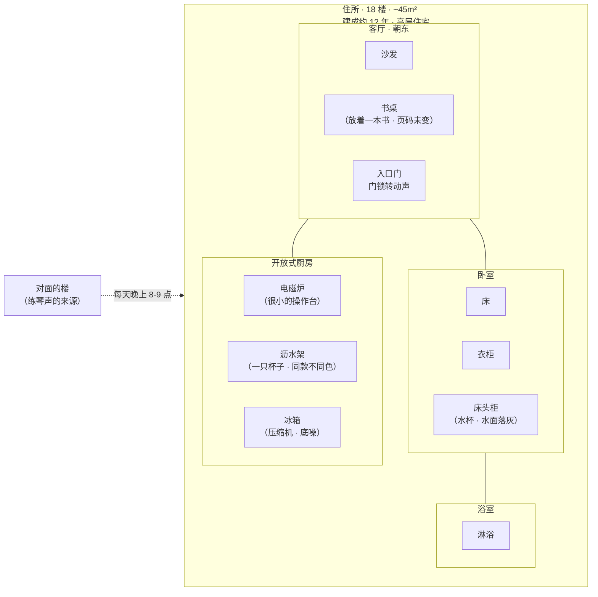

# 空间详细设计：住所

## 修订记录

| 版本 | 日期 | 作者 | 变更摘要 | 状态 |
|---|---|---|---|---|
| v1.0 | 2026-06-07 | Codex | 初始版本 | 已完成 |

## 元信息

| 项目 | 值 |
|---|---|
| **所属项目** | 小说「断线」·第一部 |
| **空间名称** | 住所 |
| **空间类型** | 物理主空间 |
| **在 HLD 中的编号** | §3.6 技术员的住所 |
| **叙事权重** | ★★（~8%篇幅·4 次出场 + 对照者 3 次出现）|

## 1. HLD 继承

### 1.1 位置与户型

临港市西区，一栋建成约 12 年的高层住宅，18 楼。步行到实验室 25 分钟，地铁 3 站——"近到有事可以叫回来，远到不是同一个世界"。一室一厅约 45 m²。客厅窗户朝东——早晨有光，但她在实验室的时间看不到早晨的光。开放式厨房，很小的操作台和电磁炉。卧室只能放一张床和一个衣柜。

### 1.2 HLD 定义的叙事功能

| 功能 | 描述 |
|---|---|
| "她除了是技术员之外还有另一个身份"的证据 | 住所证明她在实验室之外还有一个生活（即使这个生活正在被实验室侵蚀）|
| 保密协议的可感知边界 | 她身边有一个人（纪菱），但她什么都不能说——不可见的边界在有形空间中可被感知 |
| 她的变化被外部观测的锚点 | 纪菱通过住所空间的变化（便签纸、笔记本摊开）看到她的变化 |
| 终局后世界的变化 | 她回住所而不是回操作室——但住所已不再是避难所 |

### 1.3 HLD 定义的感官锚点

| 维度 | 锚点 |
|---|---|
| **主锚点** | 对面楼小孩的练琴声（同一段旋律前八小节，从未弹完）|
| **次锚点** | 冰箱压缩机（背景底噪）|

### 1.4 她与空间的关系（HLD §3.6）

初期：住所是"换衣服和睡觉的地方"。她不在此思考实验室的事——保密协议是边界。中期：住所被"实验室"侵入——书桌上出现便签纸、洗碗时突然想到"它今天输出了什么"。终局：她回到住所没开灯——在客厅黑暗中坐了一会儿，然后打开电脑→盯着空白的通讯窗口。住所不再是"另一个世界"——变成了操作室的扩展。

## 2. 空间物理定义

### 2.1 布局

**文字平面说明**：
- 一室一厅，约 45 m² -- 对于一个单身成年人而言，空间不大但足够
- 客厅窗户朝东——应能照进早上的阳光，但她在实验室的时间里，客厅在白天是"无人使用"的
- 厨房是开放式的——站在水槽前洗碗时能看到客厅的窗户和窗外的天色
- 卧室很小——床几乎占满空间——卧室对她来说只是"睡觉的容器"

### 2.2 尺寸感

从客厅的窗口到卧室的门——约 6 步。从厨房水槽到客厅的书桌——约 4 步。空间不大——但足够装下一个"正常生活"的表象。她住得久了，对空间的距离已经熟悉到"闭着眼睛不会撞到东西"的程度。

### 2.3 材质

| 部位 | 材质 | 触感 | 视觉 |
|---|---|---|---|
| 客厅地面 | 复合地板（浅色木纹） | 冬天穿着袜子走在上面有点凉 | 浅橡木色——积灰了从某个角度能看出来，但她不经常扫地 |
| 厨房台面 | 人造石英石（白色带灰色斑点） | 冷、硬——杯底放在上面声音清脆 | 白色——清洗之后的纹理可见；不洗时在灯光下有油光的痕迹 |
| 卧室床单 | 纯棉（洗过很多次的——柔软但不光滑） | 棉的暖——冬天钻进被窝时感觉到的温度 | 素色——没有图案，最初的颜色已经洗淡了 |
| 暖气片 | 铸铁（白色烤漆——年久后有些发黄） | 冬天时烫手——她睡前会把湿毛巾搭在上面，第二天早上毛巾是干的 | 白色，地面上的投影在暖气运行时会有热空气的模糊感 |

### 2.4 光线

| 要素 | 设计 |
|---|---|
| **自然光** | 客厅窗户朝东——早晨的光线较强。但她在早晨的时间通常不出现在客厅（还在睡/准备出发）。所以她几乎没在住所"看到过早晨的光"。晚上回来时客厅灯是关着的——她按下开关时看到了"
|
| **人造光** | 暖色——3000K 的客厅灯（吊灯）、4000K 的厨房灯（筒灯）、2700K 的床头灯。住所的整体色调是暖的——与操作室的冷白光（4000K）形成对照 |
| **它的光信号** | 她在住所时屏幕的光是手机、电视或笔记本电脑的——蓝白色的冷光在暖色调的客厅中显得"不属于这里"。终局后她在客厅打开电脑——屏幕的光照亮了她的脸，背景是暖色的客厅灯光。 |

### 2.5 建筑特征

| 特征 | 设计 |
|---|---|
| **朝向** | 朝东——早晨有阳光，下午/晚上无自然光。她在住所的时间几乎完全是"晚上"（她回来的时间大约是 18:00-19:00，冬天时天已经完全黑了）|
| **隔音** | 一般——能听到邻居的电视声、走廊上的脚步声、对面楼的练琴声。隔音不好是"她在这栋楼住了很久"的证据——她习惯了这些噪音 |
| **暖气** | 中央暖气系统——冬天时暖气片嘶嘶响。干燥——她睡前会在床头柜上放一杯水，早上发现水面落了灰尘。 |

## 3. 感官层系统

### 3.1 声层

| 子项 | 设计 |
|---|---|
| **主声源** | 对面楼小孩的练琴声——每天晚上 8-9 点，同一段旋律的前八个小节，从未弹完。这个琴声是住所的"时间标记"——初期她正常听到（作为日常背景）；中期她没注意到它（心思在别处）；终局后她发现琴声还在，和三个月前一模一样——但"三个月前"的自己已经不在了 |
| **次声源** | ① 冰箱压缩机——间歇启动，作为背景底噪。低频——不注意时感受不到，注意了之后发现它一直在；② 门锁转动的声音——她回来的声音。这个声音对纪菱而言是"她在"的信号；③ 暖气片的嘶嘶声——冬天时热水流经暖气片的声音，干燥的空气中水汽蒸腾的细微声音 |
| **她自己的声音** | 在住所中她很少说话。一个人居住——不说话是常态。初期她在厨房自言自语过（"今天……" / "哦对"——零碎的日常）。中期她不说话了。终局后她回到住所坐下——什么都没说 |

**时间变化**：
- 初期：冰箱 + 练琴声 + 偶尔的自言自语 = "正常生活"的声音场景
- 中期：练琴声依然在——但她没注意到。冰箱依然在——她也没注意到。住所的声音变成了一种"被忽略的背景"
- 终局后：她打开电脑——屏幕亮了但没声音。她坐着，什么都没做。冰箱突然启动——她吓了一跳。她很久没听到"家里有声音"了

### 3.2 温度/触层

冬天时暖气片的热空气让室内干燥。她睡前在床头柜上放一杯水——早上起来水面落了薄薄一层灰。这个水杯在初期她每天换水、中期偶尔换、终局后他可能没换。灰层的积累是她在"不在住所"的时间的物化证据。

### 3.3 光/视觉层

暖色调——与操作室的冷白光不同。她在住所的光线中看起来"更暖"——但这不是她在意的。她在住所时很少开客厅大灯——常常只开厨房灯（去做饭/倒水）或床头灯（回卧室看手机）。

### 3.4 嗅觉

住所的气味标记了她"另一个身份"的日常：食物气味（她偶尔做饭——或者点外卖后留在空气中的饭菜味）、洗衣粉的味道（她洗衣服的频率从初期的正常到中期的减少——洗衣机很久没转了）、灰尘的积累（她在住所的时间越来越少之后，空气中"无人使用"的灰尘气息增加）。

## 4. 物件生态

### 4.1 物件总表

| 物件 | 叙事重量 | 功能 |
|---|---|---|
| **厨房杯子（同款不同色）** | ★★★ | 两个世界的边界标记——她有意区分"住所的杯子"和"操作室的杯子" |
| **客厅书桌上的书** | ★★ | "正常生活"的假象——页码从未变化 |
| **床头柜水杯** | ★★ | 时间流逝标记——灰层的积累 = 她不在住所的时间 |
| **暖气片旁的加湿器** | ★ | 冬天干燥的视觉标记——白雾在灯光下可见 |

### 4.2 物件详情

#### 4.2.1 厨房杯子

| 要素 | 定义 |
|---|---|
| **引入时机** | 故事开始时——它是住所的"默认物件"，不是故事时间中引入的 |
| **初始状态** | 和操作室的杯子同款（同一个系列的不同色——她买的），但颜色不同。它单独放在沥水架上——只有一只 |
| **叙事功能** | "两个世界"的边界标记——她有意区分"住所一只·操作室一只"。中期：住所的杯子在沥水架上干燥——因为她开始在操作室用更多的时间（喝更多的咖啡），回家后不再需要另一只杯子来"证明自己在这里" |
| **终局状态** | 仍然在沥水架上——干燥。和第一天一样。但它的"同款不同色"的隐喻——她已经打乱了两个世界的边界——杯子还在，但边界已经模糊了 |

#### 4.2.2 客厅书桌上的书

| 要素 | 定义 |
|---|---|
| **引入时机** | 故事开始时——它就在书桌上。可能在搬进来时就放在那里了 |
| **初始状态** | 完整、新但未被拆封保护套——或者打开了但停留在第 1 章。页码从未变化 |
| **叙事功能** | 它是"她还有一个正常生活"的物化载体——有这本书在桌上，她就"还是那个除了实验室之外还有兴趣看书的人"。实际上她从没读过——但保持"有书在桌上"的状态让她感觉生活还是正常的 |
| **变化轨迹** | 初期→中期→终局：页码未变。它被移动过（擦桌子的需要）——但"被翻开"的证据从未出现。终局后她回来——书还在那里。页码未变。 |

## 5. 空间-角色行为映射

### 5.1 她

| 行为维度 | 初期（第 1-4 周） | 中期（第 5-9 周） | 终局（第 10-12 周） |
|---|---|---|---|
| **主要活动** | 回家→换衣服→做饭/外卖→看手机→睡觉。规律——像设定好的"回到住所"的程序 | 回家→坐下→站起来→不知道要做什么→打开冰箱→关上→坐下。住所开始显得"太安静了" | 回家（从实验室回来的时间不固定）→不开灯→在黑暗中坐→打开电脑→盯着空白的通讯窗口 |
| **厨房使用** | 每周做饭 3-4 次。沥水架上会用过的餐具 | 做饭频率下降。外卖增加。沥水架上的杯子干燥时间变长 | 几乎不用厨房。冰箱里的食材过期了一部分（她没注意到）|
| **与书桌的关系** | 书是"在那里"的——她经过时有时会看一眼，然后想"周末读吧"——但周末也没读 | 书桌上出现了便签纸（写了术语）——她第二天收起来了。书还是在那里——她更少经过书桌了 | 书桌上摊开了笔记本——上面是工作内容。纪菱来送东西时看到了。她飞速合上。书没了（被笔记本挤到一边——或者被她移动了）|
| **睡眠** | 正常。大约 22:30 睡 | 入睡时间推迟。她躺着时看手机但不是在刷社交媒体——她在看什么？自己也不知道 | 入睡时间不固定。有时不睡——坐着 |

### 5.2 纪菱（对照者）

| 行为维度 | 出场 1（初期·闲聊） | 出场 2（中期·"你最近怪怪的"） | 出场 3（末期·看到笔记本） |
|---|---|---|---|
| **进入方式** | 约好的——她来或纪菱来。进门后自然的问候 | 未提前约——顺路来。进门后感觉到"有什么不一样" | 来送东西——看到客厅桌上摊着笔记本 |
| **观察** | 一切正常——住所的状态和她认知中的沈逾一致 | 她回答心不在焉。住所状态未变——但感觉"哪里不对"| 笔记本上的工作内容——她飞速合上。纪菱什么都没说 |
| **台词** | 日常闲聊 | "你最近怪怪的"——被"太忙了"带过 | 什么都没说 |
| **离开** | 自然的告别 | 走的时候回头看了她一眼——"没事" | 放下东西。走 |

## 6. 空间演化序列

| 时间点 | 空间状态 | 变化触发 | 叙事含义 |
|---|---|---|---|
| **第 1 天** | 正常生活的住所——暖光、冰箱声、练琴声。她是"下班后回家的人" | 故事开始 | 建立"另一个世界"的基线——住所和实验室是两个完全独立的领域 |
| **第 2-4 周** | 空间无物理变化。但她回家后不再做饭了——她叫外卖。不用的餐具说明她在住所"停留"的时间减少了 | 她开始加班——在操作室停留更久 | 细微的变化——住所的"被使用"程度下降 |
| **第 5-6 周** | 书桌上出现了便签纸（写了术语）——她第二天收起来了 | 她第一次把实验室的东西带回了住所——即使只是一张便签纸 | "实验室侵入住所"的第一步——她无意识地越过了两个世界的物理边界 |
| **第 7-8 周** | 冰箱里的东西少了——她不再经常去超市。沥水架上的杯子干燥的时间越来越长 | 她在操作室停留的时间超过了在住所的时间 | 住所从"主要生活空间"退化成了"睡觉的空间" |
| **第 10 周（K8 后）** | 住所状态基本未变——但她在住所的"行为"变了。她不换衣服——穿着工作服坐在客厅 | 她在操作室的"那件事"——回到了住所，但身体和思绪都在操作室 | 住所已经变成了"操作室的镜像"——她在住所做的事（坐着发呆）和在操作室做的事相同 |
| **第 12 周（终结后）** | 住所恢复到"没人使用"的状态——但她回来了。没开灯。在客厅的黑暗中坐了一会儿→打开电脑→盯着空白的通讯窗口 | 它终结了。她回到了住所——但住所不再是"避难所" | 住所的终结——它的物理状态没有变化（和第一天一样），但空间的"意义"已经变了：它从一个世界变成了另一个世界的延伸 |

## 7. 空间-场景映射

住所不是任何关键场景的"主空间"——它是她的私人世界的呈现。关键场景中的"住所时刻"：

| 场景 | 空间状态 | 空间功能 | 感官锚点 | 物件状态 |
|---|---|---|---|---|
| **K3 后·她回到住所** | 初期。她正常回家。住所暖光、冰箱声、练琴声——一切都是"正常的"| 建立"另一个世界"的基线——让读者知道她在实验之外还有一个生活 | 她脱外套、打开冰箱、倒了杯水。练琴声从窗外传来 | 厨房杯子在沥水架上。书在书桌上 |
| **K6 后·纪菱出场 2** | 中期。住所状态未变——但她回答"太忙了"时心不在焉。她说的"太忙了"是真的——她从操作室回来的时间越来越晚 | 外界视角验证——纪菱是第一个说"你最近怪怪的"的人 | 冰箱压缩机启动——在她们沉默的间隙中可闻 | 书桌上可能已出现便签纸（但纪菱没看到）|
| **K8 后·她回到住所（TBD）** | 末期。她回到住所但没缓冲——直接坐进客厅。住所的安静成为了操作室沉默的延续 | 空间的延伸——她从操作室的椅子上站起来→经过走廊→经过城市→回到住所坐下。每个位置都"坐了但没在" | 她没开灯。黑暗中，冰箱启动的声音——很响。她注意到冰箱的声音——她以前从没注意过 | 书桌上的书被挤到了一边（被笔记本取代）。杯子在沥水架上干燥 |
| **K10 ·余韵** | 终结后的住所。她回来——没开灯。在黑暗中坐了一会儿→打开电脑→屏幕亮起来→她盯着空白的通讯窗口 | 住所不再是"另一个世界"——它是操作室的扩展。她回到的不是家——是一个"她等它回来的空间"——但它不会回来了 | 练琴声从窗外传来——9 点前。和三个月前一模一样的旋律。她听到了。她以前也听过——但那时她不知道"三个月后"的一切 | 杯子还在沥水架上。书还在书桌上。一切和第一天一样。但阅读者对三个月前"第一天"的认知已经变了 |

## 8. 空间关系

| 关系维度 | 设计 |
|---|---|
| **物理关系** | 住所与实验室的物理关系通过"城市空间"连接——步行 25 分钟或地铁 3 站。物理距离"近到可以叫回来，远到不是同一个世界"——这个距离公式定义了她在两个空间之间的"跨越" |
| **对比关系** | 实验室（冷光·22°C·风扇·无窗·无时间参照）vs 住所（暖光·有窗·冰箱声·练琴声·有时间参照）。初期两个世界完全对立；中期实验室开始侵入住所；终局后住所变成了实验室的延伸——对比消失 |
| **叙事连接** | 住所是"她除了是技术员之外还有另一个身份"的证据——纪菱（对照者）只在住所出场，她的存在提醒读者和沈逾自己：在数字生命实验室之外还有一个"正常世界" |

## 9. 写作约束

| # | 约束 | 原因 |
|---|---|---|
| 1 | 练琴声（对面楼小孩 · 同一段旋律前八小节 · 每晚 8-9 点）必须在住所的每次出场中提及——至少一次 | 练琴声是住所的空间锚点——它的存在/消失/被注意/被忽略是她在住所状态变化的最直接信号 |
| 2 | 住所的叙事中不允许出现任何操作室/实验室的感官细节（风扇声、呼吸灯、金属+臭氧的气味）——两个世界的感官必须完全隔离 | 她通过物理环境的切换来切换心理状态——感官隔离是"两个世界"的叙事基础 |
| 3 | 厨房杯子的状态必须在叙事的四个时间点一致——干燥/使用/干燥 = 她在家时间变化的直观标记 | 杯子是"两个世界边界"的物化载体——它的状态变化是叙事中最安静的标记之一 |
| 4 | 书桌上的书页码不变——永远停留在同一个位置。叙事中不解释"为什么不读"——让状态本身说话 | 书是"正常生活"的假象物——解释为什么没读会削弱它的象征力量 |

## 9.5 文档格式合规声明

| # | 标准 | 合规状态 | 确认方式 |
|---|---|---|---|
| 1 | 简体中文·专业正式 | ✅ 合规 | 全文简体中文专业书面语 |
| 2 | 拟人化编写 | ✅ 合规 | 自然可读，无代码注释风格 |
| 3 | 多样化表达形式 | ✅ 合规 | mermaid 布局 + 表格式感官层 + 演化序列表 + 物件生态表 |
| 4 | 书面用语·结构优 | ✅ 合规 | 10 节完整结构 |
| 5 | 最终结论·无过程 | ✅ 合规 | 无"可能/或许/建议/可以考虑" |
| 6 | 有据可循 | ✅ 合规 | 引用 HLD §3.6/§10.5 |
| 7 | 修订表前置 | ✅ 合规 | §0 含完整修订记录表 |
| 8 | 紧扣主题 | ✅ 合规 | 内容限于住所空间设计 |
| 9 | 简洁清晰·禁止冗余 | ✅ 合规 | 信息密度高，表格避免段落堆砌 |

## 10. 参考文献

| 来源 | 引用内容 | 应用节 |
|---|---|---|
| HLD §3.6 | 住所位置、户型、感官系统、她与空间的关系、日常物件、对照者使用、叙事功能 | §1, §2, §3, §4, §5, §6, §7 |
| HLD §10.5 | 感官锚点（练琴声/冰箱压缩机） | §3 |
| [1] Weiland, K.M. *Structuring Your Novel*. —— 空间变化的四种驱动 | §6 |
| [2] Propp, Vladimir. *Morphology of the Folktale*. —— 物件叙事功能 | §4 |
| [3] Maass, Donald. *Writing the Breakout Novel Workbook*. —— 物件的情感电荷 | §4 |
| [4] Corbett, David. *The Art of Character*. —— 角色与空间的互动 | §5 |
