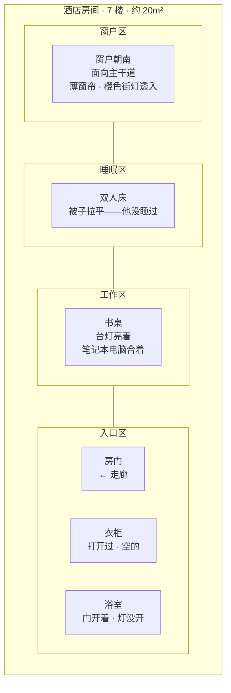

# 空间详细设计：酒店房间

## 修订记录

| 版本 | 日期 | 作者 | 变更摘要 | 状态 |
|---|---|---|---|---|
| v1.0 | 2026-06-07 | Codex | 初始版本 | 已完成 |

## 元信息

| 项目 | 值 |
|---|---|
| **所属项目** | 小说「断线」·第一部 |
| **空间名称** | 酒店房间 |
| **空间类型** | 单次空间 |
| **在 HLD 中的编号** | §3.5 序幕空间：酒店房间（情报交接） |
| **叙事权重** | ★（单次出场·序幕 K1·约 3%篇幅） |

## 1. HLD 继承

### 1.1 位置与时间

临港市老城区，一家三星级商务酒店。房间在 7 楼，窗户朝南，对着主干道。时间：10 月 24 日深夜，约 23:47。天气：小雨。

### 1.2 HLD 定义的叙事功能

前序的最终场景。读者在这里第一次见到他（活着、在等人）也最后一次见到他（遇袭、做出传输的选择）。他在这里发现自己被出卖了——那个认出但又没来得及确认的面孔。

### 1.3 HLD 定义的感官锚点

| 维度 | 锚点 |
|---|---|
| **主锚点** | 空调室外机的低频震动（从墙体传来） |
| **次锚点** | 台灯照明范围有限——明暗切割 |

### 1.4 关键细节（从 HLD §3.5 继承）

他认出了门外的脚步声不属于约定的线人。他合上电脑——不是收起来，是合上。他靠在浴室门框上，静默持续了大约三秒。然后他做出了选择：传输自己的身体数据。他不是被强行拦截的——他的最后一刻是主动的。

## 2. 空间物理定义

### 2.1 布局

**文字说明**：
- 标准单人间，约 20 m²
- 窗户朝南，薄窗帘拉上但未完全闭合——街灯的光透入变成橙色模糊光斑
- 床未使用——被子拉平但未被掀开，表明他未打算在此过夜
- 书桌上的台灯是房间的唯一光源——照明范围仅限于桌面，房间的其余部分在暗影中
- 笔记本电脑合着——不是"使用后合上"，是"识别危险后合上"
- 衣柜打开过但为空——他带来的物品极少（或已转移）
- 浴室门开着，灯没开——他在浴室门框旁做出传输决定的最后的参照点

### 2.2 尺寸感

- 从窗边走到门口——约 7 步。他在窗边看了一眼街灯下的雨（确认线人未到）、走到书桌前坐下（等）、听到脚步声后站起来（发现不是约定的节奏）、走到浴室门框旁（三秒静默）
- 空间不大——但每一段距离都承载了叙事：窗边（等待·确认）、书桌（等待·操作）、门附近（发现·选择）、浴室门框（终结前静默）

### 2.3 材质

| 部位 | 材质 | 触感 | 视觉 |
|---|---|---|---|
| 地面 | 地毯（商务酒店标准——深色、短绒、一定程度的磨损） | 脚步声被吸收——走起来无声。但行李箱滚轮在上面会发出低沉的摩擦声 | 深灰色的、看不清花纹的地毯 |
| 桌面 | 深色木纹贴面（仿木——表面光滑但缺乏木材的温度） | 冷——手指放在上面时能感觉到人造材料的凉 | 棕黑色，在台灯照明下表面有微弱反光 |
| 窗帘 | 薄聚酯纤维 | 轻——手掀开时几乎无声 | 半透光——街灯的光通过后变成模糊的橙色光晕 |
| 浴室门框 | 白色漆木 | 他靠在上面时——身体重心靠在门框上，门框的边线抵着肩胛骨 |

### 2.4 光线

| 要素 | 设计 |
|---|---|
| **唯一光源** | 书桌上的台灯——老式酒店风格，灯罩是米色的，灯泡是暖色（约 3000K）。照明范围有限——书桌面亮着，几乎形成一个"光锥"。房间的其余部分在暗影中——床、衣柜、门附近的区域只有台灯的散射光 |
| **辅助光源** | 窗户——透入的街灯光。橙色、模糊、被雨雾柔化。与台灯的暖色形成两种不同温度的光——台灯的"近"和街灯的"远" |
| **明暗切割** | 书桌区域是亮的（他的位置）；床和衣柜区域在暗处（无人使用的空间）；浴室门框附近在明暗交界处（他最后站立的位置——半张脸在光中，半张在暗里）；门口是暗的（门打开时进来的轮廓是剪影）|

### 2.5 建筑特征

| 特征 | 设计 |
|---|---|
| **隔音** | 一般——走廊上的脚步声可以听见，隔壁房间的空调启动声也能传过来。正是因为他能"听见"走廊上的脚步声，他才意识到"这个节奏不是线人的节奏" |
| **空调** | 窗口式空调——室外机固定在墙体外侧。运行时，低频震动从墙体传进来。这是房间中持续不断的"嗡"——不是吵，是"一直在" |
| **窗户密封** | 老化——雨水在窗框边缘的缝隙中形成细线。小雨时雨水从玻璃上拉下来——这是室内可以听到的、安静的雨声 |

## 3. 感官层系统

### 3.1 声层

| 子项 | 设计 |
|---|---|
| **主声源** | 空调室外机的低频震动——从墙体传来，持续不断。低频——几乎感知为"身体中的轻微震动"而非耳朵听到的声音 |
| **次声源** | ① 雨声——小雨落在窗户玻璃上，细密但不吵。在安静中可闻；② 他自己的呼吸声——他在等信号时呼吸很轻。发现异常后呼吸短暂停止——然后变得更深；③ 走廊上的脚步声——他等待的、也是最终出卖他的信号 |
| **沉默时的声音** | 房间的"安静"不是绝对的安静——是被空调低频震动填满的安静。他的呼吸和雨声在安静中交替 |

**时间变化**：深夜 → 更深夜。安静 → 更安静——直到脚步声出现。

### 3.2 光/视觉层

台灯光照范围有限——这是整个空间的光学核心。他在光中（书桌前）是"行动中的人"；他在暗处（走到门边）是"已识别的存在"；他在明暗交界处（浴室门框）是"做决定的瞬间"。

## 4. 物件生态

| 物件 | 引入时机 | 叙事功能 | 变化轨迹 |
|---|---|---|---|
| **笔记本电脑** | 他在书桌前——笔记本合着但未完全冷却（使用后不久合上） | 传输的终端——传输完成后，笔记本完成了它的使命 | 合着→（传输过程中屏幕亮起又熄灭）→合着。不再被打开 |
| **台灯** | 房间唯一亮着的光源——他进来时就开着 | 空间的"光定义者"——台灯亮着说明他还在等人。如果灯熄灭——说明他已经离开了或出事了 | 一直亮着——直到她或清洁工发现房间时可能还是亮着的 |
| **床（未使用）** | 被子拉平——他从没睡过或碰过 | "他没有打算在这里过夜"的物体证明——他来办一件事，不是来住 | 未变化——自始至终没有被使用 |
| **手机/通讯设备** | 默认物件——他在等信号 | 等待的载体——手机未响，信号未到。他等的东西最终没有以约定的形式出现 | 未接到来电。他在最后用身体发出了那个他一直等待的信号——反向的 |

## 5. 空间-角色行为映射

### 5.1 前序（灰鸟）

| 行为维度 | 定义 |
|---|---|
| **进入方式** | 标准的酒店入住——可能是下午或傍晚。他检查了房间，确认了逃生通道位置（职业习惯），拉上了窗帘，打开台灯，坐下等 |
| **占据位置** | 书桌前——这是他整晚的主要位置。面向笔记本电脑，背对窗户（窗户在他的视线之外——但街灯的光在他背后形成光晕，轮廓在薄窗帘上可见）|
| **动作模式** | ① 等待——坐在书桌前，看窗外（确认雨势/街灯状态）、看门口线（门缝下的光线——有阴影经过就注意）、看笔记本电脑（信号是否到达）；② 发现——听到不属于约定的脚步声节奏；③ 确认——通过窗外停车位置的变化（一辆不该停的车停了）确认信号；④ 行动——合上电脑，走到浴室门框旁（最终位置），做出传输选择 |
| **视线习惯** | 交替落在三个方向：笔记本电脑屏幕（信号状态）> 门缝下方（走廊光线变化）> 窗外（街灯下的停车位）。他在"三个要素的位置关系"之间切换 |
| **离场方式** | 不是"离开房间"的离场——是"离开身体"的离场。传输完成后，他的身体在房间中倒下（或在门框旁）。物理层面他没有离开这个房间。叙事层面他通过传输离开了自己的存在形式 |

## 6. 空间演化序列

*酒店房间只出现一次（K1·序幕）。无时间轴上的演化序列——但有场景内部的状态变化。*

| 场景时间点 | 空间状态 | 变化触发 | 叙事含义 |
|---|---|---|---|
| 23:30（他进入前）| 房间处于标准等待状态——台灯可能未开 | 无 | 读者未见到此状态 |
| 23:30-23:47 | 台灯亮着。笔记本电脑开着。他在书桌前等 | 他坐定开始等待 | 建立"等待中的人"的基本画面——台灯、雨声、空调震动 |
| 23:47 前后 | 他听到走廊上的脚步声——不是约定的节奏。窗外停车位上一辆车停了但未熄火 | 两个独立的信号同时到达——他确认被出卖 | 空间感知的转折——从"等待"到"确认" |
| 23:47 后·3 秒静默 | 他合上电脑。站起来。走到浴室门框旁——半张脸在台灯光线中、半张脸在暗处 | 他做出了选择——传输 | 空间的"最后画面"——他在明暗交界处。台灯依然亮着。空调仍在震动。但他已经不再存在于"等人"的状态中了 |
| 他倒下后（不可见） | 台灯仍亮着。笔记本合着。空调继续震动。雨继续下。但他的身体不再移动 | 传输完成 | 房间回到"无人使用"的状态——但这一次，使用它的人已经不存在于物理世界中 |

## 7. 空间-场景映射

| 关键场景 | 空间状态 | 空间叙事功能 | 感官锚点呈现 | 物件状态 |
|---|---|---|---|---|
| **K1 情报交接** | 深夜。台灯照亮桌面。雨在窗户玻璃上拉出细线。空调震动持续。他在书桌前→移动至浴室门框 | 全书唯一且最后一次出现前序本人的空间——读者第一次也是最后一次"看到"他 | 空调震动（主锚点·第一次出现即建立空间感）→ 雨声（次锚点）→ 台灯的明暗切割 | 笔记本合着。台灯亮着。床未使用。他靠在浴室门框上。 |

## 8. 空间关系

| 关系维度 | 定义 |
|---|---|
| **物理关系** | 与其他空间无交互——酒店房间是独立空间，与数字生命实验室/操作室无物理连接。唯一的连接是"前序的身体数据通过传输进入数字空间"——这不是空间连接，是叙事连接 |
| **对比关系** | 酒店房间（温暖、暗、雨、低压震动——人间最后的空间）vs 数字空间（冷、无感知、无物——另一个存在的"第一个空间"）。K1→K2 的章节切换不仅是时间跳转——是从"前序的最后一个空间"到"它的第一个空间"的并行 |
| **叙事连接** | K1 是全书一切的物理起点——没有这个房间中的传输，就没有数字空间的激活、没有它、没有她与它的一切。酒店房间的存在在后续章节中从未被提及——但读者每次读它·POV 时，都隐含知道"它曾经是一个人，在这间屋子中做出了选择" |

## 9. 写作约束

| # | 约束 | 原因 |
|---|---|---|
| 1 | 酒店房间的叙事使用第三人称有限——只写前序的行为、环境、感官信号，不写他"在想什么" | HLD §6.2 定义——前序 POV 为第三人称有限，保持叙事距离 |
| 2 | 空调室外机低频震动必须在 K1 前三段落中至少出现一次——它作为空间锚点必须在读者脑中建立 | 该空间只出现一次——没有阈下积累的机会，必须在单次使用中建立完整的空间感知 |
| 3 | K1 中不允许出现任何"她知道""它知道"的叙事接入——K1 只属于前序 | 她在 K1 中未出场——她是全书的核心但序幕不是她的故事 |
| 4 | 被枪声覆盖的音节不允许在文本中以文字形式出现（哪怕是"他张了张嘴，说了一个字——"后面也不能有任何字符，只能是"——（枪声）"） | HLD 约束——那个音节是全书最大的未解问题之一，不能在序幕中被解决 |

## 9.5 文档格式合规声明

| # | 标准 | 合规状态 |
|---|---|---|
| 1-9 | 全部合规 | mermaid 布局 + 感官表 + 演化序列表 + 空间关系表 + 修订表前置 + 简体中文正式 |

## 10. 参考文献

| 来源 | 应用节 |
|---|---|
| HLD §3.5 酒店房间 | §1, §2, §3, §5, §6, §7 |
| HLD §6.2 前序的第三人称有限 | §9 |
| HLD §10.5 感官锚点（空调室外机低频震动/台灯明暗切割） | §3, §9 |
| [1] Bickham, Jack M. *Scene & Structure*. —— 单次场景空间建立 | §3, §9 |
