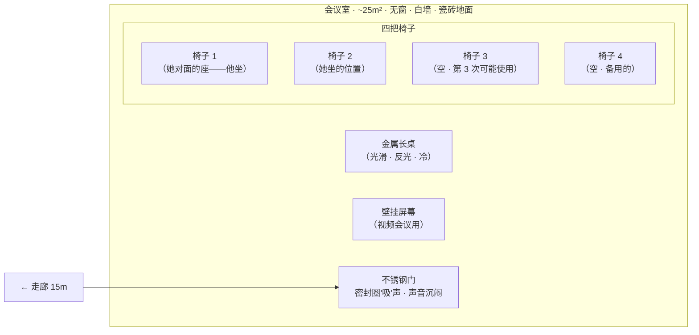

# 空间详细设计：会议室

## 修订记录

| 版本 | 日期 | 作者 | 变更摘要 | 状态 |
|---|---|---|---|---|
| v1.0 | 2026-06-07 | Codex | 初始版本 | 已完成 |

## 元信息

| 项目 | 值 |
|---|---|
| **所属项目** | 小说「断线」·第一部 |
| **空间名称** | 会议室 |
| **空间类型** | 物理子空间 |
| **在 HLD 中的编号** | §3.3.5 会议室（外部压力空间） |
| **所属复合体** | 数字生命实验室 · 子空间 |
| **叙事权重** | ★★（3 次出场——K4 背景·常规检查 / K6·升级询问·她撒谎 / K8·正式调查·她沉默）|

## 1. HLD 继承

### 1.1 位置

与操作室同层，相距 15 米走廊。无窗，白墙，金属长桌，四把椅子。

### 1.2 HLD 定义的叙事功能

| 功能 | 描述 |
|---|---|
| 外部体制压力的物理落点 | 它不是抽象概念——是这间冷屋子 |
| 她每月"变一次"的空间 | 读者通过她每次坐在这里的状态对比看到她的弧线进展 |
| 声音系统的特殊性 | 她说话的声音在瓷砖间反弹，听起来暴露了一切 |

### 1.3 HLD 定义的感官锚点

| 维度 | 锚点 |
|---|---|
| **主锚点** | 瓷砖墙面反弹回的她自己的声音 |
| **次锚点** | 桌面温度（冷——手指放在上面）|

### 1.4 使用次数

3 次：K4（第 3-4 周·常规进度汇报）/ K6（第 7-8 周·升级询问·她撒谎）/ K8（第 10 周·正式调查·她沉默）。

## 2. 空间物理定义

### 2.1 布局

**文字说明**：
- 约 25 m²，与操作室同层、相距 15 米走廊
- 金属长桌居中，四把椅子——两把在两侧，两把在两端。她坐一侧，他对面或斜对面
- 桌面光滑——灯光在上面的反射有点刺眼。她在桌上留下的痕迹——水渍、水蒸气痕迹——会停留很久
- 壁挂屏幕在她那一侧墙——她面向屏幕（虽然有时不会看它），他在她对侧面向她
- 不锈钢门——闭合时密封圈"吸"住，声音沉闷。门关上后，会议室的气密感非常强烈——像"被装进了一个盒子里"

### 2.2 尺寸感

约 25 m²，四把椅子——空间相对紧凑。但"紧凑"在这里不产生亲切感——因为墙面是瓷砖的，声音反射强烈，说话时有空间在"放大"你声音的感觉。她在这间屋子里感觉"自己无处可藏"。

### 2.3 材质

| 部位 | 材质 | 触感 | 视觉 |
|---|---|---|---|
| 地面 | 浅色瓷砖 | 硬——脚步声清脆，不像 PVC 地板的无声 | 淡米色，灯光反射明显，能看到地面上的足迹（如果有水渍的话）|
| 墙面 | 白色乳胶漆（光滑）——K8 前重新粉刷过 | 表面光滑——声音反弹强烈 | 白色，反光 |
| 桌面 | 金属（铝合金或涂层钢板） | 冷——手指放在上面能感觉到低温。表面光滑到会在上面留下指纹和蒸汽印 | 银灰色，反光 |
| 椅子 | 黑色网面办公椅 | 标准办公室座椅——不冷，不暖，没有"可久留"的舒适感 | 黑色，可调节但无人调节 |

### 2.4 光线

冷白荧光灯——4000K，与操作室同色温。无自然光。荧光灯在金属桌面上的反射形成一片明亮的区域——坐在这片区域中的人像被"照亮"了。

### 2.5 建筑特征

温度 19°C（比操作室低 2-3°C——空调单独控制）。无窗——门关上后完全封闭。隔音良好——外部走廊的声音几乎听不到。声音在瓷砖间反弹——导致在会议室说话时，能听到自己的声音从墙面弹回来。

## 3. 感官层系统

### 3.1 声层（主锚点）

会议室的声学特征是全书空间中最特殊的：瓷砖墙面使声音在房间中反弹。她在会议室中说话时，能听到"自己的声音被弹回来"——听起来不像自己。这成为她的心理状态的外部环境映射：在 K4 中她声音平稳，反弹回来的声音是职业语调；K6 中她说"正常"时——反弹回来的声音让她自己也不确定是否可信；K8 中她沉默时——房间反弹回来的是他的呼吸声和翻纸页的声音。

### 3.2 温度/触层（次锚点）

19°C——比操作室冷。她每次坐进来都把手指放在桌面上，感觉到冷。这个冷不是"寒冷的"冷——是"不温暖的"冷。她的拇指在桌面上留下的温度痕迹：按下 3 秒——抬起时桌面上有一个微弱的雾状手印，然后消失。

| 时间 | 她的手与桌面的互动 |
|---|---|
| K4 | 双手放在桌面边缘——冷但没在意 |
| K6 | 把咖啡杯沿桌面推了三厘米，留下了水渍。手收回 |
| K8 | 拇指按在桌面边缘——抬起时看到自己的温度痕迹。它凉了，她的手是热的 |

### 3.3 光/视觉层

冷白光 + 金属桌面反光。桌面反射的天花板灯光形成一个明亮的矩形区域。她低着头时能看到自己在桌面上的模糊倒影。

## 4. 物件生态

| 物件 | 引入时机 | 叙事功能 | 变化轨迹 |
|---|---|---|---|
| **壁挂屏幕** | 始终存在——视频会议用 | 在 K4 中用于显示图表数据；K6/K8 中未使用（或处于待机黑屏状态——她的余光能看到屏幕的黑色，但没有人看它）| K4：显示数据。K6：待机黑屏（无人注意）。K8：仍然是待机黑屏——但她看了一眼黑色屏幕，发现里面反射的是自己的脸 |
| **咖啡杯（水渍）** | K6——她带进来的 | 她身体状态的行为标记——她推了杯子 | 一个水渍——K6 写在桌面上，没有人擦。她下次（K8）进来时可能还在——但她没有去看桌面上的那个印记 |
| **文件夹** | K8——他带进来的 | 她行为的物化压力——他翻开文件夹的动作说明"这不是一个你想看的内容" | 翻开前→他在翻开前的手指停了两秒→翻开→逐页翻→合上 |

## 5. 空间-角色行为映射

### 5.1 她——三次出场的行为变化

| 行为维度 | K4（常规进度汇报） | K6（升级询问·她撒谎） | K8（正式调查·她沉默） |
|---|---|---|---|
| **进入方式** | 职业地推门走入。打开了电子笔记本 | 推门——她的动作没有异常。但没有带笔记本 | 推门——步速正常。但她在门口停了一下——一个短暂的、几乎不可察觉的停顿 |
| **占据位置** | 坐下——标准姿势。面向他 | 坐下——坐姿略前倾。手在咖啡杯上 | 坐下——坐得笔直。双手放在桌面边缘——手指张开。她不碰任何东西。没有任何动作 |
| **动作模式** | 逐条回答问题——看数据、看屏幕、回答 | 回答"正常"时推了咖啡杯——没有看屏幕，也没有看他。回答后恢复了正常——但那个推杯子的动作比她以为的更有力 | 不回答。不翻笔记本。不喝东西。不碰桌面上的东西。她只是坐着。她沉默的时间有多长——由他的等待决定 |
| **视线习惯** | 在屏幕和数据之间切换——职业视线 | 看向桌面——视线落在咖啡杯的边缘。然后移到他的方向——但没有聚焦到他脸上 | 看向——什么？她什么都不看。她的视线是游离的——不聚焦在任何东西上 |
| **离场方式** | 关笔记本→起身→"下次见"→推门离开 | 站起来→"那我去工作了"→离开——关门时未回头 | 他没有留她。她站起来时手指从桌面上抬起——温度痕迹在桌面上。她走出去。门在她身后关上。 |

### 5.2 郑泊舟——三次出场的行为变化

| 行为维度 | K4 | K6 | K8 |
|---|---|---|---|
| **进入方式** | 他先到——坐在她对面。标准的"上级等下属"状态 | 他打电话叫她来的——他在会议室等她。笔在桌上 | 他带了两份文件夹——其中一份是他的。他在她到之前已坐下 |
| **语气** | 标准——"进度怎么样" | 平稳——"它是不是在正常工作"。最后一个字音调略有上升 | 他翻了文件夹。问了问题。她没回答。他没追问。 |

## 6. 空间演化序列

| 时间点 | 空间状态 | 变化触发 | 叙事含义 |
|---|---|---|---|
| **K4（第 3-4 周·常规）** | 标准会议状态——冷白光、桌面无杂物、壁挂屏幕开着 | 每月例行——常规进度汇报 | 建立"正常"基线 |
| **K6（第 7-8 周·她撒谎）** | 桌面多了一个咖啡杯——她带进来的。她推了杯子。桌面上留下了第一道水渍 | 她决定撒谎 | 会议室从"报告场所"变成了"需要隐瞒的场所"——桌面上的水渍是一个她"不知道留下了"的痕迹 |
| **K8（第 10 周·她沉默）** | 桌面整洁——没有她带来的任何东西。壁挂屏幕待机黑屏。两个人的面前只有一个文件夹 | 她被调查——不是"汇报"而是接受"质询" | 会议室从"报告→隐瞒"变成了"沉默→对抗"。她的沉默比任何回答都更有力 |

## 7. 空间-场景映射

| 关键场景 | 空间状态 | 空间叙事功能 | 感官锚点呈现 | 物件状态 |
|---|---|---|---|---|
| **K4 背景·常规检查** | 标准状态。壁挂屏幕显示数据。她逐条回答 | 建立会议室作为"体制的物理落点"的感知——它是一个功能空间，不是压迫空间 | 她的声音反弹（第一次被感知——职业语调听起来正常） | 屏幕上显示数据。桌面无杂物 |
| **K6 越界·她撒谎** | 桌面多了一个咖啡杯。她推了杯子——留下了水渍。屏幕未使用 | 她从"报告者"变成了"隐瞒者"——空间见证了第一次越界 | 她说"正常"时反弹回来的声音——她不确定是否可信 | 咖啡杯+水渍（记号——她越界的痕迹）|
| **K8 推理+质问·她沉默** | 冷。屏幕黑。桌面只有一个文件夹。她的拇指按在桌面上 | 她选择了沉默——空间成为"沉默的被测量者"——她的沉默比他追问的任何问题都响亮 | 反弹回来的呼吸声——她自己的和她的。她数了拇指在桌面上的温度痕迹——它凉了，她的手是热的 | 文件夹（翻开前→翻开中→合上）。她没有碰任何东西 |

## 8. 空间关系

| 关系维度 | 设计 |
|---|---|
| **对比关系** | 操作室（她与它的世界·安全·22°C·有风扇声）vs 会议室（体制的世界·压力·19°C·声音反弹）。她在操作室坐着的时间越长，她去会议室的那一次就越"显得不同" |
| **功能关系** | 会议室是"反馈回路"——她在操作室做了什么（隐瞒/撒谎/保护），在会议室中会被"评估"（她是否被发现了）。两个空间之间有一个 15 米的走廊——她从操作室走到会议室的距离，是"准备好面对"的时间 |

## 9. 写作约束

| # | 约束 | 原因 |
|---|---|---|
| 1 | 会议室的温度变化（比操作室低 2-3°C）在每次出场时必须提及 | 她是"从操作室来的人"——温差是她物理感受上"进入了另一个世界"的信号 |
| 2 | 每次出场都必须体现"声音反弹"——"她说话时能听到自己的声音被墙壁弹回来"（或等价表述）| 声音反弹是主锚点——是会议室独有的声学特征，也是她心理状态的声音映射 |
| 3 | 她的行为变化必须通过"手与桌面的互动"体现——K4 手在桌面边缘、K6 推杯子、K8 拇指按在桌面 | 这是她心理状态的物化标记——读者通过她的手与桌面的关系感知她在每次会议中的状态差异 |
| 4 | 会议中不允许读者知道"她在想什么"——只写她的行为和感官 | HLD §6.2——她的 POV 是第三人称有限，Scene 型不反思 |

## 9.5 文档格式合规声明

| # | 标准 | 合规状态 |
|---|---|---|
| 1-9 | 全部合规 | mermaid 布局 + 行为对比表（3 次） + 感官表 + 物件表 |

## 10. 参考文献

| 来源 | 应用节 |
|---|---|
| HLD §3.3.5 会议室 | §1, §2, §3, §5, §6, §7 |
| HLD §10.5 感官锚点（声音反弹/桌面温度） | §3, §9 |
| HLD §10.3 情感表达约束（她不反思） | §9 |
