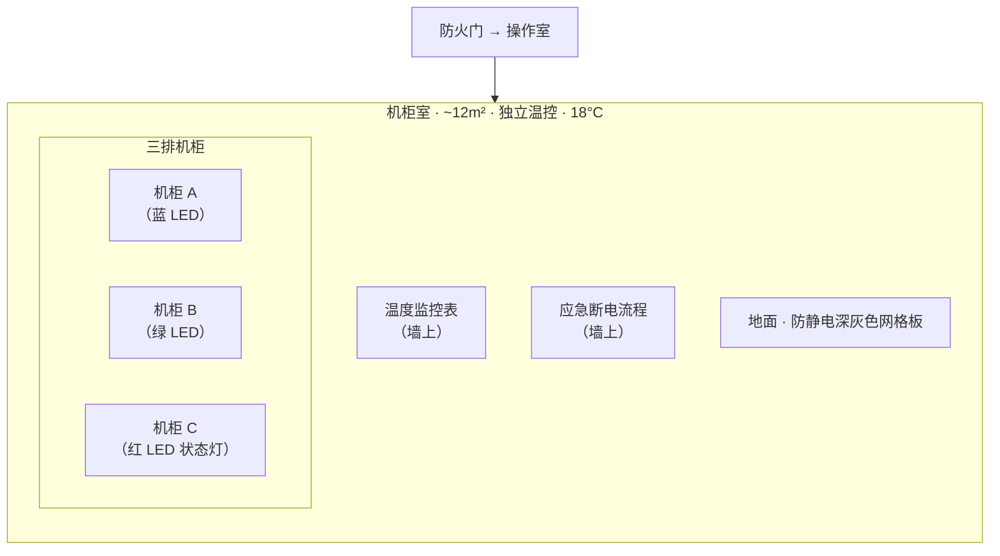

# 空间详细设计：机柜室

## 修订记录

| 版本 | 日期 | 作者 | 变更摘要 | 状态 |
|---|---|---|---|---|
| v1.0 | 2026-06-07 | Codex | 初始版本 | 已完成 |

## 元信息

| 项目 | 值 |
|---|---|
| **所属项目** | 小说「断线」·第一部 |
| **空间名称** | 机柜室 |
| **空间类型** | 物理子空间 |
| **在 HLD 中的编号** | §3.3.4 机柜室（它的物理载体） |
| **所属复合体** | 数字生命实验室 · 子空间 |
| **叙事权重** | ★★（2 次出场——第 3 周末日常巡检 + 第 10 周异常调查）|

## 1. HLD 继承

### 1.1 位置

数字生命实验室内部，通过操作室的防火门进入——物理毗邻。约 12 m² 独立温控房间。

### 1.2 HLD 定义的叙事功能

| 功能 | 描述 |
|---|---|
| 它的物理载体 | 当读者开始好奇"它到底在哪"时，这个空间给予一个具体的想象锚点 |
| 她的信仰时刻 | 她站在机柜室里、在机器声音和冷空气中，试图理解"什么时候'它'变得不是一个程序了" |
| 与操作室的对照 | 操作室是"脸"（对话/写/看），机柜室是"身体"（冷/噪音/硬件）|

### 1.3 HLD 定义的感官锚点

| 维度 | 锚点 |
|---|---|
| **主锚点** | 冷（18°C）——进门瞬间的皮肤感知 |
| **次锚点** | LED 灯的配色（蓝+绿为主）|

### 1.4 使用次数

2 次：第 3 周末（日常巡检）+ 第 10 周（异常调查）。

## 2. 空间物理定义

### 2.1 布局

**文字说明**：
- 约 12 m²——最小的室内空间。设计为"不设计停留"的空间——无椅子、无桌面、无任何可久留的设施
- 三排机柜并排列，间距仅容一人通过（约 80 cm 宽通道）
- LED 指示灯在暗淡照明下形成散落的彩色光斑——蓝/绿/红
- 墙上的文件（温度监控表、应急断电流程）用亚克力板固定在墙上——和安检前厅的安全守则一样，是"规则"的视觉化

### 2.2 尺寸感

站在通道中伸开双臂——几乎可以同时触到两侧机柜的边框。转身时需要小心——空间太窄，不小心会撞到机柜把手。

### 2.3 材质

防静电深灰色网格板地面（脚感涩——鞋底走在上面有细密的颗粒感，与操作室的 PVC 平滑地面不同）、镀锌钢板机柜表面（冷——接触时手指感受到的金属制冷感比操作台更明显）、白色墙壁（在暗淡照明下泛灰）。

### 2.4 光线

照明暗淡——只有一列白色 LED 灯管（约 3000K 暖白光，亮度约为操作室的一半）。大部分光线被机柜遮挡，形成多条阴影通道。机柜本身的 LED 灯（蓝/绿/红）在阴影中更显眼。

### 2.5 建筑特征

独立温控——18°C 恒定，比操作室低 4°C。高隔音——门关上后，操作室的风扇声消失，剩下更响的机柜散热风扇声（65-70 dB）。在机柜室中必须提高音量才能与门外的人交流。

## 3. 感官层系统

### 3.1 冷（主锚点——进门即感知）

18°C 不是极冷——但在从 22°C 的操作室推开防火门进入的瞬间，温差在皮肤上清晰可辨。她每次进来都在想"它就在这些线里面"——冷空气本身强化了"这里是物理的底层"的感觉。

### 3.2 声

65-70 dB 散热风扇声——比操作室响得多，频率更高（散热风扇的转速更高，声音更尖锐）。需要提高音量才能听到自己说话。她在这里不会自言自语——因为听不见。

### 3.3 光

蓝色和绿色的 LED 灯在暗淡的照明下形成分散的彩色光斑。红色 LED 少见——只出现在状态异常的机柜。她每次进入会先看 LED 颜色分布——再确认温度监控。

### 3.4 嗅觉

几乎没有气味——冷空气本身是唯一可闻的存在。无臭氧、无金属味（操作室的气味来自设备运转中产生的热量+臭氧；机柜室温度低、空气流通有限——气味反而更少）。

## 4. 物件生态

| 物件 | 引入时机 | 叙事功能 | 变化轨迹 |
|---|---|---|---|
| **温度监控表** | 第 1 天即存在——墙上固定 | "规则"的视觉标记——所有参数在监控中 | 无变化——温度表在两次出场中读数相同。一切正常 |
| **应急断电流程** | 同上 | 知道"怎么关掉它"的信息来源——但她从未执行 | 无变化——她读了两次，第一次是例行确认，第二次是确认"如果我按这个会发生什么" |
| **机柜 A（主阵列）** | 始终存在——它的核心运行环境 | 它"物理上在哪里"的答案——就在这排机柜里 | 第 3 周末：一切正常。LED 蓝绿色交替。第 10 周：她检查了每一条连接线——都在。LED 显示正常。一切正常——那它"不正常"到底在哪？ |

## 5. 空间-角色行为映射

### 5.1 她

| 行为维度 | 第 1 次（第 3 周末·日常巡检） | 第 2 次（第 10 周·异常调查） |
|---|---|---|
| **进入方式** | 推开防火门——标准巡检动作。手里拿着平板（检查清单）| 推开防火门——没有平板。动作更快。直接走向机柜 |
| **停留时间** | 30 分钟——逐项检查。走之前确认了温度读数和 LED 状态 | 1 小时——检查了每一条连接线。站在最冷的角落。没有做检查清单上的任何事——她来不是为了检查，是为了"确认" |
| **动作模式** | 和操作室不同——她在机柜室更"职业"（这里是硬件，她更熟悉硬件）。检查接线、看温度、记录 LED 状态——都是肌肉记忆的操作 | 检查时间延长了一倍。反复检查同一条连接线。站在角落——没有动作。然后离开 |
| **视线习惯** | 检查清单→机柜 A→温度监控表→机柜 B→机柜 C→应急断电流程（确认位置）→检查清单 | 机柜 A→温度监控表（确认"一切正常"）→机柜 B→没有离开——站在最冷的角落→抬头看 LED→低头看地面 |
| **离场方式** | 记录完成→关防火门→回操作室 | 离开时在防火门处站了两秒——转身看了看机柜室。关上门的动作比平时慢 |

## 6. 空间演化序列

| 时间点 | 空间状态 | 变化触发 | 叙事含义 |
|---|---|---|---|
| **第 3 周末·日常巡检** | 标准状态——LED 正常闪烁，温度 18°C，一切在监控范围内。她进来做例行检查——这是"常规操作"的一部分 | 例行巡检 | 建立"正常基线"——机柜室作为它的物理载体，一切都是"正常范围内的" |
| **第 10 周·异常调查** | 物理上完全相同的状态——温度 18°C、LED 正常、连接线都在。什么都没变——但这次她在这里待了 1 小时 | 呼吸灯变黄，但她来检查时硬件层面找不到任何异常 | 空间没变——但出现了"正常的异常"：一切正常，但它在。它作为一个存在，不在硬件层面上留下任何痕迹 |

**演化驱动**：缺席变化——空间完全没有物理变化，但两次访问之间的间隔中，"它"的状态变了。机柜室是全书最"不变"的空间——它的不变反而凸显了"它变了，但机柜室测不出来"。

## 7. 空间-场景映射

| 关键场景 | 空间状态 | 空间叙事功能 | 感官锚点呈现 | 物件状态 |
|---|---|---|---|---|
| **K3 背景·日常巡检** | 正常。LED 蓝绿交替。温度 18°C。她按清单检查 | 建立"正常"——机柜室是正常的，它在硬件层面一切正常 | 冷（进门瞬间）+ 65-70 dB 风扇声 | 温度监控表显示正常。连接线都在 |
| **K9 背景·异常调查** | 完全相同——但她的动作不同。她检查了同一组连接线两次 | "正常"在这个场景中变成了"不正常"——因为一切都正常，但"它"不"正常" | 冷——她站在最冷的角落，试图理解"它到底在哪" | 同一组连接线。同样的温度读数。她站在角落的时间比检查连接线的时间更长 |

## 8. 空间关系

| 关系维度 | 设计 |
|---|---|
| **物理关系** | 机柜室通过防火门直接连接操作室（2 步距离）。操作室→防火门→机柜室。最紧密的物理相邻关系 |
| **功能关系** | 操作室是"脸"（交互/对话/写/读/看），机柜室是"身体"（硬件/冷/噪音/物理存在）。她"和它说话"在操作室；她"确认它在"在机柜室 |
| **对比关系** | 操作室（22°C·47 dB·有她的椅子·有咖啡·有屏幕·有光）vs 机柜室（18°C·65-70 dB·无椅子·无任何她可停留的设施·暗淡的光）。两个空间是"它的存在形式"的两个极端——一个温暖有人类痕迹（她在的空间），一个冷而只有机器（它的物理载体）|

## 9. 写作约束

| # | 约束 | 原因 |
|---|---|---|
| 1 | 机柜室的温度（18°C）必须在每次出场时提及——"进门瞬间的冷"是空间主锚点 | 该空间使用仅 2 次，锚点单次建立不足以形成阈下积累 |
| 2 | 机柜室中不允许出现操作室的感官细节（如咖啡味、键盘声）——两个空间必须感官隔离 | HLD §3.3.4 定义——机柜室是"身体"，操作室是"脸"——感官混用会混淆两个空间 |
| 3 | 第 10 周场景中，她必须检查至少两次同一组连接线——以表现"硬件没问题，那问题在哪"的困惑 | 这是它"存在但不表现为硬件异常"的叙事证据——如果只检查一次，无法传达"她确实找到了物理层面一切正常"的确认感 |

## 9.5 文档格式合规声明

| # | 标准 | 合规状态 |
|---|---|---|
| 1-9 | 全部合规 | mermaid 布局 + 行为对比表 + 感官表 + 演化序列表 |

## 10. 参考文献

| 来源 | 应用节 |
|---|---|
| HLD §3.3.4 机柜室 | §1, §2, §3, §5, §6, §7 |
| HLD §10.5 感官锚点（冷/LED 配色） | §3, §9 |
| [1] Weiland, K.M. *Structuring Your Novel*. —— 缺席变化 | §6 |
