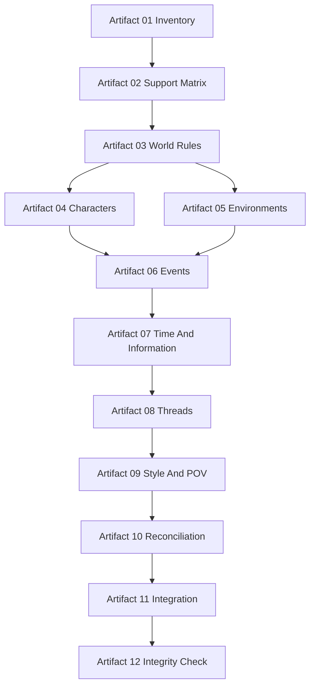

# DP-HLD-002 HLD Harness And Independent Skills Design

## Source Refs

- `engine/docs/superpowers/plans/2026-07-07-novel-hld-workflow-refactor.md`
- `tasks/design/hld/2026-07-07-duanxian-hld-design-planning/design-task-package.md`
- `engine/docs/superpowers/specs/2026-07-05-novel-harness-workflows-and-skills-design.md`

## Scope Boundary

This task designs the `novel-hld-workflow` harness and the twelve independent HLD skill contracts. It is documentation-only and does not write HLD business artifacts. The harness remains pure orchestration: entry gate, dispatch, routing, collection, packaging, reopen routing, and acceptance.

## Control Flow

The harness checks PRD HLD entry state first. If the state is blocked, it emits only a blocked manifest. If the state passes, it dispatches artifacts in topology order: inventory, support matrix, world rules, character system, environment system, event system, time/information system, thread system, style/POV system, inventory reconciliation, integration, and integrity checking.

## Data Flow

PRD and proposal facts flow into artifact 01 and artifact 02. Business skill outputs flow downstream through structured tables and Skill Verdict sections. Amendment requests flow to artifact 10. Final facts flow through artifact 11 Source Map. Risk and LLD entry state flow through artifact 12.

## Interface Contracts

Each skill owns one artifact and one schema. Every skill ends with `## Skill Verdict`. The harness consumes only structured outputs and never invents world facts. The integrator consumes artifacts 01-10 and does not depend on artifact 12.

## State And Persistence

Skill files live under `engine/skills/`. HLD run outputs live under `duanxian/design/runs/hld/...` only after PRD entry is unblocked. Blocked runs may store a manifest and gate report but no business HLD artifact.

## Error Handling And Diagnostics

Any missing skill, malformed verdict, open source closure, unresolved amendment, or boundary violation blocks downstream packaging and creates a convergence row. Reopen requests target the narrowest upstream artifact or skill.

## Security And Permissions

Do not implement code. Do not generate HLD business content. Do not modify PRD/proposal sources. The task is limited to workflow and skill contract design documents.

## Observability

The harness exposes artifact status, skill verdict, source closure state, risk status, and rerun target in structured tables. Validator tests assert that blocked PRD entry cannot produce HLD business artifacts.

## Verification

Verification uses `scripts/validate_design_tasks.py`, planned `validate_hld_contract.py`, and fixture runs for blocked and pass states. This document is validated through the design-planning quality gate.

## Task Acceptance Mapping

| Planned acceptance item | Design response |
|---|---|
| harness writes no business facts | The harness is limited to entry gate checks, dispatch, routing, collection, packaging, reopen routing, and acceptance; world facts remain inside independent skill artifacts. |
| each skill owns one artifact | The topology assigns one owner skill to each artifact 01-12 and requires each skill to emit one structured artifact with one `## Skill Verdict`. |
| blocked PRD gate is preserved | The control flow starts with the PRD HLD entry state and emits only a blocked manifest while the PRD verdict remains `blocked_pending_human_review`. |

## Harness Responsibility Boundary Matrix

| Harness responsibility | Allowed action | Forbidden action | Output |
|---|---|---|---|
| Entry gate | Read PRD risk report and decide blocked/pass route. | Override human review state or reinterpret PRD facts. | Gate report and blocked manifest or dispatch plan. |
| Dispatch | Invoke the next eligible artifact skill according to topology. | Write any artifact table cells itself. | Ordered task route and source bundle. |
| Collection | Verify required artifact files and `## Skill Verdict` sections exist. | Repair malformed business content. | Artifact index and missing-artifact diagnostics. |
| Reopen routing | Send a failed artifact to the narrowest upstream owner. | Ask integrator to patch unsupported facts. | Rerun target and convergence row. |
| Packaging | Assemble final package only from artifact 11 and artifact 12. | Invent world rules, character details, event mechanics, or prose. | Final HLD package shell and acceptance status. |

## Skill Contract Matrix

| Artifact | Owner skill | Required input | Required output | Blocking condition |
|---|---|---|---|---|
| 01 | `novel-world-entity-inventory-builder` | Proposal claims, PRD scenes, freeze/story boundaries | Initial inventory with explicit inclusions and exclusions | Missing required entity type. |
| 02 | `novel-prd-support-matrix-builder` | Artifact 01 and PRD HLD requirements | Support matrix covering PRD-S00 to PRD-S18, HLD-REQ, freeze, story boundaries | Any PRD source lacks support row. |
| 03 | `novel-world-rule-designer` | Artifacts 01-02 | World rule table with source and LLD handoff | Rule lacks PRD support. |
| 04 | `novel-character-system-designer` | Artifacts 01-03 | Character table with relationship, motivation, information permission | Digital life is treated as senior's resurrection. |
| 05 | `novel-environment-system-designer` | Artifacts 01-03 | Environment table with spatial relation and state change | Accident/lab environments lack causal function. |
| 06 | `novel-event-system-designer` | Artifacts 01-05 | Event chain table with visibility and consequences | Major event mechanics bypass researcher/digital life. |
| 07 | `novel-time-information-system-designer` | Artifacts 01-04 and 06 | Time/information table with known/hidden/reveal rules | Usable intelligence and complete cause collapse into one layer. |
| 08 | `novel-thread-system-designer` | Artifacts 01-02, 04, 06-07 | Thread table with node distribution and closure state | Emotional line or hidden line has no closure path. |
| 09 | `novel-style-pov-system-designer` | Artifacts 01-08 | Style/POV table with permissions and prohibited expressions | POV shifts into unrestricted digital-life interiority. |
| 10 | `novel-hld-inventory-reconciler` | Artifacts 01-09 | Amendment disposition and final inventory | Unresolved amendment enters integration. |
| 11 | `novel-hld-integrator` | Artifacts 01-10 | Final HLD structure, Source Map, LLD handoff index | Adds a fact not present in upstream artifacts. |
| 12 | `novel-hld-integrity-checker` | Artifacts 01-11 | Risk report, verdict matrix, convergence log | P0/P1 verdict inconsistency or weak convergence row. |

## Artifact Dispatch DAG

## Risks

The primary risk is harness leakage into business design. The mitigation is a hard forbidden-actions section and validator checks for business content in harness output.

## Handoff

The handoff is a list of skill files to create or update, their artifact ids, required schemas, forbidden scope, and acceptance checks.
