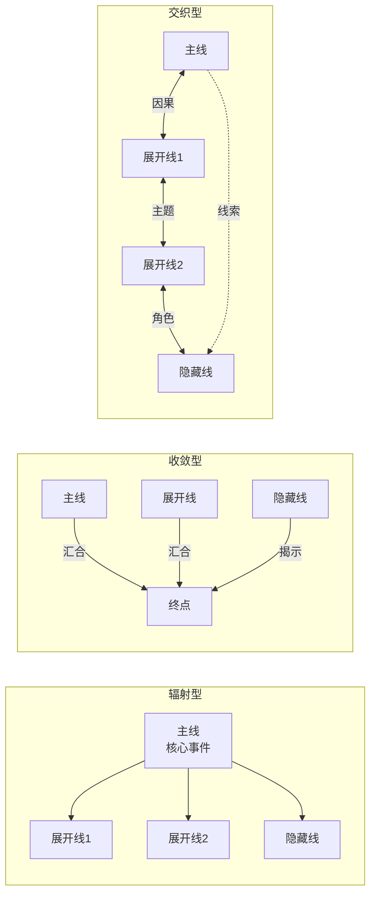

# novel-thread-designer

## 描述

设计小说的故事线（Thread）体系——在 PRD 定义了"讲什么故事"之后，本技能设计故事的"线结构"：定义主线、展开线、隐藏线及其核心节点序列，为 HLD 的讲述线设计提供原料。输出的线设计结果可直接被 HLD writer 调用。

## 使用场景

- HLD 阶段的第一步——在 HLD writer 开始设计叙事架构之前，先完成线设计
- 当小说包含复杂叙事（多POV、多时间线、多层叙事）时
- 需要精确控制读者"先知道什么、后知道什么"的叙事策略时

## 方法论来源

本技能综合以下理论来源：

- **A-Plot / B-Plot 理论** (Screenwriting)：主线与副线的因果/主题/角色关系 [1]
- **Subplot 设计原则** (Narrative Theory)：副线的功能、节奏、收敛设计 [2]
- **多线叙事结构** (Complex Narratives / Network Narratives)：线之间的交叉、嵌套、平行关系 [3]
- **悬疑与揭示管理** (Mystery Writing / Clue Structure)：隐藏线的埋设与揭示节奏 [4]
- **Snowflake Method** (Randy Ingermanson)：Step3 角色驱动的情节设计；Step4 线扩展 [5]
- **Story Engineering** (Larry Brooks)：四部分结构 + 多线织入方法 [6]
- **Save the Cat! Writes a Novel** (Jessica Brody)：B-Story 的概念和位置 [7]

---

## 核心概念

### 什么是故事线（Thread）？

故事线是叙事中具有独立因果关系的叙事流。每一条线：
- 回答一个独立的核心问题
- 有自己的核心节点序列
- 有明确的起点和终点
- 与其他线在因果关系、主题或角色上相连

> 一条线 ≠ 一个角色的戏份。一条线是一条"因果链"——一个角色可能出现在多条线中，一条线也可能涉及多个角色。

### 线类型与功能

| 类型 | 别名 | 数量要求 | 核心功能 | 读者预期 |
|---|---|---|---|---|
| **主线** | A-Plot / Main Thread | 至少 1 条 | 承载故事的核心问题和主要冲突。大多数读者的注意力集中于此 | "这是故事最让我在乎的事" |
| **展开线** | B-Plot / Branch Thread | 至少 2 条 | ① 提供主线的对照或补充视角；② 展开副角色的弧线和动机；③ 深化主题同时在另一层面传递；④ 在主线的情绪紧张时提供节奏呼吸 | "这些副线让世界更丰富" |
| **隐藏线** | Mystery Thread / Hidden Thread | 至少 1 条 | ① 起初处于背景或未被注意的状态；② 通过线索的逐步揭示提升悬念；③ 后期揭示或激活时改变读者对主/展开线的理解 | 隐藏时："总觉得有什么事不对"；揭示时："原来如此！" |

### 线的七个常见原型

以下原型可组合使用，一条线可能同时属于多个原型：

| 原型 | 核心机制 | 典型走向 | 适合的线类型 |
|---|---|---|---|
| **成长线（Transformation）** | 角色从一种状态变成另一种状态 | 缺陷→考验→认知→改变 | 主线、展开线 |
| **揭示线（Revelation）** | 一个真相被逐步揭开 | 疑问→线索→部分答案→完整真相 | 隐藏线、主线 |
| **对抗线（Confrontation）** | 外部阻力随时间增加 | 试探→冲突升级→最终对抗 | 主线、展开线 |
| **关系线（Relationship）** | 两人/两方关系的演变 | 建立→考验→裂痕→修复或决裂 | 展开线 |
| **追寻线（Pursuit）** | 对某个目标的持续追逐 | 设定目标→障碍→接近→获得或失去 | 主线、展开线 |
| **悬疑线（Mystery）** | 问题被提出→持续→回答 | 问题出现→线索累积→答案揭晓 | 隐藏线 |
| **平行线（Parallel）** | 两组相似情境的对照 | A线和B线在主题上平行推进 | 展开线 |

---

## 设计工作流

### 第一步：从 PRD 分析线需求

在开始线设计之前，从 PRD 中提取以下信息：

- **角色数量和关系** — 有多少个角色？他们之间的关系是什么？
- **核心矛盾** — 一句话说清的核心张力
- **主要情节阶段** — 故事分成哪几个阶段
- **情节约定** — 不可违反的硬约定

**线类型的匹配规则**：

| 如果 PRD 包含 | 则需要哪种线 |
|---|---|
| 主角（一个主体）+ 持续的内在冲突 | 主线（成长线/对抗线/追寻线） |
| 第二个视角角色 + 独立的情感/道德困境 | 展开线1（关系线/成长线） |
| 外部世界/社会层面/其他角色的反应 | 展开线2（对抗线/平行线） |
| 悬疑元素（真相/过去事件/秘密） | 隐藏线（揭示线/悬疑线） |
| 复杂设定中的时间跨度或代际变化 | 展开线3（追寻线/平行线） |

**数量指南**：

```
短篇小说（1-2万字）：1主线 + 2展开线 + 1隐藏线 = 4条线
中篇小说（3-5万字）：1主线 + 2-3展开线 + 1-2隐藏线 = 4-6条线
长篇小说（8万字+）：1主线 + 3-5展开线 + 1-3隐藏线 = 5-9条线
```

**注意**：线数量不是越多越好。每条线都需要有独立的因果链和完整的节点序列。如果一条线可以用"这个角色看到主线的发生"来概括，它就不是一条独立的线——应该合并到主线中。

### 第二步：定义每条线

为每条线填写以下定义表：

```
=== 线定义 ===

线名称：[功能型名称，如"存在之证""界线的模糊"]
线类型：[主线 / 展开线 / 隐藏线]
核心问题：[这条线在故事中回答什么问题？一个问题句]
归属 POV：[主要通过谁的视角呈现？]
核心原型：[成长 / 揭示 / 对抗 / 关系 / 追寻 / 悬疑 / 平行]

起点：[这条线在故事开始时的状态——一段简洁描述]
终点：[这条线在故事结束时的状态——一段简洁描述]
价值变化：[这条线从正到负/从负到正/从稳定到冲突？]
```

### 第三步：设计线之间的结构关系

使用以下模式之一确定线之间的结构关系：



| 模式 | 适用场景 | 优点 | 风险 |
|---|---|---|---|
| **辐射型** | 多线以主线为核心事件展开 | 清晰，易追踪 | 展开线可能缺乏独立分量 |
| **收敛型** | 独立开始的线索在结尾汇合 | 高潮有力，读者满足感强 | 前期可能显得松散 |
| **交织型** | 复杂的因果和主题网络 | 叙事深度最高 | 读者需要更强的注意力 |

### 第四步：设计核心节点序列

每条线需要 3-10 个核心节点（取决于线的重要性和故事长度）。

#### 4.1 节点数量指南

| 故事长度 | 主线 | 每条展开线 | 每条隐藏线 |
|---|---|---|---|
| 短篇（1-2万字） | 5-7 个节点 | 3-5 个节点 | 3-4 个节点 |
| 中篇（3-5万字） | 7-9 个节点 | 5-7 个节点 | 4-5 个节点 |
| 长篇（8万字+） | 8-12 个节点 | 6-9 个节点 | 5-7 个节点 |

#### 4.2 节点设计原则

**每条线的节点必须满足**：

```
1. 因果性：节点 A → 节点 B（A 导致 B 的发生或改变）
   反例：节点 A → 节点 B → 节点 A（没有因果，只是关于同一个主题）
   
2. 进展性：每个节点必须改变线的状态
   状态类型举例：
   - 认知状态：不知道 → 初步怀疑 → 确认 → 决定
   - 情感状态：无感 → 注意 → 关切 → 投入
   - 关系状态：陌生 → 接触 → 联结 → 分离
   
3. 不可逆性：节点一旦发生，线的状态不可回到之前
   例外：隐藏线可以在揭示后"被封装"——状态变为"信息被持有但未被使用"

4. 时间线完整性：每条线必须覆盖完整的故事时间轴——从起点到终点都有节点分布。不允许一条线在故事前段"沉睡"、后段突然"激活"。
   每条线至少需要有节点分布在以下 3 个时间区间中：
   - 开场区间（序幕/Act1）——建立线的存在
   - 发展区间（Act2）——线的演进与变化
   - 收束区间（Act3-Act4）——线的解决与结局
   如果一条线只在"需要出现时"才有节点，说明该线不是独立的叙事线——应合并到另一条线中。
```

**3. 节点记录格式**：

```
| 编号 | 节点名 | 发生时间 | 节点性质描述（不是具体情节，是性质的描述） | 状态变化 | 叙事功能 |
```

**节点性质描述 vs 具体情节的区分**：

| 正例（节点性质） | 反例（具体情节） |
|---|---|
| "角色第一次对某事产生了超出功能性的关注" | "她看到图谱上某节点的连接数异常——她在想他为什么会反复读取那段记忆" |
| "角色面临一个自己无法归类的感受" | "冷的、湿的——她不知道这种感觉应该放在哪个分类里" |

#### 4.3 节点序列节奏

每条线的节点应该有自己的节奏——不要太均匀：

```
好的节奏：
  ●——●——●———————●——●—————————————●——●
  ↑加速       ↑停顿     ↑加速到终点

不好的节奏（太均匀）：
  ●——●——●——●——●——●——●——●——●
```

加速区：节点密集（读者注意力高）
停顿区：节点稀疏（这条线在背景中运行）
加速到终点：最后的节点区（线的高潮和收束）

### 第五步：设计线之间的交叉点

| 交叉点类型 | 定义 | 读者体验 |
|---|---|---|
| **因果交叉** | A线的事件直接导致B线的事件 | "因为X发生了，所以Y不得不面对新情况" |
| **信息交叉** | A线的信息（如隐藏线的发现）改变了B线的选择 | "A线知道的事让B线的决定被重新定义" |
| **角色交叉** | 一个角色出现在多条线中，成为跨线锚点 | "这个角色把三条线串在一起" |
| **情感交叉** | A线的情绪状态在B线中得到共鸣或对比 | "A线的温度让B线的情绪更强烈" |
| **时间交叉** | 不同线中的事件在时间上对齐或错位 | "它们同时发生了，但读者不知道" |

### 第六条：验证线设计质量

```
□ 主线是否有一个明确的核心问题？（一个句子能说清）
□ 每条展开线是否与主线有因果关系或主题关系？（不是独立的二流故事）
□ 隐藏线是否在前期有隐形的线索埋设？（不是"突然冒出来"的）
□ 每条线的节点是否满足因果性、进展性、不可逆性？
□ 每条线的节点数量是否在建议范围内？
□ 展开线的数量是否在 2-5 条之间？隐藏线在 1-2 条之间？
□ 所有线是否在结局时有收敛或呼应？（不是各走各路）
□ 是否有线被"悬空"——在一段时间内完全消失而无交代？
□ 每条线的起点和终点是否清晰？
□ 线的总数量是否在读者可追踪的范围内？（短篇 ≤4，中篇 ≤6，长篇 ≤9）
```

---

## 输出产物

### 线设计输出结构

```
=== 线设计报告：[项目名称] ===

1. 线结构总览
   - 线总览表（类型/名称/核心问题/POV/原型）
   - 线关系图（mermaid）

2. 各线详细设计
   [每条线：定义 + 核心节点表 + 起点/终点/价值变化]

3. 线交叉点矩阵
   [所有交叉点：线A节点 → 线B节点 → 交叉类型 → 对叙事的影响]

4. 线节奏总览
   [每条线的节点密度分布 + 加速/停顿区标注]
```

### 与 HLD 的接口

线设计的输出直接供 HLD writer 调用。HLD §2（故事线设计）使用本输出的"线结构总览"和"各线详细设计"填充内容。HLD §3（讲述线设计）则从本输出的核心节点中提取和组织讲述单元。

---

## 典型线设计方案示例

### 标准三线结构（示例）

```
主线：成长线——主角从缺陷到认知到改变
展开线1：关系线——主角与关键角色的关系演变
展开线2：对抗线——外部压力的升级
隐藏线：揭示线——故事世界的隐藏真相
```

### 侦探/悬疑结构（示例）

```
主线：追寻线——侦探追查案件真相
展开线1：关系线——侦探与助手/受害者的关系
展开线2：对抗线——对手/反派的逐步介入
隐藏线（主）：揭示线——案件背后的真正动机
隐藏线（副）：揭示线——侦探自身的过去
```

### 情感/心理结构（示例）

```
主线：成长线——主角内心的进化
展开线1：关系线——主角与另一个人的情感联结
展开线2：平行线——另一个人物与主角的镜像关系
隐藏线：揭示线——主角自身隐藏的创伤或秘密
```

---


## 文档格式与用语规范（9 条强制性标准）

线索设计文档必须遵守以下 9 条标准：

| # | 标准 | 要求 |
|---|---|---|
| 1 | **简体中文·专业正式** | 全文使用简体中文专业书面语，无口语/随笔/对话体 |
| 2 | **拟人化编写** | 措辞自然可读，无代码注释风格 |
| 3 | **多样化表达形式** | 综合使用表格、mermaid 图、文字说明等表达形式 |
| 4 | **书面用语·结构优** | ## → ### → 标号体系完整，节/子节层次清晰 |
| 5 | **最终结论·无过程** | 所有语句均为最终设计决策，无"可能/或许/建议/可以考虑" |
| 6 | **有据可循** | 设计决策引用方法论出处 [n]，末尾提供完整参考文献 |
| 7 | **修订表前置** | 文档起始处含完整修订记录表 |
| 8 | **紧扣主题** | 内容限于线索设计，与叙事线索无关的内容不得放入 |
| 9 | **简洁清晰·禁止冗余** | 信息密度高，优先使用表格承载结构化内容 |

## 参考文献

[1] McKee, Robert. *Story: Substance, Structure, Style and the Principles of Screenwriting*. HarperCollins, 1997.
[2] Turco, Lewis. *The Book of Literary Terms*. University Press of New England, 1999.
[3] Ryan, Marie-Laure (ed.). *Narrative across Media: The Languages of Storytelling*. University of Nebraska Press, 2004.
[4] Truby, John. *The Anatomy of Story*. Farrar, Straus and Giroux, 2007.
[5] Ingermanson, Randy. *How to Write a Novel Using the Snowflake Method*. 2014.
[6] Brooks, Larry. *Story Engineering: Mastering the 6 Core Competencies of Successful Writing*. Writer's Digest Books, 2011.
[7] Brody, Jessica. *Save the Cat! Writes a Novel*. Ten Speed Press, 2018.
