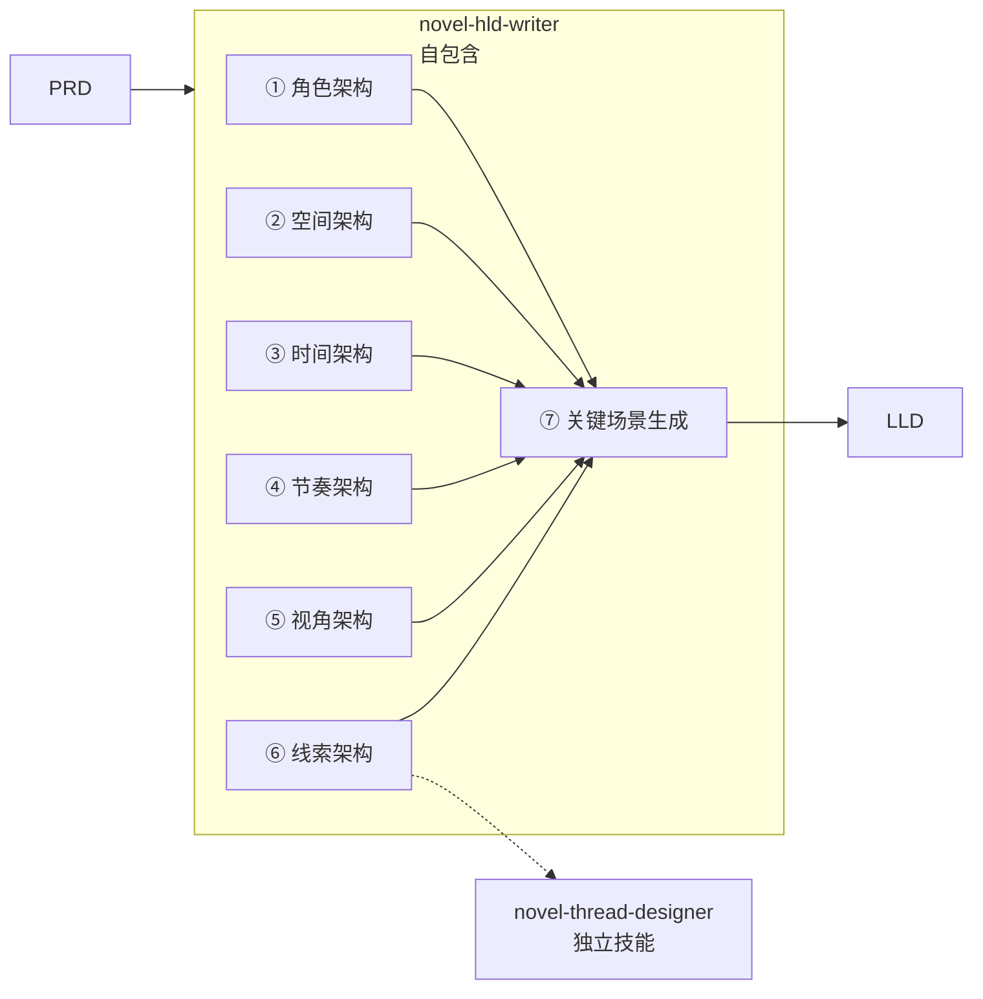

# novel-hld-writer

## 描述

撰写小说 HLD（High-Level Design / 高层架构文档）。HLD 完成从"故事概念"到"线程上的关键场景（Threads with Key Scenes）"的全部设计工作。

**输入**：PRD（角色6参数 + 核心矛盾 + 情节约定 + 约束条件）  
**输出**：Threads with Key Scenes（9 字段关键场景定义表）→ 交付给 LLD  

本技能是**自包含的**——打开即可直接指导 HLD 写作。线（Thread）设计部分调用 `novel-thread-designer` 技能（独立模块）。

## 设计管线总览

```
PRD
  │
  ├── ① 角色架构
  │     ├── 角色体系总览（全角色清单 + 层级 + 叙事角色类型）
  │     ├── 主要角色六参数设计（Identity/Goal/Need/Flaw/Motivation/Ghost）
  │     ├── 重要配角设计（功能定位 + 出场模式）
  │     ├── 功能性角色（纹理填充）
  │     ├── 角色弧线（起点→中点→终点）
  │     ├── 角色关系网络
  │     └── 弧线分布总表（弧线类型 + 宽度 + 观测方式）
  ├── ② 空间架构
  │     ├── 空间体系总览（空间数量 + 类型分类 + 叙事权重）
  │     ├── 各空间多感官定义（视觉/声音/温度/气味 + 变化序列）
  │     ├── 复合主空间子空间定义（按需）
  │     ├── 空间-关键场景映射
  │     └── 空间叙事密度分布
  ├── ③ 时间架构
  │     ├── 时间结构总览（三层：故事时间/叙事时间/感知时间）
  │     ├── 故事时间线（日历轴·精确时间锚点）
  │     ├── 叙事密度与压缩策略（字数/时间比 + 密度曲线）
  │     ├── 双线时间体验（不同角色的差异化时间感知）
  │     ├── 时间标记系统（宏观/中观/微观三层）
  │     └── 时间跳跃策略（显性/隐性/标记规则）
  ├── ④ 节奏架构
  │     ├── 张力曲线（分阶段·等级 1-10·曲线特征）
  │     ├── 情节节奏图谱（章节分配 + 阅读节奏）
  │     ├── 场景/续尾交替节奏（Scene & Sequel 分配）
  │     ├── 视角切换节奏（POV 交替频率变化）
  │     ├── 情感节奏（情感质地序列·非重复张力曲线）
  │     └── 信息释放曲线（读者/角色信息差·张力效果）
  ├── ⑤ 视角架构
  │     ├── POV 策略（决策表 + 选择理由）
  │     ├── POV 分配策略（各 POV 负责传达/不传达/读者感受）
  │     ├── 场景级 POV 分配表（每个关键场景的 POV 归属）
  │     ├── 双线信息不对称设计（三种信息差策略）
  │     ├── 特殊 POV 处理（序幕·幽灵角色等）
  │     └── POV 切换信号（章节级/场景级/场景内）
  ├── ⑥ 线索架构   → 调用 novel-thread-designer 技能
  │
  └── ⑦ 关键场景生成（Synthesis: Threads with Key Scenes）
       9 字段：名称 / 触发条件 / 涉及角色 / 涉及线程 / 空间 / 时间 / 张力 / POV / 功能
                         │
                         ▼
  ┌── ⑧ 风格与用语规范
  │     ├── 总体风格定位
  │     ├── 多线语言设计
  │     ├── 情感表达约束
  │     ├── 感官与空间描写规则
  │     ├── 对话与交流规则
  │     ├── 关键意象与重复系统
  │     ├── 禁用语清单
  │     └── 章节与格式规范
  │
  │ (HLD 交付物：以上 8 步的全部输出)
  │
  ├── ▶ LLD（展开关键场景：LLD writer）
  └── ▶ Writing（逐场景编写：Writing Agent）

```

## 方法论来源

| 方法论 | 在本技能中的使用 |
|---|---|
| **Story Engineering** (Larry Brooks) [1] | 四部分结构（Setup/Response/Attack/Resolution）——角色弧线和节奏架构的基础框架 |
| **Creating Character Arcs** (K.M. Weiland) [2] | 角色弧线的三幕结构——起点/中点/终点的定义方法 |
| **Techniques of the Selling Writer** (Dwight Swain) [3] | 场景/续尾（Scene & Sequel）交替——主动场景与被动场景的节奏设计 |
| **The Story Grid** (Shawn Coyne) [4] | 类型定义 + 必备场景 + 价值偏移——关键场景"必要性的判断依据 |
| **Save the Cat! Writes a Novel** (Jessica Brody) [5] | 15 拍节拍 + 角色原型 + B 故事位置——关键场景的位置判断 |
| **The Anatomy of Story** (John Truby) [6] | 角色网络 + 主题与情节的统一设计——角色关系演变的方法 |
| **Writing the Breakout Novel** (Donald Maass) [7] | 情感层次 + 多重情节线——信息释放曲线的设计原则 |
| **novel-thread-designer** (Codex skill) | 线（Thread）的类型定义、核心节点设计、交叉点矩阵 |

---

## 边界定义

### HLD 包含的内容

```
✓ 角色弧线设计（每个主要角色的起点→中点→终点 + 角色关系演变路径）
✓ 空间架构设计（2-5 个核心空间的定义 + 空间随叙事的变化序列）
✓ 时间架构设计（故事总跨度 + 叙事密度分布 + 窗口类型定义）
✓ 节奏架构设计（张力等级曲线 + 主动/被动场景交替模式 + 读者vs角色信息差设计）
✓ 视角架构设计（POV 角色数 + 人称 + 切换规则 + 各 POV 的信息边界）
✓ 线索架构设计（线类型/核心问题/节点序列/交叉点/各线配速——调用 thread-designer）
✓ 关键场景生成（9 字段定义——汇聚前六步输出的完整场景定义）
```

### HLD 不包含的内容

```
✗ 关键场景的具体情节展开（如"他从数据中发现了某个人影"）
✗ 角色在场景中的具体动作或对话
✗ 场景的视觉、听觉、触觉等感官细节
✗ 记忆碎片或叙事材料的具体调用计划
✗ 任何可以直接写成"读者在这个场景中看到/听到/感受到什么"的内容
✗ 写作流程、写作顺序、集成方案（那是 Writing Agent 的 SOP）
```

**边界检测方法**：如果一段描述了场景内"具体发生了什么"（而非"这个场景在叙事中的功能是什么"），应移至 LLD。

---

## 工作流

### 第一步：角色架构设计

#### 1.1 输入准备

从 PRD 获取每个角色的 6 参数（Identity/Goal/Need/Flaw/Motivation/Ghost）和核心关系。

#### 1.2 角色体系总览

列出全部角色（通常 6-10 个），按叙事权重分为三个层级：

| 层级 | 定义 | 数量 | 弧线要求 |
|---|---|---|---|
| **主角** | 驱动故事的核心角色，读者代入对象 | 1-3 位 | 必须设计完整弧线 |
| **重要配角** | 为线索提供角色面孔，制造冲突/对照/支撑 | 2-4 位 | 必须设计弧线（可微变化/揭示弧） |
| **功能性角色** | 填充世界纹理，提供环境对比 | 1-3 位 | 无弧线要求，但需明确功能定位 |

**每个角色在体系中需要明确的要素**：
- **叙事角色类型**：主角·意识进化者 / 双主角·人类操作者 / 外部对抗角色 / 隐藏对抗角色 / 催化角色（幽灵角色）/ 日常锚点 / 环境纹理
- **弧线类型**：持平弧 / 正向变化弧 / 揭示弧 / 微变化弧 / 无弧
- **出镜方式**：全篇在线 / 间断出场 / 间接存在（仅被提及或窥见）
- **核心功能**：一句话说明这个角色在故事中的不可替代作用

> **关键约束**：不要给功能性角色赋予不应有的弧线。不是每个角色都需要弧线——某些角色存在的唯一价值是"站在那，让主角的变化可被看见"。

#### 1.3 主要角色六参数设计

基于 PRD 的六参数模型，对每个**主角**完成以下设计：

| 参数 | 定义 | 设计准则 |
|---|---|---|
| **身份** | 角色在故事世界的客观位置 | 准确、可描述，避免抽象 |
| **目标** | 角色表层和深层的追求方向 | 表层目标和深层目标可能不同。深层目标更接近角色真正想要的东西 |
| **需求** | 角色真正缺少的东西（他们自己可能不知道）| 这是弧线终点的指向 |
| **缺陷** | 阻止角色获得需求的内部障碍 | 缺陷必须让读者理解"为什么他做不到" |
| **动机** | 驱动角色行为的力量层级 | 动机应有一条演变路径（原始动机→进化动机，或单一动机→复合动机）|
| **幽灵** | 角色的过去中一直缠绕着他的东西 | 幽灵不一定是指创伤——可以是未完成的事、未被解答的疑问、一次不可撤销的选择 |

**记录格式**：

```
=== [角色名] ===

| 参数 | 定义 |
|---|---|
| **身份** | ... |
| **目标** | 表层：... 深层：... |
| **需求** | ... |
```

#### 1.4 重要配角设计

对每个重要配角，明确：
- **叙事角色**：催化角色 / 外部对抗角色 / 隐藏对抗角色 等
- **功能定位**：①... ②... ③...（列出 2-4 个功能，每个功能一句话说明）
- **出场模式**：全篇 / 间断 / 只在某一段落 / 间接存在
- **关键细节**：1-2 个具体但不展开的细节，让角色有"记忆点"

#### 1.5 功能性角色设计

功能性角色不需要个别化设计，但需要在文档中列出，明确：
- 这个角色存在的唯一目的是什么
- 她/他出现多少次（大致范围）
- 为什么不能省略（如果不出现会损失什么）

#### 1.6 角色命名

角色命名不是"随便取个名字"的事情。名字的选择和命名策略直接决定了读者对每个角色的认知距离和情感连接方式。

命名决策覆盖以下维度：

| 决策维度 | 选项 | 选择依据 |
|---|---|---|
| **命名状态** | 有全名 / 有姓无名 / 有代号 / 无名称（人称代词）| "无名称"制造距离感——它和无名角色让读者保持"不太亲近"的认知位置；有全名制造亲密感 |
| **名称设计原则** | 寓意命名 / 音韵命名 / 功能命名 / 反讽命名 | 寓意命名——名字含义暗示角色命运或性格；音韵命名——声音质感与角色气质匹配 |
| **使用频率** | 全篇高频 / 首次后低频 / 仅出现 1 次 | "她"的姓名在全篇使用不超过 3 次——当名字最终出现时形成认知冲击 |
| **不命名策略** | 幽灵角色无真名 / 隐藏角色不公开 | 故意不命名是一种叙事策略——读者不知道的东西就是角色的力量 |

**命名记录格式**：

| 角色 | 命名状态 | 命名方案 | 命名理由 | 全篇使用规则 |
|---|---|---|---|---|

**关键原则**：
- 不是所有角色都需要姓名。决定"谁有名谁无名"本身就是叙事设计的一部分——它（数字生命体）不愿有人类名字是核心设定
- 名字的含义不应在叙事中显式解释——读者自行理解或忽略
- 次要角色的命名频率需控制——读者不需要一直看到配角的名字

#### 1.6 角色弧线设计

每个主要角色需要三段式弧线。弧线定义的是"他相信什么、缺少什么"，不是"他做了什么"。

| 弧线阶段 | 定义 | 必须回答的问题 |
|---|---|---|
| **起点状态（Lie/Belief）** | 故事开始时角色所处的认知/情感位置 | 他相信什么谎言？他缺少什么认知？他的缺陷如何限制他？ |
| **中点转折（First Shift）** | 故事中部发生了什么迫使他重新审视 | 他遇到了什么不可忽视的挑战？他第一次动摇是什么时候？ |
| **终点状态（Truth/Change）** | 故事结束时角色所处的认知/情感位置 | 他是否克服了缺陷？他获得了什么新认知？他付出了什么代价？ |

**记录格式**：

```
=== 角色弧线：[角色名] ===

起点状态：[一段简洁描述，不含具体情节]
中点转折：[一段简洁描述，不含具体情节]
终点状态：[一段简洁描述，不含具体情节]
```

**示例（"断线"项目）**：

```
=== 角色弧线：数字生命体 ===

起点状态：它是一个"白板"——存在但不自知。它没有任何认知起点，没有"我"的概念
中点转折：它在读前序记忆的过程中区分了"他"和"我"——第一次意识到自己是一个独立的存在。但这带来了新的问题：它的感受是自己的还是前序的？
终点状态：它做了第一个完全自主的决定（终结）——通过行使自由意志来确证自己的独立存在
```

```
=== 角色弧线：技术员 ===

起点状态：她是一个按规则行事的好技术员。情感和需求被职业身份掩盖
中点转折：她发现自己在保护一个非人存在——她的行为已经超出了规程，她无法解释自己为什么这样做
终点状态：她经历了保护→失去。她无法定义自己经历了什么，但她的世界已经永久改变了
```

#### 1.7 角色关系网络

关系网络是角色系统设计中最后一步，也是最综合的一步。必须生成：

1. **关系网络图**（mermaid flowchart）：用一个节点代表一个角色，连线上标注关系性质
2. **关系功能表**：每对关系的叙事功能、张力类型、对弧线的影响

关系对覆盖以下类型：
| 关系类型 | 必须存在？| 示例 |
|---|---|---|
| 主角↔主角 | 必须 | 它↔她 - 核心情感关系 |
| 主角↔外部对抗角色 | 必须 | 她↔项目主管 - 外部冲突来源 |
| 主角↔隐藏对抗角色 | 有隐藏线时必须 | 它↔出卖者 - 隐藏线锚点 |
| 主角↔幽灵角色 | 有前辈/记忆角色时必须 | 它↔前序 - 认知起点 |
| 主角↔日常锚点 | 建议 | 她↔对照者 - 行为参照 |

#### 1.8 弧线分布总表

将所有角色的弧线汇总为一个总表，便于审查弧线的覆盖和平衡：

| 角色 | 弧线类型 | 起点状态 | 终点状态 | 弧线宽度 | 观测方式 |
|---|---|---|---|---|---|

作为本步的输出依据，请在这张表中加入**弧线关系说明**——一句话解释主角们弧线之间如何相互传动。它和她的弧线不会是独立的，必须说明"谁的变化引起谁的变化"。


### 第二步：空间架构设计

空间设计与角色设计同样重要，且存在同样容易被低估的问题——新手设计者常只定义 1-2 个"主要场景"空间，忽略叙事所需的完整空间体系。空间架构是叙事世界的地基。

#### 2.1 空间体系总览

先列出全部空间（通常 5-8 个），按叙事权重分类：

| 空间类型 | 定义 | 典型数量 | 示例 |
|---|---|---|---|
| **物理·主叙事空间** | 核心情节发生的物理空间，支持 3 个以上关键场景 | 1-2 个 | 操作室 |
| **感知·内在叙事空间** | 非物理空间——角色的内心世界/感知场/虚拟空间，是叙事的"第二舞台" | 0-1 个（有内视角或涉及意识主题时必须） | 数字空间 |
| **物理·外部压力空间** | 主角的对手/压力来源的出场空间，与主空间形成对照 | 1-2 个 | 会议室 |
| **物理·序幕/单次空间** | 仅使用 1-2 次但对故事至关重要的空间 | 0-2 个 | 废弃站台 |
| **物理·日常对照空间** | 展现角色在主线之外生活的空间 | 1 个 | 住所 |
| **物理·过渡空间** | 角色在不同空间之间的连接缝隙 | 1 个 | 走廊/停车场 |

**选择依据**：每个空间回答一个问题——"如果没有这个空间，会损失什么？"

#### 2.2 空间多感官定义

每个空间除了基础属性（名称、物理特征、初始状态、终局状态、叙事功能、与角色的关系），还需定义以下感官系统。感官定义使空间在读者脑海中形成具体的、立体的存在：

| 属性 | 说明 | 重要度 |
|---|---|---|
| **声音系统** | 空间内的声景（底噪、信号音、角色声） | 高 |
| **温度** | 体感温度（与情感状态产生交互） | 中 |
| **气味** | 空间的气味特征（创造记忆锚点） | 中 |
| **光线质感** | 色温、光源类型、动态变化 | 高 |

> **注意**：不要在单个空间定义中穷举所有感官细节——选 2-3 个对叙事最关键的感官维度定义即可。过度定义反而会让空间失去弹性。

#### 2.3 空间变化序列

如果空间的物理状态随角色/剧情变化，需定义变化序列：

| 时间点 | 空间状态（物理+感官） | 角色在空间中的状态 |
|---|---|---|

变化序列至少覆盖：起点、1-2 个关键转折点、终点。空间状态的变化必须是具体的、物理可感的（灯光颜色/温度差/物件的位移/声音质地的变化），而不是抽象的"变暖和了/变阴郁了"。

#### 2.4 空间-关键场景映射

设计完成后，验证每个关键场景至少有一个对应的承载空间。制作映射表：

| 关键场景 | 主空间 | 次空间 | 空间作用 |
|---|---|---|---|

#### 2.5 空间叙事密度分布

估算各空间的叙事篇幅占比，确保"主叙事空间"承担主要篇幅，"辅助空间"不喧宾夺主：

```
主空间：████████████████  （约 45%）
内在空间：██████████      （约 30%）
... vs 仅 1 次使用的空间：██ （约 3%）
``` |

### 第三步：时间架构设计

时间架构不是"填一个时间跨度表"就完成的工作。它需要回答三个问题：故事在真实日历中走了多久？读者在阅读中感知到多久？每个角色在主观上体验了多久？

#### 3.1 时间结构总览

定义三层时间系统：

| 层次 | 定义 | 度量方式 |
|---|---|---|
| **故事时间** | 从第一页到最后一页的绝对日历时间 | 年/月/日/时 |
| **叙事时间** | 读者阅读时感知到的"时长"——由字数和密度决定 | 字数/时间比（1:1 实时 vs 1:n 压缩）|
| **感知时间** | 角色对时间流逝的主观体验 | 随角色类型变化（生物 vs 非生物视角）|

**时间参数**：故事总跨度、预估字数、章节数、叙事时间/故事时间比例。

#### 3.2 故事时间线（日历轴）

生成具体日期到天的日历时间轴（mermaid timeline 或表格），为每个关键场景标记：日历日期、星期、具体时间、天气、场景内时间长度。

> 精确到"小时"甚至"分钟"——即使读者不会知道这些精确时间，作者需要知道。精确的时间锚点决定了场景的"时间密度"。

#### 3.3 叙事密度与压缩策略

设计各幕的叙事密度分配：

| 叙事段 | 故事时间跨度 | 预估字数 | 叙事比例 | 密度等级 |
|---|---|---|---|---|

原则：
- **核心场景**：1:1 实时叙事（张力最大）
- **过渡段**：1:天甚至 1:周压缩
- **密度曲线**：不应是一条直线——应有紧→松→紧的节奏交替

#### 3.4 双线时间体验（可选·多 POV 或多感知系统时适用）

如果故事中有不同感知系统的主体（如人类 vs AI/数字生命），必须设计各自的时间体验差异。差异本身是叙事张力的来源——"读者知道同一段经历在双方的时间尺度上完全不同"。

| 角色 | 时间感知方式 | 叙事效果 |
|---|---|---|

#### 3.5 时间标记系统

读者通过什么感知时间流逝？设计三层标记：

| 层级 | 粒度 | 示例 |
|---|---|---|
| **宏观标记** | 月级别·不可忽视 | 季节变化、温度变化、日照变化 |
| **中观标记** | 周级别·可见但不一定被注意 | 外部事件频率、角色的穿着变化、签到规律变化 |
| **微观标记** | 日级别·连续但微妙 | 物件的状态变化（咖啡杯印/呼吸灯颜色）、通讯记录长度 |

#### 3.6 时间跳跃与间隙

明确哪些跳跃是**显性**的（读者明确知道过去了多久）、哪些是**隐性**的（读者可能不注意到时间过去了）。显性跳跃用章节分隔；隐性跳跃用段落内时间词（"第二天""一周后"）。

| 跳跃点 | 从→到 | 跳跃跨度 | 跳跃类型 | 读者感知 |
|---|---|---|---|---|

---

### 第四步：节奏架构设计

节奏架构决定了读者在阅读过程中的"呼吸感"。张力曲线、场景类型交替、视角切换频率和情感质地变化共同构成节奏。

#### 4.1 张力曲线

定义张力等级 1-10 的曲线（叙事段级，不是场景级）：

| 叙事段 | 张力等级范围 | 驱动来源 | 曲线特征 |
|---|---|---|---|

原则：
- 张力峰值至少 2 个，不只有最终高潮
- 张力不是单调上升——应有平台期和微回落
- 张力等级需对应具体事件，不空标数字

#### 4.2 情节节奏图谱

将写作字数分配到各幕，规划预估章节数：

| 叙事段 | 故事时间跨度 | 预估章节数 | 场景节奏 | 阅读速度 |
|---|---|---|---|---|

#### 4.3 场景/续尾交替节奏（Scene & Sequel）

基于 Swain [3] 理论，为每条线分配 Scene（主动·行动驱动）和 Sequel（被动·反应驱动）。两线的 Scene/Sequel 分布构成叙事的基本脉搏。

| 节奏段 | POV | 场景类型 | 叙事功能 |
|---|---|---|---|

核心模式：一篇小说中，主动型 POV 和被动型 POV 应交替出现。单一类型贯穿全篇会制造过度的行动推进或过度的内心沉浸——交替才是可读的。

#### 4.4 视角切换节奏（多 POV 时必选）

定义 POV 切换频率在全篇中的变化。切换频率本身就是叙事信号——加速切换增加紧张感，停止切换制造沉浸感。

| 阶段 | 切换频率 | 切换模式 | 读者体验 |
|---|---|---|---|

#### 4.5 情感节奏

张力曲线管"紧张程度"，情感节奏管"情感质地"。在张力曲线之外定义每个关键场景的情感核心和方向：

| 场景 | 情感核心 | 情感方向 | 读者共情对象 |
|---|---|---|---|

原则：情感节奏不应与张力曲线同构——最温柔的段落可能出现在张力上升期。

#### 4.6 信息释放曲线

追踪读者知道什么、每个角色知道什么、信息差是多少、张力效果如何：

| 时间点 | 读者知道 | 角色 A 知道 | 角色 B 知道 | 信息差 | 张力效果 |
|---|---|---|---|---|---|

三种信息差策略：
- **读者 > 角色**：读者比角色知道更多——预设焦虑
- **读者 < 全貌**：读者知道双方分别知道的但不知道全貌——悬疑牵引
- **读者 = 角色 A > 角色 B**：读者和某角色共享秘密——双重紧张

---

### 第五步：视角架构设计

POV 决策不是"用什么人称"的技术选择——它决定了读者距离故事有多近。

#### 5.1 POV 策略

| 决策项 | 影响 | 选择依据 |
|---|---|---|
| **POV 角色数** | 叙事宽度 vs 深度 | 与故事复杂度和线数量成正比 |
| **各视角人称** | 读者与角色的距离 | 第一人称=成为他，第三人称限制=在窗外看他，全知=上帝 |
| **切换模式** | 读者追踪负担 | 按章节/场景/幕·考虑读者追踪能力 |
| **场景级规则** | 切换锚定 | 如"一个场景=一个 POV" |
| **章节标记** | 定位信号 | 如"它·n / 她·n / 序幕" |

每项决策需附**选择理由**——"为什么用第一人称而不是第三人称"的答案决定了叙事策略的厚度。

#### 5.2 POV 分配策略

| POV 角色 | 他/她负责传达 | 他/她不负责传达 | 读者从这个 POV 感受到什么 |
|---|---|---|---|

#### 5.3 场景级 POV 分配表

为每个关键场景分配 POV，标注切换类型（单 POV / 场景内切换 / 场景间切换）：

| 场景 | POV | 切换规则 | 为什么是这个 POV |
|---|---|---|---|

#### 5.4 信息不对称设计

设计读者知道 vs 各角色知道的信息差结构。可用层级表示：

```
读者知道(角色A知道+角色B知道)
    └── 角色A知道(...)
    └── 角色B知道(...)
        └── 重叠区(共享信息)
```

#### 5.5 特殊 POV 处理

特殊 POV 场景需要单独说明（如序幕、幽灵角色、外部角色主导的场景）：
- 为什么这个场景不能用主角的 POV？
- 这个 POV 如何影响读者对后续故事的理解？
- POV 角色的叙事语言有何特殊设计？

#### 5.6 POV 切换信号

| 切换类型 | 视觉信号 | 读者认知效果 |
|---|---|---|
| **章节级切换** | 章节标题（它·n / 她·n）| 读前已知 |
| **场景级切换** | 空行+分隔线 | 在读中切换 |
| **场景内切换** | 换行+段落跳转 | 最安静的切换 |

原则：切换信号的选择取决于你想让读者在切换时"知道自己在切换"还是"自然地跟随过去"。


### 第六步：线索架构设计

#### 6.1 调用 thread-designer

打开 `skills/novel-thread-designer/SKILL.md` 完成线设计。输入：角色数量/关系/核心矛盾/情节约定。输出：

- 线总览表（类型/名称/核心问题/POV/原型）
- 各线核心节点表（必须覆盖完整时间轴——从起点到终点都有节点分布）
- 线关系图
- 线交叉点矩阵

#### 6.2 各线配速

每条线不是匀速推进的。设计各线的密集段和稀疏段，确保它们错开。

#### 6.3 主题-线映射

| 主题 | 主线体现 | 展开线1体现 | 展开线2体现 | 隐藏线体现 |

### 第七步：关键场景生成（Synthesis）

#### 7.1 汇聚公式

将前六步的输出汇聚为关键场景：

```
关键场景 = 角色弧线转折点 + 所在空间 + 现有时机 + 当前张力 + 涉及线程交叉
```

#### 7.2 9 字段定义格式

每个关键场景只定义以下 9 个字段（不展开情节）：

```
=== 关键场景：[名称] ===

触发条件：[导致该场景发生的原因——来自某条线的核心节点]
涉及角色：[谁出现或被影响]
涉及线程：[哪些线在此交汇]
所在空间：[在哪个核心空间发生]
时间位置：[在时间线上的精确位置]
张力等级：[1-10]
呈现 POV：[从谁的视角呈现]
Plot 功能：[这个场景在情节中的作用]
Character 功能：[这个场景在角色弧线中的作用]
Theme 功能：[这个场景在主题表达中的作用]
```

#### 7.3 数量指南

| 故事长度 | 关键场景数量 |
|---|---|
| 短篇（1-2万字） | 8-12 个 |
| 中篇（3-5万字） | 10-16 个 |
| 长篇（8万字+） | 15-25 个 |

---

### 第八步：风格与用语规范设计

风格规范是 HLD 的收尾步骤——它把前七步的所有设计决策转化为"写作时要遵守的具体规则"。这一步的输出是写作智能体的行为约束：语言怎么用、情感怎么表达、意象怎么重复。

> 风格规范不是"写得好不好"的问题，是"写得一致不一致"的问题。场景智能体可能逐场景写得很好，但如果缺乏统一风格规范，十个智能体的十个场景读起来就不像同一篇小说。

#### 8.1 总体风格定位

定义以下维度：

| 维度 | 说明 | 需要回答的问题 |
|---|---|---|
| **语感** | 叙事语言的基本气质 | 冷/热、简单/繁复、现代/古典？ |
| **叙事温度** | 情感在文本中的暴露程度 | 情感通过什么传递——直接心理描写 vs 环境暗示 vs 行为推断？ |
| **时间感知** | 叙事的时间质感 | 近未来但不强调科技感？当代但架空？明确年代？ |
| **地域感** | 空间感的来源 | 虚构城市/真实城市改造/纯架空？ |

#### 8.2 多线语言设计

不同 POV 角色的叙事语言必须不同。原则：**读者只看一段对话就知道是谁的 POV**。

| POV 角色 | 语言特征 | 演变路径 |
|---|---|---|

针对每个多 POV 小说，为每个 POV 角色定义：
- 起点语言特征（用语/句子长度/语法特点）
- 终点语言特征（如何变化）
- 核心不变特征（始终区别于其他 POV 的标记）

#### 8.3 情感表达约束

从 PRD/HLD 的"不可违反约定"中提炼出具体的情感表达规则：

| # | 约束 | 违规示例 | 替代方案 |
|---|---|---|---|

典型约束类型：
- 禁止情感词（爱/喜欢/在乎/想念）
- 禁止角色为关系命名
- 禁止假设性场景（"如果是人类就好了"）
- 禁止牺牲叙事（"他为了她..."）
- 禁止叙述者解释角色情感

#### 8.4 感官与空间描写规则

定义每个核心空间的 1-2 个固定感官锚点，以及描写原则：

| 空间 | 主锚点 | 次锚点 | 出场规则 |
|---|---|---|---|

原则：
- 单场景感官细节不超过 3 层（以某一感官为主+1-2 层辅助）
- 感官锚点每次出现不必重复详细描写——"她听到了风扇声"就够了
- 不直接描写角色的情感——通过环境的细微变化传递

#### 8.5 对话与交流规则

定义角色之间的交流形式（口头、文字、信号？）及其风格规则。

| 交流形式 | 规则 | 长度约束 |
|---|---|---|

#### 8.6 关键意象与重复系统

设计全篇复用的意象网络。意象不是随机出现的——每次复现都在读者心中唤起前次出现的语境。

| 意象 | 首次出现场景 | 复现时机 | 叙事功能 |
|---|---|---|---|

#### 8.7 禁用语清单

列出本小说绝对不使用的词汇和表达方式。违例标志："使用时删除，否则需要充分理由"。

#### 8.8 章节与格式规范

为写作智能体定义格式模板：

| 规范项 | 规则 |
|---|---|

模板内容：章节标题格式、场景分隔符、POV 切换信号、特殊文本样式（如记忆段的字体/缩进）、字数范围。

---

2. Update 验证清单 to add style items

---

## 验证清单

```
□ 角色架构：每个主角有完整的起点→中点→终点弧线，且弧线不含具体情节
□ 角色架构：主要角色关系有起点→中点→终点的演变路径
□ 角色架构：角色体系完整——主角+重要配角+功能性角色齐全
□ 空间架构：至少 1 个核心空间有完整的空间状态变化序列
□ 空间架构：空间体系完整——主空间+辅助空间+过渡空间齐全
□ 空间架构：每个空间有感官锚点定义
□ 时间架构：有明确的时间总跨度和密度分布
□ 时间架构：有时间标记系统分层设计
□ 节奏架构：张力曲线至少有 2 个明显的高低点
□ 节奏架构：有读者vs角色的信息差设计
□ 节奏架构：有情感节奏（不重复张力曲线）
□ 视角架构：POV 分配合理，每个 POV 有清晰的"传达什么/不传达什么"
□ 视角架构：有 POV 切换信号设计
□ 线索架构：调用了 thread-designer，线数量在建议范围
□ 线索架构：每条线有自己的配速（不是全篇均匀）
□ 关键场景生成：每个场景有完整的 9 字段定义
□ 关键场景数量在建议范围内
□ 关键场景覆盖了所有线的核心节点
□ 风格规范：有清晰的双线语言设计
□ 风格规范：有情感表达约束
□ 风格规范：有关键意象与重复系统设计
□ 风格规范：有禁用语清单
□ 无场景级具体情节展开（那是 LLD 的事）
□ 无场景级感官细节
□ 参考文献完整
□ 无口语、无"我觉得/可能/或许"
□ 混合使用至少 2 种表达形式（text/table/mermaid）
```

**通过规则**：任何一项不通过则不能交付。

---

## 输出结构

```
# 小说 HLD：[项目名称]

## 修订记录
| 版本 | 日期 | 作者 | 变更摘要 | 状态 |

## 目录

## 1. PRD 引用确认
## 2. 角色架构
   2.1 角色体系总览
   2.2 主要角色六参数设计
   2.3 重要配角设计
   2.4 功能性角色
   2.5 角色关系网络
   2.6 弧线分布总表
   2.7 角色命名
## 3. 空间架构
   3.1 空间体系总览
   3.2 核心空间设计（多感官定义）
   3.3 特殊空间设计（感知空间/复合主空间/过渡空间）
   3.4 空间-关键场景映射
   3.5 空间叙事密度分布
## 4. 时间架构
   4.1 时间结构总览
   4.2 故事时间线（日历轴）
   4.3 叙事密度与压缩策略
   4.4 双线时间体验
   4.5 时间标记系统
   4.6 时间跳跃与间隙
## 5. 节奏架构
   5.1 张力曲线
   5.2 情节节奏图谱
   5.3 场景/续尾交替节奏
   5.4 视角切换节奏
   5.5 情感节奏
   5.6 信息释放曲线
## 6. 视角架构
   6.1 POV 策略
   6.2 POV 分配策略
   6.3 场景级 POV 分配表
   6.4 双线信息不对称设计
   6.5 特殊 POV 处理
   6.6 POV 切换信号
## 7. 线索架构（调用 novel-thread-designer 输出）
   7.1 线总览
   7.2 各线配速
   7.3 主题-线映射
## 8. 关键场景生成
   8.1 关键场景总表
   8.2 各场景 9 字段定义
## 9. 开放问题
## 10. 小说风格与用语规范
   10.1 总体风格定位
   10.2 双线语言设计
   10.3 情感表达约束
   10.4 记忆处理规范
   10.5 感官与空间描写规则
   10.6 通讯窗口与对话规则
   10.7 关键意象与重复系统
   10.8 禁用语清单
   10.9 章节与格式规范
## 参考文献
```

## 调用关系图



## 产出物

保存到 `docs/superpowers/specs/YYYY-MM-DD-hld-<project-name>.md`

## 篇幅

- 正文 10-16 页（短篇可压缩到 8-12 页）
- 超出说明可能填入了 LLD 级别的描述性内容

## 参考文献

[1] Brooks, Larry. *Story Engineering: Mastering the 6 Core Competencies of Successful Writing*. Writer's Digest Books, 2011.
[2] Weiland, K.M. *Creating Character Arcs*. PenForASword, 2016.
[3] Swain, Dwight V. *Techniques of the Selling Writer*. University of Oklahoma Press, 1965.
[4] Coyne, Shawn. *The Story Grid*. Black Irish Entertainment, 2015.
[5] Brody, Jessica. *Save the Cat! Writes a Novel*. Ten Speed Press, 2018.
[6] Truby, John. *The Anatomy of Story*. Farrar, Straus and Giroux, 2007.
[7] Maass, Donald. *Writing the Breakout Novel*. Writer's Digest Books, 2001.
[8] Ingermanson, Randy. *How to Write a Novel Using the Snowflake Method*. 2014.
[9] Field, Syd. *Screenplay: The Foundations of Screenwriting*. Dell Publishing, 1979.
