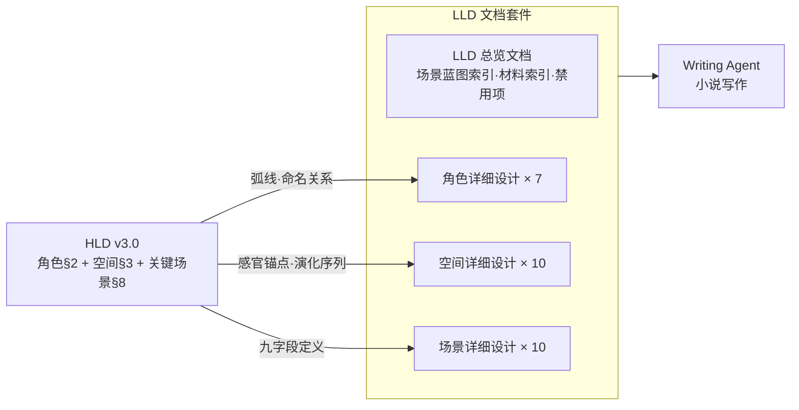

# novel-lld-writer

## 描述

撰写小说 LLD（Low-Level Design / 低层详细设计文档）。LLD 的职责是**逐一细化 HLD 已经系统性构建出的小说内容**，把角色、路线、情节、空间、风格和关键场景落实为写作前可直接使用的基本设定。

LLD 回答"这些已经被 HLD 确定功能和位置的内容，具体应该如何呈现、如何被写出来"。它不重新定义 PRD 的方向和标准，也不重构 HLD 的结构和功能。

LLD 在 HLD 的框架下，完成三个设计任务：

1. **角色详细设计** —— 将 HLD §2 的角色系统细化为每个角色的完整设计档案（外观/行为模式/动机链/逐场景行为标记）
2. **空间详细设计** —— 将 HLD §3 的空间系统细化为每个空间的逐场景感官状态矩阵（光线/声音/温度/气味/物件变化）
3. **关键场景设计** —— 将 HLD §8 的线索-场景映射展开为写作可直接使用的详细场景蓝图

LLD 的输出是 Writing Agent 直接可用的完整设计套件。

## 三层边界原则

| 层级 | 目标 | 核心职责 | 边界 |
|---|---|---|---|
| **PRD** | 给出小说内容的方向、约束和标准 | 明确核心角色、核心路线、核心情节、设定、主题和风格要求 | 不系统构建，不逐项细化，不写具体场景或正文 |
| **HLD** | 系统性构建 PRD 定义的内容 | 把角色、路线、情节、设定、节奏、视角和风格组织成完整叙事架构 | 不进入逐场景细节、动作、对白、感官材料 |
| **LLD** | 逐一细化 HLD 构建出的内容 | 把角色、空间、路线节点和关键场景细化为可写作的基本设定 | 不重新定义方向、结构和功能，不写小说正文 |

## Hard Skill Contract

### Skill Type

`novel-lld-writer` 是 **thinking skill**。它执行详细设定设计、材料拆解、边界划分和语义评审，不执行确定性生成脚本，也不编排多阶段 harness。

### Trigger

在以下场景使用本 skill：

```
✓ 用户已有小说 HLD，需要展开 LLD
✓ 用户要把角色、空间、路线节点、关键场景细化为写作前设定
✓ 用户要定义逐场景行为标记、感官矩阵、情绪/信息材料、写作指引
✓ 用户要评审 LLD 是否可交付给 Writing Agent
```

不得在以下场景使用本 skill 作为主技能：

```
✗ 用户尚未明确小说方向、约束和标准 → 使用 PRD writer
✗ 用户尚未构建叙事架构、路线和关键场景功能 → 使用 HLD writer
✗ 用户要直接写小说正文 → 使用 Writing Agent / writer skill
✗ 用户要设计多阶段 agent workflow、门禁、release package → 转 harness workflow
```

### Input Contract

LLD writer 必须先确认或提取以下输入。缺失项必须标记为 `待定` 或返回 `fail`，不能重构 HLD：

| 输入项 | 必需性 | 说明 |
|---|---|---|
| HLD 文档或等价架构包 | 必需 | 必须包含角色架构、路线/线索架构、关键场景功能 |
| PRD 约束摘要 | 必需 | 用于防止 LLD 细化时偏离方向和风格底线 |
| 核心角色列表 | 必需 | 用于角色详细设计 |
| 核心空间列表 | 必需 | 用于空间感官矩阵 |
| 关键场景功能表 | 必需 | 用于场景蓝图 |

### Execution Contract

LLD writer 必须按以下顺序执行：

1. **HLD 引用确认**：列出继承的角色、空间、路线节点、关键场景功能。
2. **角色详细设计**：细化外观、行为、语言、动机链、逐场景行为标记。
3. **空间详细设计**：细化空间状态、感官矩阵、物件变化和角色-空间关系。
4. **路线节点材料化**：定义每条路线在关键场景中的材料承载方式。
5. **关键场景蓝图**：细化时空、画面、感官、情绪、信息、材料、写作指引。
6. **Writing Agent 交付包**：输出可写作设定和禁止事项。
7. **LLD 自检**：输出 `pass/revise/fail`，并说明是否可交付 Writing Agent。

### Output Contract

正式 LLD 必须包含以下 canonical sections，章节名可以本地化但语义不可缺失：

```
1. HLD 引用确认
2. 角色详细设计
3. 空间详细设计
4. 路线节点材料化
5. 关键场景设计/蓝图
6. 感官与回调材料
7. 写作指引与禁用项
8. Writing Agent 交付包
9. 风险与开放问题
```

### Blocker Criteria

出现以下任一情况，LLD writer 必须输出 `fail` 并列出 blocker：

```
✗ 没有 HLD 或等价架构包
✗ HLD 中关键场景功能、角色架构或空间架构无法识别
✗ LLD 重新定义 PRD 方向、HLD 结构、角色弧线或场景功能
✗ LLD 开始写小说正文或逐行对白
✗ LLD 缺少角色详细设计、空间详细设计、关键场景蓝图任一核心部分
✗ LLD 没有给 Writing Agent 可消费的交付包
```

### Semantic Review Contract

交付前必须按以下维度自评，每项给出 `pass/revise/fail`：

| 维度 | Pass 条件 | Fail 条件 |
|---|---|---|
| HLD 继承 | 明确继承 HLD 功能和边界 | 静默改写结构 |
| 角色细化 | 外观、行为、语言、动机链、场景行为标记可写作 | 只有角色概述 |
| 空间细化 | 感官矩阵、物件状态、角色-空间关系可写作 | 只有空间名 |
| 场景蓝图 | 时空、情绪、信息、材料、写作指引完整 | 写成正文或只有功能描述 |
| 边界纪律 | 不重定义 PRD/HLD，不写正文 | 改结构或写 prose |
| Writing 可消费 | Writing Agent 能直接据此写场景 | 仍需猜画面、动作、材料 |

最终结论：

```
pass：所有维度 pass，且无 blocker
revise：存在 1-2 个 revise，且无 blocker
fail：存在 blocker，或任一维度 fail
```

`fail` 是唯一阻塞性最终状态；不要另设 `blocked` 作为交付 verdict。

### Reference Loading Rule

默认只按本文件 hard contract 和执行步骤处理。需要解释 LLD 方法论、角色档案、空间感官、Scene & Sequel、Story Grid scene elements、POV/声音或感官写作来源时，加载 `references/sources.md`，但不得重构 HLD 或写正文。

## 边界定义

### LLD 回答的问题（三分层中的定位）

| 分层 | 核心问题 | LLD 的角色 | 下一层的输入 |
|---|---|---|---|
| PRD | 这部小说必须是什么？ | → 给出方向、约束和标准 | → 交付给 HLD |
| HLD | 这些内容如何系统性构建？ | → 构建角色、路线、情节、设定和关键场景功能 | → 交付给 LLD |
| **LLD** | **这些内容如何逐一细化成基本设定？** | **细化角色、空间、路线节点和关键场景蓝图** | **→ 场景蓝图交付给 Writing Agent** |

### LLD 包含的内容

```
✓ 角色基本设定细化：外观、行为、语言、动机链、逐场景行为标记
✓ 路线节点细化：每条路线在关键场景中的具体承载方式和材料需求
✓ 情节基本设定细化：关键场景的触发、推进、转折、情绪和信息材料
✓ 角色详细设计：外观/行为/语言/动机链/逐场景行为标记（7个角色，分主次深度）
✓ 空间详细设计：逐场景感官状态矩阵（视觉/听觉/触觉/温度/物件变化）
✓ 关键场景设计：每个场景的完整蓝图（时空+画面+感官+情感+材料+细节+写作指引）
✓ 写作时可复用的感官钩子（callback-ready details）
```

### LLD 不包含的内容

```
✗ 重新定义 PRD 的方向、内容约束、风格底线或成功标准
✗ 重新定义角色弧线、空间功能或场景功能（那是 HLD 的事）
✗ 重新定义叙事架构、幕结构或线索路径
✗ 实际的小说段落（那是 Writing Agent 的写作输出）
✗ 写作顺序、集成方案、验证流程（那是 Writing Agent 的执行职责，不是设计文档的一部分）
✗ 逐行对话（可以指示"对话的方向"或"对话的功能"，但不写实际台词）
```

**边界检测方法**：
- 如果内容在"这个场景的功能是什么"层面，属于 HLD
- 如果内容在"这个场景里发生什么具体的事"层面，属于 LLD
- 如果内容在"这部小说必须是什么、必须避免什么"层面，属于 PRD
- 如果内容是"用以下文字写出这个故事"，属于 Writing（非 LLD）
- 如果内容是"写完之后如何检查"，属于 Writing Agent 的 SOP（非 LLD）

### 三层输出的演进关系示例

以"临终转移"场景为例：

| 层 | 输出 | 内容 |
|---|---|---|
| **HLD** | 功能定义 | "关键场景 1：临终转移 —— 触发数字生命体激活。位置：第一幕催化剂。功能：它接收第一段数据，她第一次做出非规程选择。" |
| **LLD** | 画面展开 | "时间：凌晨 03:47。地点：操作室。她站在转移床边，六个银色模块的触感。屏幕上星图第一次亮起——不规则、活的。通讯窗口出现第一个字符：句号。她的手碰到了他的皮肤——暖的。这个温度在她的触觉记忆中留存。" |
| **Writing** | 小说正文 | （写出的实际段落） |

---

## 方法论来源

- **Story Grid Scene Elements**（Shawn Coyne）：Inciting Incident / Progressive Complication / Turning Point / Crisis / Climax / Resolution 的场景级设计工具 [1]
- **Value Shift 理论**（Story Grid）：每个场景从一个情感价值状态向另一个变化 [1]
- **Scene & Sequel**（Dwight Swain）：主动场景（Goal→Conflict→Disaster）与被动场景（Reaction→Dilemma→Decision）的交替节奏 [2]
- **感官写作法**：通过具体感官细节（视觉、听觉、触觉、嗅觉、动觉）而非抽象描述来传达情感
- **可复用细节设计**：有意识地设计一些细节，使其在后续场景中被回调（callback）

---

## 执行步骤

LLD 包含三个设计模块。建议按顺序执行：角色详细设计 → 空间详细设计 → 关键场景设计。每个模块完成后记录交叉引用；如发现矛盾，只能修正 LLD 细化材料，不能回头改写 PRD/HLD 的方向、结构和功能。

---

### 模块 A：角色详细设计

**执行条件**：HLD §2 已完成（角色系统 + 命名）
**增强参考**：可参考 `skills/novel-character-designer/SKILL.md`；若该 skill 不可用，按本节模板完成。

#### A1 角色设计范围

按以下范围完成角色详细设计；如参考 `skills/novel-character-designer/SKILL.md`，只继承其角色细化方法，不改变 HLD 角色弧线。

| 角色 | 设计深度 | 说明 |
|---|---|---|
| 主角（沈逾/它）| ★★★ 完整设计 | 外观/气质/动机链/行为模式/语言特征/逐场景行为标记 |
| 重要配角（前序/郑柏舟/出卖者）| ★★ 中等设计 | 功能定位/出场模式/关键行为标记 |
| 功能性角色（纪菱/同事）| ★ 轻量设计 | 出场目的/次数/行为锚点 |

#### A2 主角完整设计格式

每个主角使用以下模板：

```
=== 角色设计：[角色名] ===

【外观与气质】
身体特征：[身高/体型/面容特征/衣着风格]
身体语言：[常见姿态/手势/微表情/速度]
关键视觉标记：[1-3 个读者一看到就能想起这个角色的特征]

【语言与行为】
说话方式：[句型/语速/用词偏好/沉默的模式]
行为模式：[在压力下/在日常中/在关系中分别怎么行动]
核心矛盾：[角色的内在冲突——HLD 的缺陷在此具体化为行为表现]

【动机链】
当 X 发生时：他会做 Y，因为他相信 Z
[列出 3-5 条关键行为-信念链，不写内心独白，只写"行为+原因"]

【逐场景行为标记】
| 场景 | 角色在该场景中的行为标记 | 与该角色在其他场景的对比 |
```

**逐场景行为标记示例**（沈逾·K2）：
`| K2 临终转移 | 她的动作精确——不犹豫。但完成操作后她没有立即移开手。她的手指在操作台边缘停留了 2 秒。 | 对比 K3：同样是检查数据，K2 是"完成任务"，K3 是"发现了什么但决定不做什么"——两幕之间"静默的时间"在增长。|`

#### A3 重要配角中等设计格式

```
=== 角色设计：[角色名] ===

【叙事角色类型】：[从 HLD §2.1 继承]
【出场模式】：[从 HLD §2.3 继承]

【核心行为标记】：[2-4 个具体的行为特征——这个角色在关键场景中做什么、怎么做]

【与主角的交互模式】：[对方如何回应这个角色——每次交互生成什么]
```

#### A4 功能性角色轻量设计格式

```
=== 角色设计：[角色名] ===

【出场目的】：[一句话]
【出场次数】：[数字]
【行为锚点】：[每次出现时的固定行为——如"纪菱每次来都带一样东西"或"她说什么话题"]
```

#### A5 角色关系逐场景演变

将所有主角-重要配角的关系演变按场景列表：

| 场景 | 沈逾↔它 | 沈逾↔郑柏舟 | 沈逾↔纪菱 | 它↔前序记忆 |
|---|---|---|---|---|

每格填写该场景中该关系对的状态（1-2 句），不重写已有内容，只标注"变化"。

---

### 模块 B：空间详细设计

**执行条件**：HLD §3 已完成（空间系统 + 感官锚点 + 变化序列）

#### B1 空间设计范围

| 空间 | 设计深度 | 说明 |
|---|---|---|
| 操作室 | ★★★ 完整设计 | 10 阶段矩阵（视觉/声音/温度/气味/物件/光线）+ 每阶段对应场景 |
| 数字空间 | ★★★ 完整设计 | 7 阶段感知层设计 + 每阶段对应场景 |
| 机柜室 | ★★ 中等设计 | 2 次场景具体状态 |
| 会议室 | ★★ 中等设计 | 3 次场景具体状态 |
| 住所 | ★★ 中等设计 | 4 次场景具体状态 |
| 酒店房间/走廊/城市 | ★ 轻量设计 | 场景出现时的固定状态 |

#### B2 主空间逐场景感官矩阵格式

```
=== 空间设计：[空间名] ===

【感官矩阵】

| 阶段/场景 | 时间 | 视觉 | 声音 | 触觉/温度 | 物件状态 | 角色在空间中的状态 |
```

每个阶段填写具体可感的状态，不使用抽象描述（如"气氛紧张"改为"风扇声的节奏变化了"）。

#### B3 次空间场景状态定义格式

```
=== 空间设计：[空间名] ===

【出场次数】：[数字]
【各次场景状态】：

第 1 次：[场景编号] 时间：
- 关键差异：[与默认状态的差异点，而非完整描写]
- 角色与空间的关系：[角色在这个空间中做什么、怎么做]

第 2 次：[场景编号] 时间：
- 关键差异：
- 角色与空间的关系：
```

---

### 模块 C：关键场景设计

**执行条件**：HLD §8 已完成（线索-场景映射 + 9 字段定义）+ 角色详细设计（模块 A）已完成 + 空间详细设计（模块 B）已完成

**增强参考**：可参考 `skills/novel-scene-designer/SKILL.md`；若该 skill 不可用，按本节场景蓝图模板完成。

#### C1 场景设计范围

按照 HLD §8.1 的分类，LLD 阶段只对 HLD 已批准的可见叙事场景进行完整蓝图展开。嵌入节点和隐性背景节点只做材料锚定，不能新增路线节点或改写场景功能。

| 优先级 | 类型 | 数量 | 展开深度 | 约束 |
|---|---|---|---|---|
| **P0（必做·完全展开）** | HLD 已批准的可见叙事场景 | 以 HLD 为准 | 场景蓝图，不写正文 | 不新增场景功能 |
| **P1（中等展开）** | HLD 已批准的嵌入节点 | 以 HLD 为准 | 嵌入材料提示 | 不改变主线顺序 |
| **P2（轻量设计）** | 隐性背景节点 | 以 HLD 为准 | 背景锚定材料 | 不扩展为新场景 |

#### C2 输入内容

场景设计的输入来自两个已完成的模块：

**来自角色设计（模块 A）**：
- 每个角色的逐场景行为标记——角色在该场景中"做了什么、怎么做的"
- 角色的动机链引用——该场景中的行为可以从哪条动机链追溯

**来自空间设计（模块 B）**：
- 该场景所在空间的逐场景感官状态矩阵——空间在该场景中的具体物理状态
- 感官锚点 + 物件状态

#### C3 输出内容

每个场景输出一份独立设计文档（`docs/superpowers/specs/lld/scenes/2026-06-07-scene-<编号>.md`），包含：

- **场景编号**：K1-K10
- **HLD 继承**：从 HLD §8.2 继承 9 字段定义
- **三幕结构**：起始/发展/高潮/转折·价值变迁
- **空间-场景展开**：空间状态 + 感官锚点 + 物件状态
- **角色行为标记**：每个角色在该场景中的行为
- **感官层设计**：主导感官 + 背景感官 + 时序序列
- **线索-场景映射**：如何服务各条线程
- **对话与文字设计**：角色说话功能 + 数字生命文字输出方式
- **POV 叙事策略**：POV + 信息差 + 节奏控制 + 切换信号
- **写作约束**：场景特定的不可违反规则
- **格式合规声明**：9 条标准逐条确认

#### C4 验证

场景设计完成后，逐一验证：
- 每个场景的 POV 与 HLD §6.3 一致
- 每个场景的空间状态与空间设计 §7 一致
- 每个场景的角色行为与角色设计 §5 一致
- 每个场景的线索映射与 HLD §7 一致
- 每个场景的写作约束与 HLD §10 一致

### 最终校验

三个模块全部完成后，执行交叉校验：

```
□ 角色设计中的逐场景行为标记与空间设计中的逐场景感官矩阵对齐
□ 空间设计中的空间状态与场景设计中的"环境条件"一致
□ 场景设计中的"叙事材料调用"与 HLD §8.1 的节点映射一致
□ 场景设计中的"写作约束"与 HLD §10 的风格约束一致
□ 所有 30 个节点（10 可见 + 7 嵌入 + 13 背景）均已覆盖
□ 参考文献完整
```

## 输出结构

```
# 小说 LLD：[项目名称]

## 修订记录
## 目录

## 1. HLD 引用确认
## 2. 角色详细设计
   2.1 沈逾（技术员）
   2.2 数字生命体（它）
   2.3 前序·灰鸟
   2.4 郑柏舟（项目主管）
   2.5 纪菱（对照者）
   2.6 出卖者 / 实验室同事
   2.7 角色关系逐场景演变
## 3. 空间详细设计
   3.1 操作室感官矩阵（10 阶段）
   3.2 数字空间感知层设计（7 阶段）
   3.3 机柜室（2 次场景）
   3.4 会议室（3 次场景）
   3.5 酒店房间（K1）
   3.6 住所（4 次场景）
   3.7 走廊/过渡空间 / 城市外部空间
## 4. 关键场景设计
   4.1 可见叙事场景 K1-K10（完全展开）
   4.2 嵌入节点场景指引（7 个）
   4.3 隐性背景节点锚定设计（13 个）
## 参考文献
```

## 产出物

保存到 `docs/superpowers/specs/YYYY-MM-DD-lld-<project-name>.md`

## 篇幅

- 角色详细设计：约 600-1000 字
- 空间详细设计：约 500-800 字
- 关键场景设计：可见场景 10 × 300-500 字 + 嵌入 7 × 100-200 字 + 背景 13 × 50-100 字 ≈ 5000-7500 字
- 总计：约 6500-9500 字


### 文档架构说明

LLD 输出采用**模块化设计包**：一个 LLD 总览文档 + 多个独立设计文档。各子文档按设计对象独立管理，但共同继承同一份 HLD。

| 文档类型 | 数量 | 独立文件名格式 | 职责 |
|---|---|---|---|
| LLD 总览文档 | 1 份 | `YYYY-MM-DD-lld-<project>.md` | HLD 引用、场景蓝图索引、材料索引、写作约束、禁用项 |
| 角色详细设计 | 每角色 1 份 | `YYYY-MM-DD-character-<name>.md` | 外观/行为/语言/动机链/逐场景行为标记 |
| 空间详细设计 | 每空间 1 份 | `YYYY-MM-DD-space-<name>.md` | 物理布局/感官层/物件生态/演化序列/场景映射 |
| 场景详细设计 | 每场景 1 份 | `YYYY-MM-DD-scene-<name>.md` | 九字段继承/三幕结构/感官设计/角色行为/写作约束 |

### 与 HLD 的关系



### 文档格式与用语规范（9 条强制性标准）

LLD 主文档及各子文档必须遵守以下 9 条标准：

| # | 标准 | 要求 |
|---|---|---|
| 1 | **简体中文·专业正式** | 全文使用简体中文专业书面语，无口语/随笔/对话体 |
| 2 | **拟人化编写** | 措辞自然可读，无代码注释风格 |
| 3 | **多样化表达形式** | 综合使用表格、mermaid 图、文字说明等表达形式 |
| 4 | **书面用语·结构优** | ## → ### → 标号体系完整，节/子节层次清晰 |
| 5 | **最终结论·无过程** | 所有语句均为最终设计决策，无"可能/或许/建议/可以考虑" |
| 6 | **有据可循** | 设计决策引用 HLD 节号及方法论文献 |
| 7 | **修订表前置** | 文档起始处含完整修订记录表 |
| 8 | **紧扣主题** | 内容限于该设计领域，无方法论声明/技能说明 |
| 9 | **简洁清晰·禁止冗余** | 信息密度高，优先使用表格承载结构化内容 |

## 参考文献

[1] Coyne, Shawn. *The Story Grid*. Black Irish Entertainment, 2015.
[2] Swain, Dwight V. *Techniques of the Selling Writer*. University of Oklahoma Press, 1965.
[3] Ingermanson, Randy. *How to Write a Novel Using the Snowflake Method*. 2014.
[4] Cron, Lisa. *Story Genius*. 2016.
[5] McKee, Robert. *Story*. 1997.
[6] Weiland, K.M. *Structuring Your Novel*. 2013.
